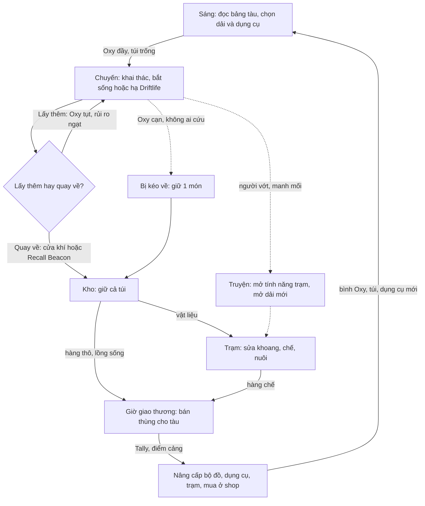
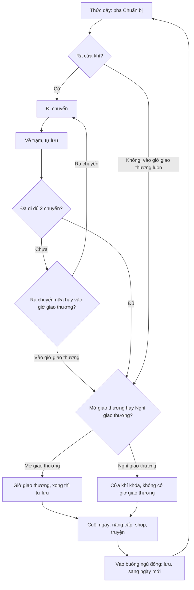
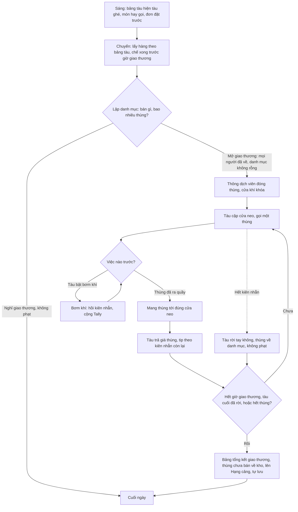
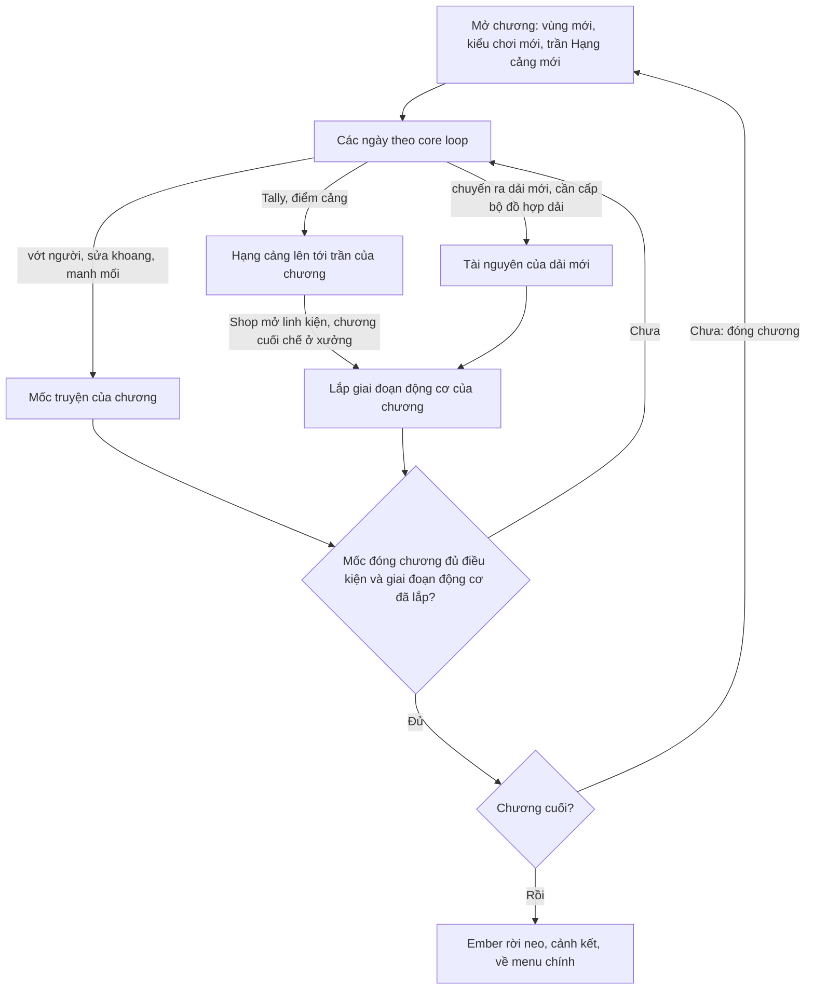

## II.1. Daily Cycle

Ngày là đơn vị nhịp của The Novent. Mỗi ngày người chơi ra ngoài bãi vỡ lấy đồ, về trạm biến đồ thành tiến độ, rồi bán hàng ở giờ giao thương để có Tally cho ngày sau đi xa hơn. Mục này nói một ngày gồm những pha nào, luật nào giữ nhịp đó, và các mục sau gắn vào ngày ở đâu. Người đọc nên đọc mục này trước, vì mọi hệ thống khác đều chạy bên trong một ngày.

### II.1.1. Overview

Vòng chơi lớn của game đi theo một đường thẳng rồi quay lại điểm đầu:
- Ra ngoài thu thập tài nguyên và **Driftlife**, sinh vật trôi trong chân không mà người chơi bắt sống hoặc hạ (xem mục II.3 và II.4).
- Mang về kho của trạm.
- Sửa trạm, chế đồ, nuôi Driftlife (xem mục II.5 và II.6).
- Lập danh mục và bán ở giờ giao thương lấy Tally (xem mục II.6).
- Nâng cấp bộ đồ và trạm, mua ở shop thứ trạm không tự làm được (xem mục II.7).
- Đi xa hơn, lâu hơn, gặp thứ mới, mở thêm truyện (xem mục II.9).

Một **ngày** là một vòng như vậy, trong truyện gọi là một chu kỳ trạm. Ban ngày người chơi đi các **chuyến**, tức một lần ra ngoài không gian rồi về. Ban đêm là **giờ giao thương**, pha bán hàng cho tàu thương nhân. Hai nửa nuôi nhau: chuyến cấp hàng cho giờ giao thương, giờ giao thương cấp Tally để nâng cấp cho chuyến sau. Ngày không có đồng hồ thật. Ngày chỉ sang khi người chơi đi ngủ, nên người chơi làm việc trên trạm bao lâu cũng được.

Cả game chia thành năm chương. Mỗi chương mở một vùng mới và thêm một hai kiểu chơi mới, nên ngày ở chương sau có nhiều việc hơn ngày ở chương đầu. MVP là trọn chương đầu.


*Hình II.1.1 - Core loop: Oxy đổi lấy hàng, hàng đổi lấy Tally, Tally đổi lấy tầm đi*

Đọc sơ đồ: nhãn trên mũi tên là thứ chảy từ bước này sang bước sau. Quyết định lõi của game nằm ở nút Lấy thêm hay quay về. Oxy vừa là đồng hồ vừa là máu, nên mỗi lần nán lại là đổi Oxy lấy hàng và nhận thêm rủi ro ngạt. Về an toàn thì giữ cả túi, cạn Oxy mà không ai cứu thì chỉ giữ một món. Kho chia hai đường: vật liệu vào trạm, hàng bán được vào giờ giao thương, hàng chế ở trạm cũng đổ về giờ giao thương. Giờ giao thương đổi hàng thành Tally, Tally thành nâng cấp, nâng cấp cho chuyến sau đi xa hơn và lâu hơn. Vòng khép lại ở bảng tàu buổi sáng: thứ tàu hôm nay muốn mua quyết định người chơi ra dải nào. Nhánh đứt nét là đường truyện, đi thẳng vào trạm chứ không qua Tally. Sửa động cơ và qua chương nằm ở sơ đồ vòng chương phía dưới.

### II.1.2. Five Phases of a Day

Một ngày có năm pha theo thứ tự cố định:

| Pha | Người chơi làm gì | Kết thúc khi | Bỏ qua được |
|---|---|---|---|
| 1. Chuẩn bị | Xem bảng tàu hôm nay và đơn đặt trước, chọn dụng cụ mang theo, nhận đồ chế xong | Người chơi ra cửa khí | Có |
| 2. Chuyến 1 | Ra ngoài nhặt phế liệu, khai khoáng, bắt sống hoặc hạ Driftlife, vào map nhánh, vớt người, tìm manh mối | Mọi người đã về trạm hoặc bị kéo về | Có |
| 3. Chuyến 2 | Như chuyến 1. Giữa hai chuyến được vào kho và xưởng | Như chuyến 1 | Có |
| 4. Giờ giao thương | Lập danh mục bán rồi mở giao thương. Tàu cập cửa neo, mỗi tàu gọi 1 thùng, người chơi mang thùng tới đúng tàu, bơm khí cho tàu đang chờ | Hết giờ giao thương, tàu cuối rời, hoặc hết hàng | Có, không bị phạt |
| 5. Cuối ngày | Nâng cấp, đặt hàng ở shop, nói chuyện với người trong trạm, nhận quest, xem truyện | Người chơi vào buồng ngủ đông | Không |

Pha Chuẩn bị là lúc người chơi đặt mục tiêu cho ngày. **Bảng tàu** ở khoang liên lạc cho biết tối nay loại tàu nào ghé và chúng hay gọi gì. **Đơn đặt trước** là thùng một tàu cụ thể đặt từ đầu ngày với giá cao. Đọc hai thứ này buổi sáng, người chơi biết nên chọn dải nào và mang gì về. Đây là mối nối giữa nửa phiêu lưu và nửa quản lý.

Hai pha Chuyến là nửa hành động. Ngoài không gian **Oxy** là chỉ số duy nhất của người chơi, vừa là thời gian của chuyến vừa là máu. Túi đồ có sức chứa giới hạn. Chuyến kết thúc khi người chơi về cửa khí, dùng **Recall Beacon** (điểm thoát kéo người chơi về trạm), hoặc hết Oxy và bị kéo về. Luật của chuyến ở mục II.2 và mục kế tiếp.

Pha Giờ giao thương là nửa chơi tay thứ hai. Luật của giờ giao thương ở mục II.6.

Pha Cuối ngày là lúc tiêu Tally vừa kiếm được và đọc truyện. Người chơi ngủ ở buồng ngủ đông thì game lưu và sang ngày mới.

[CHỜ ẢNH: mặt cắt trạm lúc cuối ngày, người chơi đứng ở buồng ngủ đông, chụp từ build]
*Hình II.1.2 - Trạm lúc cuối ngày, người chơi chuẩn bị ngủ*

Chi tiết dữ liệu: tab Day trên Sheet GDD, khối Cấu trúc một ngày.

### II.1.3. Day Rules

Ba luật giữ nhịp một ngày:

**Tối đa 2 chuyến mỗi ngày.** Ở bản đủ, đi bằng **Skiff** (xuồng chở thẳng tới một map nhánh đã tìm ra) cũng tính là một chuyến. Sau chuyến thứ hai cửa khí khóa tới ngày mới. Lý do: về trạm thì Oxy được nạp đầy. Nếu được ra lại không giới hạn thì Oxy không còn là giới hạn của chuyến, và quyết định lúc nào quay về mất ý nghĩa.

**Giờ giao thương luôn sau các chuyến.** Đã mở giờ giao thương thì không ra ngoài được nữa trong ngày. Người chơi được mở giao thương sớm khi mới đi 1 chuyến hoặc chưa đi chuyến nào, đổi lại mất chuyến còn lại của ngày. Mỗi ngày có đúng một giờ giao thương. Chọn Mở giao thương hay Nghỉ giao thương thì cửa khí cũng khóa tới ngày mới.

**Ngày không có đồng hồ.** Ngày chỉ sang khi người chơi vào buồng ngủ đông. Trạm không xấu đi khi người chơi nghỉ: không có hệ đói, không có chi phí duy trì, khoang đã sửa không tự hỏng lại.

Game tự lưu ở ba lúc:
- Sau mỗi chuyến, khi mọi người đã về trạm.
- Sau giờ giao thương.
- Lúc ngủ.

Thoát giữa một chuyến hoặc giữa giờ giao thương thì lần sau vào lại ở điểm lưu gần nhất, mất phần đang dở. Bố cục map của từng chuyến được lưu theo ngày và số thứ tự chuyến, nên nạp lại không đổi bố cục. Cách lưu khi co-op ở mục II.8.


*Hình II.1.3 - Luồng một ngày và các điểm tự lưu*

Đọc sơ đồ: sáng ra, người chơi chọn ra cửa khí hoặc đi thẳng vào giờ giao thương. Mỗi chuyến về là một điểm lưu. Sau chuyến đầu người chơi còn chọn đi tiếp hay vào giờ giao thương sớm. Sau chuyến thứ hai thì chỉ còn đường vào giờ giao thương. Tới giờ giao thương, người chơi Mở giao thương để bán hoặc Nghỉ giao thương mà không bị phạt. Cả hai nhánh đều khóa cửa khí và dẫn tới cuối ngày. Ngủ là cách duy nhất để sang ngày mới.

Pha giờ giao thương phóng to ở sơ đồ dưới, luật đầy đủ ở mục II.6.


*Hình II.1.4 - Toàn giờ giao thương và hai chỗ người chơi quyết*

Đọc sơ đồ: giờ giao thương có hai chỗ người chơi quyết. Chỗ thứ nhất là danh mục, lập trước giờ giao thương. Hàng rẻ được gọi nhiều, hàng đắt ít tàu gọi, đơn đặt trước trả giá cao, còn tàu tip cao chỉ tới khi danh mục có món nó gọi. Danh mục là quyết định chiến lược của giờ giao thương, vì trong giờ giao thương không chế và không đóng thêm. Chỗ thứ hai là việc nào trước, lặp lại suốt giờ giao thương. Thùng ra quầy sau ít giây, trong lúc đó tàu khác bật bơm khí, người chơi chọn chạy về quầy hay đứng bơm. Tip đi theo phần kiên nhẫn còn lại, nên chọn đúng thứ tự là chỗ ăn thêm Tally. Thất bại luôn nhẹ: tàu hết kiên nhẫn thì rời tay không, thùng quay về danh mục. Nghỉ giao thương cũng không bị phạt. Giờ giao thương dừng ở điều tới trước trong ba điều ghi ở nút cuối, rồi bảng tổng kết giao thương cộng Tally, điểm cảng và tự lưu.

Chi tiết dữ liệu: tab Day khối Luật ngày, tab CORE LOOP khối Một ngày.

### II.1.4. Day Length

Độ dài một ngày được tính từ độ dài các pha, không đặt riêng:

```text
PhutMotNgay = 2 * PhutMotChuyen + PhutCaCang + PhutChuanBiVaCuoiNgay
```
- PhutMotChuyen: thời gian trung bình một chuyến của chương đó, đo bằng sim chuyến, đơn vị phút.
- PhutCaCang: thời gian một giờ giao thương đo bằng sim giờ giao thương, một người chơi trễ phản xạ hai giây, đơn vị phút.
- PhutChuanBiVaCuoiNgay: thời gian cố định cho pha Chuẩn bị và Cuối ngày, đặt bằng 3 phút.
- PhutMotNgay: độ dài một ngày đủ 2 chuyến và một giờ giao thương, đơn vị phút. Nguồn công thức: `kinh-te-tien-trinh.md` mục ngân sách chương.

Ví dụ chương 1 với số đo của sim:

| Thành phần | Phút |
|---|---|
| Hai chuyến | 2 x 4,4 |
| Giờ giao thương | 3,8 |
| Chuẩn bị và cuối ngày | 3 |
| Một ngày | 15,6 |

Chuyến dài ra theo chương vì bình Oxy lớn hơn và dải xa hơn, nên ngày ở chương cuối dài hơn ngày ở chương đầu. Độ dài ngày quyết định số ngày cần để đi hết một chương, và từ đó quyết định ngân sách Tally của chương (xem mục II.7).

Chi tiết dữ liệu: tab Day khối Độ dài mục tiêu, tab Balance Sheet.

### II.1.5. Chapters and the Day

Truyện không chạy theo đồng hồ mà theo **mốc truyện**. Mỗi chương có một chuỗi mốc, một số mốc cần số ngày tối thiểu để diễn ra. Chương chỉ đóng khi mốc đóng chương xong, và mốc đó chỉ kích hoạt khi giai đoạn động cơ chính của chương đã lắp. **Động cơ chính** là việc sửa dài nhất của trạm, chia năm giai đoạn, mỗi chương lắp một giai đoạn (xem mục II.6). Kinh tế và trạm không có cổng chương riêng.

| Chương | Tên tạm | Vùng mới | Kiểu chơi mới | Số ngày tối thiểu |
|---|---|---|---|---|
| 1 | Tỉnh dậy | Vành đai ngoài, xác Seed Station đầu tiên | Khai thác, bắt sống loài nhỏ bằng lưới, giờ giao thương | 7 |
| 2 | Không cô độc | Vành đai trong, Station Lantern | Nuôi Driftlife, bắt sống cỡ M, lấy mẫu sinh thiết cỡ L | 5 |
| 3 | Kẻ canh giữ | Vùng trung tâm, Veyl Waypost, The Remainers | Sự cố trong giờ giao thương, kẻ địch có vũ khí | 8 |
| 4 | Tâm vụ nổ | Cradle Interior | Map nhánh lớn trong nội thất tàu | 3 |
| 5 | Rời neo | Warden Rig | Hộ tống Sevra, trận đối đầu cuối | 3 |

Số ngày tối thiểu là mức sàn. Nhóm đông chơi nhanh cũng không hết game sớm hơn tổng số ngày này. Nội dung truyện của từng chương ở mục II.9.

Chương đầu là MVP. Những ngày đầu cảng chưa mở vì khoang liên lạc và cảng còn hỏng. Người chơi đi chuyến, sửa khoang neo, xưởng, khoang liên lạc và cảng. Lịch tàu sinh vào đầu ngày, nên cảng sửa xong thì sang ngày sau mới có tàu. Theo chuỗi mốc truyện, giờ giao thương sớm nhất là ngày 5. Hàng nhặt được trong những ngày này nằm trong kho chờ giờ giao thương đầu tiên. Giờ giao thương đầu tiên là giờ giao thương hướng dẫn, chỉ có hai tàu.


*Hình II.1.5 - Vòng chương: truyện, Hạng cảng và dải mới cùng mở cổng chương*

Đọc sơ đồ: mỗi chương mở một vùng, thêm kiểu chơi mới và nâng trần Hạng cảng. Trong chương, các ngày đẩy ba đường cùng lúc. Đường truyện đi qua các mốc của chương. Đường cảng đi qua Hạng cảng: Hạng chạm trần của chương thì shop mở linh kiện động cơ, nên giờ giao thương là nhịp giữ độ dài chương. Đường khám phá đưa người chơi ra dải mới lấy tài nguyên, bộ đồ thiếu cấp vẫn vào được nhưng hao Oxy nhanh. Có linh kiện và tài nguyên thì lắp giai đoạn động cơ của chương. Mốc đóng chương chỉ xong khi đường truyện tới và giai đoạn động cơ đã lắp, thiếu thì người chơi tiếp tục các ngày. Chương cuối khác ở một chỗ: linh kiện chế ở xưởng chứ không mua, lắp xong thì Ember rời neo, cảnh kết chạy rồi game về menu chính.

Chi tiết dữ liệu: tab Day khối 5 chương, tab GAME STORY.

### II.1.6. Two-player Co-op and Acceptance Criteria

Một ngày chạy cùng một luật cho một người và cho co-op. MVP có co-op 2 người, khác biệt nằm ở các điểm xác nhận:
- Ra chuyến: chuyến bắt đầu khi mọi người đang online đã xác nhận ở cửa khí. Ai không trả lời trong 30 giây thì tính là ở lại trạm, vẫn dùng được xưởng và các khoang.
- Ngoài không gian mỗi người tự do tách nhau. Mỗi người kết thúc chuyến riêng. Chuyến kết thúc khi người cuối cùng đã về hoặc bị kéo về.
- Người đã về trạm không ra lại trong cùng chuyến. Trong lúc chờ, người đó chế trước ở xưởng, sửa danh mục nháp, sửa khoang và xem vị trí đồng đội.
- Ngủ: vào buồng ngủ đông là đồng ý ngủ, đếm 30 giây từ người đầu tiên, người chưa vào tự tính là đồng ý.
- Từ 2 người thì không có tạm dừng toàn cục, mở menu không dừng thời gian. Chơi một mình được tạm dừng.

Mục tiêu độ dài và kết quả sim, một người chơi ở kịch bản trung bình:

| Chỉ số | Mục tiêu | Sim đo được | Đạt |
|---|---|---|---|
| Một chuyến, chương 1 | 4 đến 6 phút | 4,4 phút | Có |
| Một chuyến, chương 5 | 10 đến 12 phút | 10,4 phút | Có |
| Giờ giao thương | 3 đến 5 phút | 3,8 phút | Có |
| Một ngày, chương 1 | 15 đến 20 phút | 15,6 phút | Có |
| Một ngày, chương 5 | 25 đến 30 phút | 27,6 phút | Có |
| Chương 1 | 1,5 đến 2 giờ | 1,77 giờ | Có |
| Cả game | 12 đến 15 giờ | 14,2 giờ | Có |
| Nhóm 4 hết game so với chơi một mình | 60 đến 75% thời gian | 70% | Có |
| Một phiên chơi | 30 đến 60 phút, tức 2 đến 3 ngày trong game | Chưa đo | Chờ playtest |

Sim chưa đo được người chơi có thấy nhịp ngày dễ chịu không, việc đó chờ playtest trên build.

### II.1.7. Edge Cases

| Tình huống | Phán quyết |
|---|---|
| Người chơi mở giao thương khi mới đi 1 chuyến | Được. Cửa khí khóa, chuyến thứ hai của ngày mất |
| Người chơi đi ngủ khi chưa có giờ giao thương hôm đó | Được. Ngày đó không có giờ giao thương, kho giữ nguyên, sang ngày mới bình thường |
| Thoát game giữa chuyến khi chơi một mình | Vào lại ở điểm lưu sau chuyến trước. Chuyến dở không tính vào hạn hai chuyến của ngày, đồ nhặt trong chuyến đó mất, người chơi đi lại chuyến đó với cùng bố cục map |
| Co-op: một người còn ở ngoài khi người kia muốn mở giao thương | Nút Mở bán xám kèm lý do, chờ người còn ở ngoài về |
| Co-op: một người không trả lời xác nhận ra chuyến | Sau 30 giây tính là ở lại trạm, chuyến bắt đầu với những người đã xác nhận |
| Ba ngày đầu khi cảng chưa sửa | Ngày chỉ có chuyến và cuối ngày, không có pha Giờ giao thương |

### II.1.z. Post-MVP

- Chương 2 tới 5 và các kiểu chơi mới của từng chương.
- Nuôi Driftlife trong pha Chuẩn bị và Cuối ngày, mở ở chương 2.
- Skiff đi thẳng tới map nhánh đã tìm ra.
- Sự cố trạm chen ngang giờ giao thương, mở ở chương 3.
- Co-op 3 và 4 người.
- Chơi tự do sau cảnh kết, khi trạm vẫn ở neo và không còn nội dung mới.
