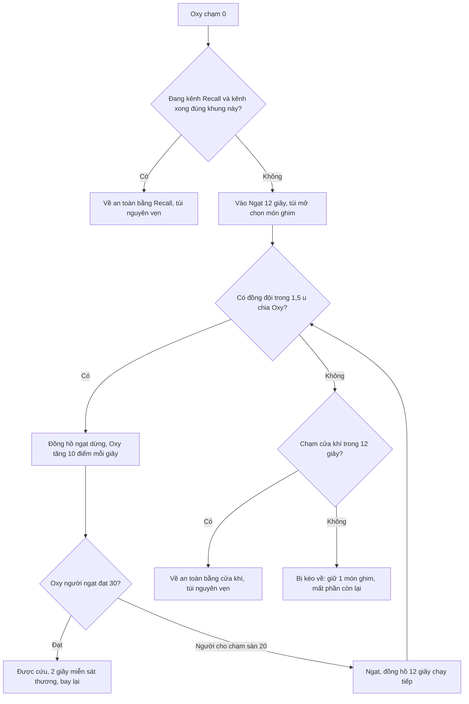

## II.2. Player

Người chơi là một người sống sót mặc bộ đồ không gian, bay bằng bộ đẩy ngoài bãi vỡ và đi bộ trong trạm khi ở nhà. Chỉ số duy nhất của nhân vật là **Oxy**, vừa là thời gian vừa là máu. Mục này nối với mục Chiến đấu ở chỗ sát thương trừ vào Oxy, với mục Vật phẩm ở chỗ túi đồ và dụng cụ, với mục Kinh tế ở giá nâng cấp bộ đồ. Ai cần hiểu vì sao một chuyến ra ngoài có hạn mà vẫn không bao giờ chết ngay nên đọc mục này.

### II.2.1. Overview

Người chơi ra khỏi cửa khí là bay tự do 8 hướng. Bấm đẩy là đi ngay, buông phím thì trượt chừng nửa giây rồi dừng, giữ phím hãm thì dừng gọn. Nhân vật nhặt tài nguyên tự động khi tới gần, bỏ vào một **túi đồ** có sức chứa. Thanh Oxy tụt đều từng giây, nên mỗi lần lướt hay nán lại thêm một mẻ đều có giá. Người chơi luôn phải cân giữa đi tiếp và quay về.

Oxy về 0 thì nhân vật không chết mà vào **Ngạt**, một khoảng thời gian ngắn để chạy về cửa khí hoặc chờ đồng đội cứu. Hết giờ mà chưa ai cứu thì nhân vật bị kéo về trạm, mất gần hết túi nhưng giữ lại một **món ghim** người chơi đã chọn từ trước. Tally và dụng cụ không bao giờ mất. Về tới trạm thì Oxy đầy lại ngay và đồ trong túi đổ vào kho.

Nâng cấp bộ đồ mua một lần cho cả nhóm, gồm năm trục: bình Oxy, vỏ bộ đồ, bộ đẩy, túi đồ, đai dụng cụ. Ở trạm nhân vật đi bộ 8 hướng trên mặt bằng nhìn từ trên xuống, không có Oxy, không có Ngạt. Chơi một mình hay co-op đều dùng cùng luật.

### II.2.2. Flight and Movement

Ngoài không gian dùng đơn vị **u**, đơn vị thế giới. Điều khiển trực tiếp, không có độ trễ nạp lực.
- Nhân vật cao 1 u, va chạm là hình tròn bán kính 0,4 u.
- Bay 8 hướng: bàn phím cho 8 hướng rời rạc, gamepad cho analog. Tốc độ cuối bằng đúng tốc độ tối đa theo hướng đẩy, đi chéo không cộng dồn.
- Đẩy ngược hướng đang trôi thì gia tốc nhân 1,5 để đảo chiều gọn.

| Thao tác | Số bậc 0 | Kết quả |
|---|---|---|
| Bay, tốc độ tối đa | 6,0 u/s | Đạt sau 0,33 giây |
| Bay, gia tốc | 18 u/s2 | Phản hồi tức thì |
| Buông phím, hãm tự nhiên | 12 u/s2 | Dừng sau 0,5 giây, trượt thêm 1,5 u |
| Giữ Hãm, hãm chủ động | 36 u/s2 | Dừng sau 0,17 giây, trượt thêm 0,5 u, không tốn Oxy |
| Lướt | 15 u/s trong 0,22 giây | Đi 3,3 u, tốn 4 Oxy, hồi chiêu 1,2 giây |

**Hãm** là cách dừng chính xác để nhặt và khai thác. **Lướt** là xung lực ngắn theo hướng đang đẩy, không đẩy thì theo hướng nhân vật quay. Hết lướt thì vận tốc cắt về tốc độ tối đa, rồi hãm tự nhiên áp bình thường. Lướt có khoảng miễn sát thương ngắn lúc đầu. Lướt không dùng để đi đường dài vì mỗi u tốn Oxy gấp 7 lần bay thường, nó dùng để né, vượt khe hẹp và vào đúng điểm.

Các luật còn lại của di chuyển:
- Hướng nhìn theo con trỏ chuột hoặc cần ngắm phải, không ngắm thì quay theo hướng đang bay. Sprite nhân vật vẽ 3 hướng (lên, xuống, ngang), hướng ngang lật gương, đi 8 hướng dùng hướng gần nhất.
- Chạm tường thì triệt thành phần vận tốc vuông góc, giữ thành phần trượt dọc tường. Va tường không trừ Oxy, không choáng. Có bù góc 0,25 u: nhân vật trượt qua mép góc thay vì kẹt.
- Lực ngoài như dòng chảy hay hazard cộng vào vận tốc, phần do lực ngoài gây ra chặn ở 12 u/s. Trần này không áp cho Lướt.

**Kéo vật** nối nhân vật với một vật bằng dây lò xo. Kéo không chiếm chỗ trong túi, mỗi người kéo tối đa một vật.
- Dây dài tối đa 3 u.
- Giữ phím tương tác 0,4 giây ở tầm 1,5 u để bắt đầu, bấm lần nữa để thả.

| Lớp vật | Vật ví dụ | Hệ số tốc độ | Lướt | Hệ số hao Oxy nền |
|---|---|---|---|---|
| Nhẹ | Lồng mẫu có Driftlife cỡ S | 1,00 | Được | 1,00 |
| Vừa | Chưa gán vật nào, giữ chỗ cho bản sau | 0,75 | Được | 1,10 |
| Nặng | Buồng ngủ đông | 0,50 | Không | 1,25 |

Mỗi người kéo thêm cùng một vật nặng hoặc vừa thì hệ số tăng:
- Cộng 0,15 mỗi người, trần 0,95.
- Một mình vẫn kéo được buồng ngủ đông, ở hệ số 0,50.

Chi tiết dữ liệu: tab Player, khối Move của Task Nhân vật người chơi.

### II.2.3. Oxygen

Oxy là chỉ số duy nhất của người chơi ngoài không gian, mỗi người có một thanh riêng. Đơn vị là điểm, một điểm bằng một giây hao nền. Dung lượng khởi đầu là 330 điểm.

Các khoản hao Oxy, cộng dồn vào một tốc độ hao mỗi giây:
- Hao nền 1,0 điểm mỗi giây từ lúc ra khỏi cửa khí tới lúc về. Đứng yên, hãm, khai thác đều hao như nhau.
- Hao môi trường: vào vùng mà **Vỏ bộ đồ** chưa đủ cấp (mỗi vùng có cấp Vỏ yêu cầu, xem mục II.2.7) thì hao nền nhân hệ số. Thiếu 1 cấp nhân 2,5, thiếu 2 cấp trở lên nhân 4,0, đủ cấp nhân 1,0. Đi được nhưng đắt.
- Hao khi lướt: mỗi lần lướt trừ thẳng 4 điểm ở bậc 0.
- Hao khi trúng đòn: sát thương của mục Chiến đấu trừ thẳng vào Oxy sau khi Vỏ giảm 0, 5, 10 hoặc 15 phần trăm theo cấp 0 tới 3. Oxy không xuống âm.
- Hao theo tải: túi quá 60% sức chứa thì hao nền tăng tuyến tính tới 1,15 lần khi đầy. Cùng lúc đó tốc độ tối đa và gia tốc giảm tới 0,85 lần.

```text
HeSoTai = TaiHienTai / SucChuaTui
PhatTai = 0,15 * max(0, (HeSoTai - 0,6) / 0,4)
VmaxThat = VmaxBac * (1 - PhatTai) * HeSoKeo
HaoNenThat = 1,0 * (1 + PhatTai) * HeSoMoiTruong * HeSoHaoKeo
```
- tải hiện tại: tổng Khối đang mang trong túi, đơn vị Khối.
- sức chứa túi: sức chứa túi của bậc hiện tại, đơn vị Khối.
- hệ số tải: tỉ lệ đầy của túi, từ 0 tới 1, không đơn vị.
- phạt tải: phần phạt, từ 0 tới 0,15, không đơn vị.
- vmax bậc: tốc độ tối đa của bậc bộ đẩy, đơn vị u/s.
- hệ số kéo: hệ số tốc độ của lớp vật đang kéo, 1,00 nếu không kéo.
- hệ số môi trường: 1,0 / 2,5 / 4,0 theo mức thiếu cấp Vỏ.
- hệ số hao kéo: 1,00 / 1,10 / 1,25 theo lớp vật đang kéo.

Ví dụ tính bằng số của nguồn, túi khởi đầu mang 60 Khối:
- Hệ số tải 0,75, phạt tải 0,056.
- Tốc độ tối đa còn 5,66 u/s.
- Thiếu 1 cấp môi trường thì hao nền thành 2,64 điểm mỗi giây.

Oxy không hồi miễn phí giữa chuyến. Chỉ có hai đường nhận lại: **chia Oxy** từ đồng đội (xem mục II.2.4) và vật tiêu hao Bình Oxy nhỏ.
- Bình Oxy nhỏ hồi 40 điểm, kênh 1,5 giây, chỉ cho chính người dùng.
- Kênh bị hủy khi trúng đòn, thả phím hoặc Lướt, bình chưa tiêu.
- Không dùng được khi Ngạt hoặc khi Oxy đã đầy.
- Mỗi người mang tối đa 2 bình mỗi chuyến, tổng Oxy hồi từ vật tiêu hao không quá 25% dung lượng bình, tức 82 điểm ở bậc 0.

Về tới trạm qua cửa khí thì Oxy đầy lại ngay. Thanh Oxy cảnh báo theo phần trăm dung lượng:

| Ngưỡng | Hiển thị | Âm thanh |
|---|---|---|
| 50% | Thanh chuyển vàng | Bíp chậm mỗi 3 giây |
| 25% | Thanh đỏ nhấp nháy, hiện gợi ý "về" | Bíp mỗi 1,5 giây |
| 10% | Viền màn hình đỏ, camera thu nhẹ vào nhân vật | Bíp mỗi 0,7 giây kèm nhịp thở |

Ngoài thanh Oxy còn có **vạch "đủ về"**, mức Oxy tối thiểu để bay thẳng về đích:
```text
OxyVe = (KhoangCach / (0,8 * VmaxThat)) * HeSoMoiTruongDocDuong + DuPhong
```
- khoảng cách: đường thẳng tới đích, đơn vị u.
- vmax thật: tốc độ tối đa thật ở công thức trên, đơn vị u/s.
- hệ số môi trường dọc đường: hệ số hao môi trường trung bình trên đường về, không đơn vị.
- dự phòng: 8 điểm khi đích là Recall Beacon (cột hồi hương, xem mục II.2.6, 5 giây kênh cộng 3 giây đệm), 3 điểm khi đích là cửa khí.

Ví dụ, đích là cửa khí không có hao môi trường:
- Khoảng cách 240 u, vmax thật 6,0 u/s.
- Oxy về là 50 + 3 = 53 điểm.

[CHỜ ẢNH: HUD thanh Oxy với vạch đủ về, lấy từ Figma The Novent trang Wireframe MVP hoặc chụp build]
*Hình II.2.3 - Thanh Oxy, các ngưỡng cảnh báo và vạch đủ về*

Chi tiết dữ liệu: tab Player, khối Oxy, Ngạt, cứu và bị kéo về.

### II.2.4. Suffocation, Rescue and Pulled Back

Oxy chạm 0 do hao hay do đòn đều vào **Ngạt**, không có nhánh chết ngay. Ngạt có thời gian cố định. Trong Ngạt nhân vật chỉ đi chậm, mọi thao tác khác bị khóa.
- Tốc độ tối đa nhân 0,4.
- Không Lướt, không dùng dụng cụ, không kích Recall, không dùng vật tiêu hao, không trao hay thả đồ.
- Thả mọi vật đang kéo. Oxy giữ 0, không hao thêm.
- Người ngạt không bị AI nhắm tới và không nhận sát thương.

Ngay khi vào Ngạt, túi đồ mở ở chế độ chọn món ghim. Món ghim chọn từ trước vẫn được giữ.

Có ba lối ra khỏi Ngạt:
- **Được cứu**: một đồng đội trong 1,5 u giữ phím Chia Oxy, chuyển 10 điểm mỗi giây. Đồng hồ ngạt tạm dừng trong lúc đang được chia. Người ngạt đạt 30 điểm thì sang Được cứu, có 2 giây miễn sát thương rồi bay lại. Người cho không xuống dưới 20 điểm.
- **Tự thoát**: chạm cửa khí trong 12 giây thì tính là kết thúc chuyến bằng cửa khí, túi giữ nguyên. Ở tốc độ ngạt 2,4 u/s chỉ khả thi ở Vành đai ngoài. Recall Beacon cần kênh 5 giây nên không dùng được khi ngạt.
- **Bị kéo về**: hết 12 giây không ai cứu và chưa về. Nhân vật về buồng cửa khí. Túi chỉ giữ đúng 1 món ghim, phần còn lại biến mất, không rơi ra map. Dụng cụ trên đai và Tally không mất.

Món ghim là một đơn vị vật phẩm, một lồng mẫu đang kéo hoặc một vật nhiệm vụ. Ghim lồng mẫu thì chỉ giữ con có sao cao nhất trong lồng. Vật nhiệm vụ không ghim thì trở về vị trí gốc để lấy lại ở chuyến sau. Vật manh mối ghi thẳng vào Sổ tay nên không bao giờ mất.

Bị kéo về, cũng như về an toàn sớm, là kết thúc chuyến của riêng người đó. Người đã về trạm không ra lại trong cùng chuyến, vì về trạm nạp đầy Oxy rồi ra lại sẽ phá giới hạn Oxy. Trong lúc chờ, người đó làm việc trạm như xưởng và xem vị trí đồng đội. Chuyến chung kết thúc khi người cuối cùng đã về hoặc bị kéo về.


*Hình II.2.4 - Từ lúc hết Oxy tới lúc được cứu, tự thoát hoặc bị kéo về*

Đọc sơ đồ: hết Oxy thì trước hết hệ thống kiểm Recall, nếu kênh đã xong đúng khung đó thì Recall thắng và người chơi về an toàn. Không thì vào Ngạt và túi mở cho chọn món ghim. Có đồng đội ở gần thì người đó chia Oxy và đồng hồ ngạt dừng, tới khi người ngạt đủ ngưỡng thì được cứu. Người cho tụt tới sàn thì việc chia dừng và đồng hồ ngạt chạy tiếp. Không ai cứu thì người ngạt chạy về cửa khí, kịp thì túi nguyên vẹn, không kịp thì bị kéo về và giữ đúng một món.

Chi tiết dữ liệu: tab Player, khối Oxy, Ngạt, cứu và bị kéo về.

### II.2.5. Bag and Toolbelt

Túi đồ đo bằng **Khối**, đơn vị khối lượng của vật phẩm, không có lưới ô. Túi khởi đầu chứa 80 Khối. Túi đầy thì không nhặt thêm, vật nảy ra khỏi người và hiện "Túi đầy". Mở túi không dừng thời gian.
- Người chơi thả vật khỏi túi trong menu Mở túi, vật thả nằm tại chỗ 30 giây rồi biến mất.
- Nhặt là tự động trong bán kính 1,2 u nếu túi còn chỗ, vật bay vào trong 0,2 giây.
- Vật kể chuyện và vật nặng cần bấm tương tác. Đồ trong túi chỉ thành của trạm khi về tới trạm, tự đổ vào kho lúc về an toàn.

Vật manh mối ghi vào Sổ tay ngay khi nhặt, không chiếm túi, nhặt được cả khi túi đầy.

**Đai dụng cụ** là chỗ mang dụng cụ, riêng từng người. Dụng cụ không tốn Oxy, chi phí của chúng là hồi chiêu và vật tiêu hao. Đổi dụng cụ chỉ ở trạm, ngoài không gian chỉ đổi ô đang cầm. Dụng cụ không mất khi bị kéo về.
- Đai khởi điểm có 3 ô: Dụng cụ khai thác, Lao từ, và một ô trống cho Dùi xung hoặc Súng lưới mở bằng quest Kỹ sư.
- Bậc 1 thêm ô thứ 4 cho dụng cụ như Súng gây mê.

Chi tiết dữ liệu: tab Player, khối Túi đồ và dụng cụ.

### II.2.6. Interactions and Controls

Mọi thao tác của người chơi ngoài không gian có phím riêng, và không phím nào đổi nghĩa theo chế độ ngoài hai ngữ cảnh là ngoài không gian và trong trạm.

| Hành động | Bàn phím và chuột | Gamepad Xbox |
|---|---|---|
| Bay | W A S D | Cần trái |
| Ngắm và quay mặt | Con trỏ chuột | Cần phải, ngắm hỗ trợ trong nón 15 độ |
| Dùng dụng cụ | Chuột trái | RT |
| Đổi dụng cụ | 1 tới 4, bánh xe chuột | D-pad trái và phải |
| Lướt | Shift trái | RB |
| Hãm | Space | LT |
| Tương tác, Kéo, Trao đồ, Mở lối | E | A |
| Kích Recall (giữ) | F | Giữ Y |
| Chia Oxy (giữ) | V | Giữ X |
| Ghim món (khi túi mở) | R | Bấm cần phải |
| Dùng vật tiêu hao | G | D-pad xuống |

Mọi phím gán lại được, trừ Esc và Start. Các thao tác giữ phím có thời gian và tầm riêng:

| Thao tác | Giữ | Tầm | Hủy khi |
|---|---|---|---|
| Kéo | 0,4 giây | 1,5 u | Bấm thả, vào Ngạt |
| Kích Recall | 5,0 giây | 1,5 u tới Beacon | Thả phím, trúng đòn, rời quá 2,5 u |
| Mở lối map nhánh | 1,0 giây | 1,5 u | Thả phím, rời tầm |
| Chia Oxy | Liên tục | 1,5 u | Thả phím, rời tầm, trúng đòn |
| Trao đồ | 0,5 giây | 1,5 u | Thả phím, một trong hai người vào Ngạt |
| Dùng vật tiêu hao | 1,5 giây | Bản thân | Trúng đòn, thả phím, Lướt, Ngạt |

**Recall Beacon** là cột hồi hương đặt trên map, kích xong thì người chơi về an toàn cùng vật đang kéo gần đó. Thử lại không giới hạn, mỗi lần bắt đầu lại từ đầu. Khi kích, tốc độ nhân 0,3 và không Lướt được.

Chi tiết dữ liệu: tab Player, khối Controls Scheme.

### II.2.7. Suit Upgrades

Bộ đồ có năm trục nâng cấp, mua một lần cho cả nhóm, mọi bộ đồ lên cấp cùng lúc. Bậc chỉ tăng. Tốc độ chỉ tăng nhẹ mỗi bậc để không đổi cảm giác tay. Nâng cấp ở Xưởng nhờ Kỹ sư, bằng vật liệu cộng Tally, giá xem mục Economy and Progression.

| Trục | Bậc 0 | Bậc 1 |
|---|---|---|
| Bình Oxy, dung lượng điểm | 330 | 450 |
| Vỏ bộ đồ, cấp môi trường và giảm đòn | 0 và 0% | Sau MVP |
| Bộ đẩy, tốc độ u/s | 6,0 | 6,5 |
| Bộ đẩy, gia tốc u/s2 | 18 | 20 |
| Bộ đẩy, hồi chiêu lướt giây | 1,2 | 1,1 |
| Túi đồ, sức chứa Khối | 80 | 100 |
| Đai dụng cụ, số ô | 3 | 4 |

Bình Oxy quyết định độ dài chuyến, Vỏ quyết định đi được dải nào mà không đắt, Bộ đẩy làm chuyến gọn hơn, Túi quyết định lượng mang về, Đai quyết định kiểu chơi. MVP chỉ cần hai bậc đầu của Bình Oxy, Bộ đẩy, Túi và Đai, đủ cho chương đầu và thử hệ nâng cấp.

Chi tiết dữ liệu: tab Player, khối Bộ đồ, tab Upgrade cho giá.

### II.2.8. On the Station

Trạm là một mặt bằng nhìn từ trên xuống, khoang là phòng nối bằng hành lang. Nhân vật đi bộ 8 hướng bằng W A S D hoặc cần trái, không có nhảy, không có leo. Trong trạm nhân vật không có Oxy, không Ngạt, không dùng dụng cụ.

- Tốc độ đi 5,5 u/s theo mọi hướng.
- Không có chạy riêng, vì giờ giao thương có áp lực thời gian nên tốc độ cố định cho dễ đọc.
- Người chơi đi xuyên qua nhau để không kẹt hành lang.

Luật mang thùng và bơm khí trong giờ giao thương nằm ở mục II.6.

Qua cửa khí từ trong ra cần cả nhóm đang online xác nhận. Ai không trả lời trong 30 giây thì tính là ở lại trạm và chuyến vẫn đi. Người ở lại dùng xưởng và khoang nuôi. Bộ đồ tự mặc khi ra.

Một ngày có tối đa 2 chuyến, đi Skiff cũng tính một chuyến. Sau chuyến thứ hai hoặc sau khi mở giờ giao thương thì cửa khí khóa tới ngày mới, kèm chữ nêu lý do. Lý do là về trạm nạp đầy Oxy rồi ra lại không giới hạn sẽ phá luật Oxy là thời gian.

### II.2.9. Joining Late and Leaving

Thế giới lưu tối đa bốn nhân vật theo bốn slot màu. Người vào sau lấy slot trống thấp nhất, xuất hiện như một người sống sót vớt về từ buồng ngủ đông vô danh.
- Cảnh đến tối đa 3 câu, phát một lần, bỏ qua được.
- Người đó đặt tên mới, túi rỗng, bộ đồ theo cấp chung của nhóm, dụng cụ lấy bộ khởi điểm.
- Vào lúc nhóm đang ở ngoài thì chờ ở trạm tới chuyến kế.

| Tình huống | Kết quả |
|---|---|
| Khách thoát chủ động giữa chuyến | Tính như bị kéo về, giữ 1 món ghim, nhân vật ở lại trạm, vào lại nhận lại nhân vật cũ |
| Khách mất kết nối giữa chuyến | Giữ chỗ 15 giây: đứng yên, bất tử, Oxy đóng băng. Quá hạn hoặc mất lần hai trong chuyến thì bị kéo về, giữ 1 món ghim |
| Chơi một mình thoát giữa chuyến | Vào lại ở điểm lưu sau chuyến trước, mất đồ trong chuyến, chuyến dở vẫn tính vào hạn 2 chuyến mỗi ngày, chuyến kế có bố cục khác |
| Host thoát hoặc mất kết nối | Phiên kết thúc, thế giới về điểm lưu gần nhất |

Chi tiết dữ liệu: tab Player, khối Co-op.

### II.2.10. Two-player Co-op and Acceptance Criteria

MVP có co-op 2 người, mọi luật đúng với một người. Thêm người là thêm tay, không mở nội dung riêng.

| Mục | 1 người | 2 người |
|---|---|---|
| Oxy | Riêng, không ai chia được | Riêng, chia Oxy cho nhau |
| Kéo vật nặng | Hệ số 0,50 | Hệ số 0,65 nếu cùng kéo |
| Ngạt và kéo về | Riêng từng người | Riêng, người còn lại tiếp tục |

Mục tiêu số của hệ thống. Cột kết quả chờ prototype và playtest, riêng độ dài chuyến đã có sim.

| Chỉ số | Mục tiêu | Kết quả |
|---|---|---|
| Thời gian một chuyến chương 1 | 4 tới 6 phút | Sim 4,4 phút |
| Bị kéo về, người chơi cẩn thận | Dưới 5% | Sim 1% ở chương 1 |
| Bị kéo về, người chơi tham | 15 tới 40% | Sim 10% ở chương 1, lệch 5 điểm, chờ playtest |
| Dừng cách đích tối đa 0,5 u bằng Hãm | Trên 90% lần thử | Chờ prototype |
| Đi hành lang rộng 1,5 u không chạm tường, từ lần thử thứ 3 | Từ 90% lượt đi | Chờ playtest |
| Số lần được cứu trên số lần ngạt khi co-op 2 người | Trên 40% | Chờ playtest |

Bot chấm trên 1000 chuyến, đạt khi không có giờ giao thương nào vi phạm:
- Người chơi không kẹt ở trạng thái không thoát được.
- Bị kéo về luôn giữ đúng 1 món ghim và không trừ Tally.
- Bình Oxy nhỏ không hồi vượt trần của chuyến.

Cảm giác điều khiển thật chỉ đo được trên build, nên số di chuyển là số khởi điểm chờ prototype.

Chi tiết dữ liệu: tab Player, khối Co-op, tab MVP Criteria Checklist.

### II.2.11. Edge Cases

| Tình huống | Phán quyết |
|---|---|
| Oxy bằng 0 đúng khung Recall hoàn tất | Recall thắng, về an toàn, túi nguyên vẹn |
| Đòn trúng đúng khung Recall hoàn tất | Đòn thắng, Recall bị hủy |
| Hai người cùng ngạt, đứng cạnh nhau | Không ai chia được vì người cho phải từ 20 Oxy, hết giờ thì cả hai bị kéo về |
| Vừa được cứu thì trúng đòn | 2 giây miễn sát thương che đòn |
| Ngạt khi đang kéo buồng ngủ đông | Thả buồng, người khác kéo về được. Một mình bị kéo về thì buồng nằm lại, kéo lại ở chuyến sau |
| Túi đầy lúc nhặt | Không nhặt, vật nảy ra, hiện "Túi đầy", không mất vật |
| Người đã về trạm muốn ra lại trong cùng chuyến | Không cho, cửa khí báo "chờ nhóm về" |
| Dùng Bình Oxy nhỏ khi Oxy gần đầy hoặc chạm trần | Hồi phần còn lại tới trần hoặc dung lượng, bình tiêu hết |

### II.2.z. Post-MVP

- Vỏ bộ đồ cấp 1 tới 3, mở theo Vành đai trong, Vùng trung tâm và các khu cuối.
- Bình Oxy bậc 2 tới 4, Bộ đẩy bậc 2 tới 3, Túi bậc 2 tới 4, Đai dụng cụ bậc 2, với số ở Sheet.
- Lớp vật kéo Vừa, chờ vật cỡ lớn ở bản sau.
- Co-op 3 và 4 người, kéo chung hệ số 0,80 và 0,95.
- Chuyển host khi host rớt mạng.
- Người rời phiên làm NPC hỗ trợ trong giờ giao thương.
