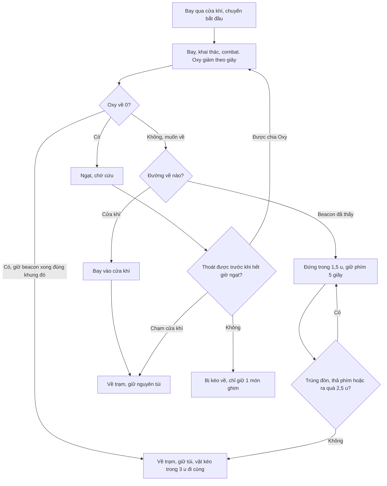

## II.3. Map and Expeditions

Map là nửa ra ngoài của The Novent. Mỗi ngày người chơi rời cửa khí của trạm, bay vào bãi vỡ để nhặt tài nguyên, bắt Driftlife, vớt người sống sót, rồi quay về trước khi hết Oxy. Mục này giải thích không gian ngoài trạm được dựng ra sao, nội dung và hazard được rải thế nào, và một chuyến bắt đầu, kết thúc ra sao. Mục nối với mục Người chơi ở Oxy và cách bay, với mục Combat ở Driftlife và boss, với mục Vật phẩm ở tài nguyên nhặt được, với mục Trạm và cảng ở chỗ đồ mang về dùng để sửa khoang và bán ở ca cảng.

### II.3.1. Overview

Không gian ngoài trạm có hai loại. **Map tổng The Wake** là bãi vỡ quanh trạm, được ghép lại mỗi chuyến từ các khối dựng tay, nên mỗi lần ra là một bố cục mới. Trạm, Ember Mooring và lối vào các khu đặc biệt, kể cả vỏ xác Station Cinder, thì luôn ở chỗ cũ, người chơi không bao giờ lạc. **Map nhánh** là khu dựng tay cố định vào qua một lối trong map tổng, nơi giữ truyện, người vớt và boss.

Một **chuyến** là một lần ra ngoài rồi về. Chuyến bắt đầu khi người chơi bay qua cửa khí. Từ lúc đó **Oxy**, chỉ số duy nhất của người chơi ngoài không gian, giảm đều theo giây và là đồng hồ của cả chuyến. Đi xa trạm thì gặp hàng hiếm hơn, nhưng đường về dài hơn và chỗ thoát ít hơn. Người chơi về bằng cách bay lại cửa khí, hoặc tìm và kích một **Recall Beacon**, điểm thoát kéo người chơi về trạm. Hết Oxy mà không ai cứu thì bị kéo về và mất gần hết túi đồ. Vì vậy mỗi chuyến xoay quanh việc chọn đi xa tới đâu, rẽ vào khu thưởng có rủi ro hay không, và lúc nào quay về bằng đường nào.

### II.3.2. The Wake and Tiles

Map tổng nhìn ngang. Trạm Ember nằm ngoài lưới ở mép trái, cửa khí mở vào giữa chiều cao map. Đi sang phải là đi xa trạm. Map tổng gồm ba **dải** nối tiếp theo chiều ngang là Gần, Giữa và Xa. Bản MVP chỉ có dải Gần, tên riêng Ember Anchorage, môi trường chân không sạch nên không đòi cấp vỏ bộ đồ.

Mỗi dải là một lưới **mảnh**, tức khối không gian dựng tay cùng kích thước:
- Mảnh rộng 40 u, cao 24 u. 1 u bằng chiều cao nhân vật, một mảnh bằng khoảng 2,2 x 2,4 màn hình.
- Dải cao 3 hàng. Dải Gần có 4 cột, tức 12 ô, chạy từ 0 tới 160 u theo chiều ngang.
- Mỗi cạnh mảnh có một cổng mở rộng 8 u ở giữa cạnh, hoặc đóng. Hai mảnh cạnh nhau chỉ thông khi cả hai cạnh chạm nhau đều mở.
- Biên trên và biên dưới là tường mảnh vỡ dày. Chạm biên thì dừng lại, không mất Oxy.

Mỗi mảnh thuộc một loại. Loại quyết định vai của mảnh trên đường đi và số khe điểm sinh nó mang (xem mục II.3.4):

| Loại mảnh | Vai | Cổng mở tối thiểu | Khe tài nguyên | Khe Driftlife | Khe hazard | Khe beacon | Tỉ lệ trong kho |
|---|---|---|---|---|---|---|---|
| Mở | Khai thác, chỗ thở | 3 | 8 | 2 | 0 tới 1 | 1 | 30% |
| Hành lang | Nối, hẹp, có hazard | 2, đối diện | 3 | 1 | 1 tới 2 | 0 | 20% |
| Ổ | Driftlife tập trung | 2 | 4 | 4 | 0 tới 1 | 0 | 20% |
| Xác lớn | Vật cản lớn có túi khai thác bên trong, che tầm nhìn | 2 | 10 | 1 | 1 | 1 | 20% |
| Thưởng | Hàng hiếm, rủi ro cao, chỉ ở nửa ngoài dải | 1 | 6, có khe hàng hiếm | 2 | 2 | 0 | 10% |

**Ô cố định** giữ nguyên mảnh qua mọi chuyến. Dải Gần có hai ô cố định:
- **Ember Mooring**, ô cột 1 hàng giữa, ngay trước cửa khí. Bốn cạnh đều mở. Ô luôn có 6 khe phế liệu và 1 khe Driftlife hiền có hàng, không hazard, không loài săn mồi. Đây là chỗ an toàn để học bay ở 30 giây đầu game.
- Ô lối vào Station Cinder, cột 3 hàng trên. Vỏ xác 32 x 16 u nhìn thấy từ Ember Mooring, làm mốc định hướng cho cả dải.

Dải chưa mở bị chặn bằng **Rạn vụn**, dải va chạm cứng dày 8 u nằm ở đầu dải sau, cao suốt chiều cao map. Không dụng cụ nào phá được. Ở MVP người chơi chạm Rạn vụn ở cuối dải Gần thì hiện dòng chưa có đường qua.

Chi tiết dữ liệu: tab Zone khối Map tổng The Wake và khối Dải Gần, Ember Anchorage.

### II.3.3. Layout Generation

Bố cục dải Gần được sinh lại khi chuyến bắt đầu và giữ nguyên tới hết chuyến. Seed của chuyến lấy từ thế giới, số ngày và số thứ tự chuyến trong ngày, nên nạp lại cùng ngày cùng chuyến thì ra đúng bố cục cũ. Máy sinh bố cục theo thứ tự sau:
- Kho mảnh MVP của dải Gần có 16 mảnh cho 10 ô ghép, tức 12 ô trừ 2 ô cố định. Đặt ô cố định và Rạn vụn trước.
- Chọn **đường chính**, đường đi được từ trạm tới mép ngoài dải mà không cần dụng cụ phá vật cản. Đường chính bắt đầu ở Ember Mooring, đi qua mọi cột từ trái sang phải, trong một cột đổi tối đa 1 hàng và chỉ sang hàng kề.
- Đặt mảnh cho các ô trên đường chính, cổng khớp hướng đường. Chọn một cặp cột để tạo **vòng**, tức đường thứ hai nối cùng hai cột, rồi điền các ô còn lại bằng mảnh có cổng nối về ô đã nối.
- Bật khe điểm sinh (mục II.3.4), đặt Recall Beacon (mục II.3.6), rồi kiểm hợp lệ.
- Hỏng thì sinh lại với seed kế tiếp. Thử 20 lần vẫn hỏng thì dùng bố cục dự phòng dựng tay của dải và ghi log seed hỏng, người chơi không bao giờ kẹt ở màn chờ.

Bố cục hợp lệ khi đủ các luật sau:
- Đường chính đi được, dải có vòng, mọi beacon và lối vào map nhánh nối được với đường chính.
- Một mảnh chỉ xuất hiện một lần trong chuyến. Không hai mảnh Ổ hoặc Thưởng đứng liền nhau trên đường chính. Mảnh có cờ nửa ngoài, gồm mọi mảnh Thưởng, chỉ nằm ở cột 3 và cột 4 của dải Gần.
- So với chuyến liền trước, số ô trùng không quá 5 trên 10 ô ghép, trùng tính là cùng mảnh ở cùng ô. Beacon không nằm ở ô có beacon của chuyến trước.

Chi tiết dữ liệu: tab Zone khối Map tổng The Wake.

### II.3.4. Spawn Points and Density

Mỗi mảnh khai báo sẵn các **khe điểm sinh**, marker vô hình đánh dấu chỗ có thể sinh nội dung: khe tài nguyên, khe Driftlife, khe hazard, khe beacon và lối vào map nhánh. Khi sinh chuyến, máy chỉ bật một phần khe tài nguyên và khe Driftlife, khe không bật thì để trống. Khe tài nguyên chọn một điểm khai thác của dải theo trọng số ở mục Vật phẩm. Khe Driftlife chọn một loài của dải và kiểu sinh đơn, đàn hoặc tổ theo mục Combat. Đã nhặt, đã bắt hay đã hạ thì khe trống tới chuyến sau, trong cùng chuyến không sinh lại.

```text
TiLeBat = TiLeMotNguoi * HeSoNguoi
HeSoNguoi = 1 + a * (SoNguoi - 1)
```
- TiLeBat: phần khe tài nguyên hoặc khe Driftlife được bật trong chuyến, đơn vị phần trăm, trần 100%.
- TiLeMotNguoi: tỉ lệ bật khi chơi một người, dải Gần là 40% cho cả hai loại khe. Nguồn tab Zone.
- HeSoNguoi: hệ số số người, không đơn vị. a là hệ số theo dải, dải Gần là 0,30. Nguồn tab Zone.
- SoNguoi: số người trong chuyến, đơn vị người.
- Ví dụ hai người ở dải Gần: HeSoNguoi = 1,30, TiLeBat = 52%.

Mật độ dải Gần ở bản MVP:

| Chỉ số | Dải Gần |
|---|---|
| Khe tài nguyên và khe Driftlife được bật, một người | 40% mỗi loại |
| Khe hàng hiếm, nửa trong và nửa ngoài dải | 5% và 15% |
| Phần mảnh có hazard được bật | 30% |
| Loài chủ động tấn công trên tổng loài | 1 trên 4 (Arc Eel) |
| Recall Beacon mỗi chuyến | 1 |

Phần thưởng tăng theo rủi ro bằng các luật sau:
- **Khe hàng hiếm** là khe chỉ nhận loại hòm của dải. Tỉ lệ khe hàng hiếm cao hơn ở nửa ngoài dải. Mảnh Thưởng chỉ đặt ở nửa ngoài, luôn có ít nhất 1 khe hàng hiếm được bật, và luôn có ít nhất một hazard hoặc một loài săn mồi được bật.
- Mảnh vỡ trôi nhặt tay chiếm tối đa 25% khe tài nguyên của một mảnh, hai khe nhặt tay cách nhau ít nhất 2 u.
- Node khoan và nạy đặt thành cụm 2 tới 3 node trong bán kính 4 u. Tính cả thời gian bay giữa các node thì nhặt tay cho giá trị mỗi giây bằng 1,04 lần khoan trung bình, hai cách gần ngang nhau.
- Trọng số trục độ khó của một chuyến, GDM đã duyệt: Oxy bay ra 35%, mật độ đe dọa (Driftlife săn mồi, The Wardens) 30%, phần mảnh có hazard 20%, môi trường 15%.

Khe Driftlife khai báo **điểm neo**, loại chỗ loài đó chịu sinh. Loài có điểm neo chỉ sinh ở khe có điểm neo đó. Ở dải Gần, Driftmoth, Sting Krill và Skitter Ray neo ở mảnh vỡ nhỏ trong mảnh Mở và mảnh Ổ. Arc Eel neo ở xác có điện hoặc cạnh Cáp chập, nằm trong mảnh Xác lớn và mảnh có Cáp chập.

Chi tiết dữ liệu: tab Zone khối Dải Gần, Ember Anchorage. Cột điểm sinh của từng điểm khai thác ở tab Salvage, điểm sinh từng loài ở tab Enemy.

### II.3.5. Hazards

**Hazard** là mối nguy của môi trường, khác Driftlife ở chỗ không có AI. Hazard chỉ xuất hiện ở khe hazard của mảnh hoặc ở chỗ dựng tay trong map nhánh. Mỗi khe khai báo danh sách hazard được phép, máy chọn một theo dải và chương. Luật chung cho mọi hazard:
- Mọi hazard gây hại có tín hiệu báo trước bằng hình và tiếng, dài ít nhất 1 giây, tính từ lúc người chơi thấy được tín hiệu.
- Sát thương trừ thẳng vào Oxy. Đẩy lùi cộng vào vận tốc người chơi. Hazard không giết thẳng, Oxy về 0 thì theo luật Ngạt ở mục Người chơi.
- Hazard không phân biệt người chơi, trúng ai trừ người đó. Driftlife cũng chịu Mảnh trôi.
- Không có hazard ở Ember Mooring và trong bán kính 8 u quanh Recall Beacon.
- Khe tài nguyên cách vùng gây hại của hazard ít nhất 2 u.

Bản MVP có ba hazard:

| Hazard | Loại | Tác động | Báo trước | Chu kỳ | Cách né |
|---|---|---|---|---|---|
| Mảnh trôi | Động | Khối tròn bán kính 1 u, trôi thẳng hết chiều ngang hoặc chiều dọc mảnh rồi sinh lại ở đầu đường. Va trúng trừ 8 Oxy, đẩy 4 u/s | Vệt bụi phía trước 1,5 giây. Tới từ ngoài màn thì có chỉ báo ở mép 1 giây trước khi vào | Trôi 2 u/s | Tránh đường trôi, nấp sau Xác lớn |
| Cáp chập | Tĩnh theo nhịp | Tia thẳng giữa hai đầu cáp, dài 4 tới 8 u, rộng 0,5 u. Mỗi lần phóng trúng một người tối đa một lần, trừ 12 Oxy, choáng 0,5 giây | Tia lửa nhỏ 1 giây | Phóng 1,5 giây, mỗi 5 giây một lần | Đi qua lúc tắt |
| Ống xì | Đẩy | Luồng chữ nhật dài 12 u, rộng 3 u, theo một trong 8 hướng. Đẩy 6 u/s, không trừ Oxy | Hơi trắng 1 giây | Xì 3 giây, nghỉ 3 giây | Bay xuôi để tăng tốc, hoặc đợi lúc nghỉ |

Mảnh trôi cần chỉ báo ở mép màn hình vì nó có thể tới trước khi người chơi kịp thấy:
- Vùng nhìn tối thiểu là 17,8 x 10 u, nửa chiều ngang là 8,9 u. Tốc độ tương đối lớn nhất là 17 u/s, gồm lướt 15 u/s và trôi 2 u/s. Ở tốc độ đó Mảnh trôi đi hết nửa màn trong 0,52 giây, ngắn hơn báo trước tối thiểu.

Hazard cũng dùng để làm node khó lấy. Ở dải Gần, Hòm kỹ thuật vỡ đặt cạnh Cáp chập, nên muốn lấy hòm người chơi phải canh nhịp tia. Lần đầu gặp mỗi hazard có một dòng gợi ý. Trúng hazard thì nhân vật nháy và bị đẩy ngay trong khung hình đó, thanh Oxy rơi kèm số trừ.

Chi tiết dữ liệu: tab Zone khối Hazard: luật chung và ba khối Hazard Mảnh trôi, Cáp chập, Ống xì.

### II.3.6. Expeditions and Returning

Chuyến kết thúc với từng người khi người đó bay vào cửa khí, kích beacon xong, hoặc bị kéo về. Chuyến của nhóm kết thúc khi người cuối cùng xong. Số chuyến mỗi ngày ở mục Một ngày.

**Cửa khí** của Ember là lối về luôn có: bay vào là về, không cần giữ phím, túi đồ giữ nguyên. Ở dải Gần trạm đủ gần nên đây là đường về chính.

Recall Beacon là lối về thứ hai, đổi chỗ mỗi chuyến:
- Dải Gần có 1 beacon mỗi chuyến, chỉ đặt ở khe beacon, không đặt ở Ember Mooring, nằm trên hoặc kề đường chính. Mỗi dải có ít nhất một beacon ở nửa ngoài.
- Người chơi bay vào trong 30 u quanh beacon thì beacon hiện trên la bàn của cả nhóm tới hết chuyến. Chưa vào bán kính đó thì không thấy, người chơi phải đi dò.
- Kích beacon: đứng trong 1,5 u, giữ phím Kích Recall 5 giây, trong lúc giữ Oxy vẫn hao. Trúng đòn, thả phím hoặc ra xa quá 2,5 u thì hủy, phải giữ lại từ đầu, thử lại không giới hạn.
- Kích xong thì người đó về trạm, giữ nguyên túi đồ. Vật đang kéo trong 3 u đi cùng. Beacon dùng nhiều lần trong chuyến. Nhiều người kích cùng một beacon được, mỗi người tính riêng.

Oxy về 0 thì người chơi vào **Ngạt**, trạng thái chờ cứu có giới hạn thời gian. Trong lúc ngạt, người chơi được đồng đội chia Oxy hoặc tự chạm cửa khí thì thoát. Hết giờ thì bị kéo về trạm, túi chỉ giữ một món đã ghim. Thời gian ngạt, luật chia Oxy và ghim món ở mục Người chơi.


*Hình II.3.1 - Ba cách một chuyến kết thúc với một người*

Đọc sơ đồ: trong chuyến Oxy luôn giảm, nên mọi nhánh đều là cuộc chạy đua với thanh Oxy. Muốn về khi còn Oxy thì có hai đường. Cửa khí không đòi gì nhưng có thể xa. Beacon thường gần hơn nhưng đòi đứng yên giữ phím, và bị Driftlife cắn một cái là phải giữ lại từ đầu. Nếu Oxy cạn trước, người chơi vào Ngạt. Đồng đội chia Oxy kịp thì bay tiếp. Chạm được cửa khí trong lúc ngạt thì vẫn tính là về an toàn. Nếu Oxy về 0 đúng khung giữ beacon xong thì người chơi về trạm luôn, không vào Ngạt. Không kịp cả hai thì bị kéo về và mất gần hết túi. Đây là lý do quyết định quay về sớm hay đi thêm một mảnh là quyết định chính của mỗi chuyến.

Trong chuyến người chơi mở **bản đồ chuyến** bằng phím M. Bản đồ hiện lưới mảnh, ô đã vào sáng và ô chưa vào tối, beacon đã thấy, lối vào map nhánh và vị trí đồng đội. Mở bản đồ không dừng thời gian.

Chi tiết dữ liệu: tab Zone khối Recall Beacon, tab Player cho Ngạt và chia Oxy.

### II.3.7. Oxygen Budget and Pacing

Oxy hao nền 1 điểm mỗi giây, nên một điểm Oxy bằng một giây. Bình quyết chuyến dài bao lâu, dải quyết phần nào của chuyến là bay và phần nào là làm việc. Phép tính ngân sách dưới đây cho trần thời lượng của một chuyến:

```text
OxyLamViec = Binh * (1 - DuTruVe) - OxyBayRa - OxyVe - Binh * DuTruDon
OxyBayRa = KhoangCach / TocDoBay * HeSoDuongVong * HaoNen
```
- OxyLamViec: Oxy còn cho khai thác và combat, đơn vị Oxy, cũng là giây.
- Binh: dung lượng bình Oxy, chương 1 là 330. Nguồn tab Player.
- DuTruVe: phần bình người chơi được giả định giữ lại để quay về, 15%. Đây là giả định của phép tính, HUD dùng vạch đủ về ở mục Người chơi. DuTruDon: phần bình dành cho trúng đòn, 10%.
- OxyBayRa, OxyVe: Oxy tốn khi bay ra tới chỗ làm việc và khi bay về, đơn vị Oxy.
- KhoangCach: khoảng cách từ cửa khí tới chỗ làm việc, đơn vị u.
- TocDoBay: tốc độ bay đều, 6,0 u/s ở bộ đẩy bậc 0. Nguồn tab Player.
- HeSoDuongVong: hệ số bù đường không thẳng, 1,3, không đơn vị. HaoNen: 1 Oxy mỗi giây.
- Ví dụ chương 1: OxyLamViec = 330 * 0,85 - 17 - 17 - 33 = 213 giây. Mỗi chặng bay 17 giây ứng với khoảng 78 u (17 * 6,0 / 1,3), 213 là làm tròn xuống từ 213,5.

Từ đó trần của một chuyến chương 1:
- Bay ra 17 giây, về 17 giây, làm việc 213 giây, dự trù trúng đòn 33 giây, tổng 280 giây, tức 4,7 phút. Túi đồ chương 1 chứa 80 Khối. Bay thẳng tới mép ngoài dải Gần mất 27 giây, có đường vòng thì 35 giây.

Thời lượng thật ngắn hơn trần, vì trần chưa tính hao thêm còn sim chuyến có tính:
- Túi gần đầy: hao nền tăng tới 1,15 lần. Kéo buồng ngủ đông: hao 1,25 lần.
- Ở chương 1 túi đầy trước khi Oxy cạn, nên túi quyết thời lượng đầu game, còn bình quyết thời lượng cuối game.

**Đường áp lực** của một chuyến được giữ bằng chính luật đặt mảnh:
- Áp lực nhẹ ở Ember Mooring và tăng dần theo cột, vì khe hàng hiếm, mảnh Thưởng và loài săn mồi dày hơn ở nửa ngoài.
- Sau mỗi mảnh Ổ hoặc Thưởng trên đường chính có mảnh Mở hoặc Xác lớn để người chơi thở.
- Đi càng xa cửa khí thì đường về càng dài, và dải Gần chỉ có một beacon để rút ngắn.

Chi tiết dữ liệu: tab Zone khối Ngân sách Oxy một chuyến.

### II.3.8. Branch Map: Station Cinder

Map nhánh là khu dựng tay không sinh lại bố cục. Map nhánh giữ trạng thái giữa các chuyến: cửa đã mở, vách đã cắt, boss đã hạ, đường tắt đã mở, vật kể chuyện đã lấy. Tài nguyên và Driftlife thường trong map nhánh vẫn sinh lại mỗi chuyến như map tổng. Vào và ra qua một màn chuyển cảnh ngắn. Khóa trong map nhánh mở bằng dụng cụ, mốc truyện hoặc hạ boss, và một người mở được mọi khóa. Map nhánh dùng môi trường của dải chứa lối vào.

Bản MVP có một map nhánh là **Station Cinder**, xác Seed Station đầu tiên ở dải Gần. Lối vào mở sau mốc truyện Hãm trôi và neo, tức khi khoang neo của trạm Hoạt động (xem mục Trạm và cảng). Nội thất có hai tầng, chia thành các khu:

| Khu | Vị trí | Có gì |
|---|---|---|
| Cửa khí hỏng | Tầng dưới, đầu trái | Lối vào và lối ra chính, beacon cố định |
| Hành lang trục | Tầng dưới | Hai Mảnh trôi, đàn Driftmoth, phế liệu, linh kiện, một hòm kỹ thuật. Beacon ngay trước Cửa khóa nguồn để rút khỏi phòng boss |
| Khoang ngủ đông trái | Tầng trên, lên bằng giếng ở đầu hành lang trục | Buồng của Ingrid (Kỹ sư), một buồng tắt có thẻ tên, nhật ký trạm, một hòm kỹ thuật. Vách sập ở mép phải chặn đường sang khoang ngủ đông phải, không phá được |
| Cửa khóa nguồn | Cuối hành lang trục | Mở bằng Bộ kích nguồn. Nhóm đã có thì ai chạm cửa cũng mở |
| Khoang máy | Tầng dưới, sau Cửa khóa nguồn | Phòng boss Scrapmaw, lõi năng lượng, hai Cáp chập, kho hàng Seed mở sau boss |
| Khoang lái | Đầu phải, hai tầng | Manh mối, mảnh lõi dẫn đường Cinder, một hòm kỹ thuật, beacon bật sau boss |
| Hành lang trên và khoang ngủ đông phải | Tầng trên | Hành lang trên là đường duy nhất từ khoang lái tới buồng của Linh (Thông dịch viên). Khoang có thêm một buồng tắt có thẻ tên |

Người chơi đi Station Cinder trong hai lần:

| Lần | Cần có | Đường đi | Kết quả | Thời lượng trong nhánh |
|---|---|---|---|---|
| Lần 1 | Không | Cửa khí hỏng, hành lang trục, giếng, khoang ngủ đông trái | Vớt Ingrid, kéo buồng về beacon ở cửa khí hỏng | 90 giây |
| Lần 2 | Bộ kích nguồn | Cửa khí hỏng, hành lang trục, Cửa khóa nguồn, khoang máy, khoang lái, hành lang trên, khoang ngủ đông phải | Hạ hoặc xua Scrapmaw, vớt Linh, kéo buồng về beacon ở khoang lái | 150 giây, gồm trận boss ước 60 giây |

Bộ kích nguồn là món đầu tiên Ingrid chế ở xưởng, chỉ dùng tài nguyên thô dải Gần. Vì vậy lần đầu dạy kéo buồng và beacon cố định, lần sau mới mở trận boss. Vách giữa khoang máy và khoang lái chỉ mở khi trận boss kết thúc, bằng cách hạ hoặc xua đi, nên muốn tới Linh phải qua trận boss. Cửa phòng boss không khóa. Beacon để rút giữa trận nằm ngoài phòng, cách Cửa khóa nguồn 6 u về phía hành lang trục. Driftlife do boss sinh ra không rời phòng, nên beacon đó luôn kích được. Cơ chế trận boss ở mục Combat.

Người vớt nằm trong **buồng ngủ đông**, vật kéo nặng không vào túi. Muốn vớt thì kéo buồng tới beacon hoặc tới cửa ra. Buồng tới trạm thì vào khu hồi sức (xem mục Trạm và cảng). Tốc độ khi kéo và Oxy hao thêm khi kéo ở mục Người chơi.

[CHỜ ẢNH: sơ đồ mặt cắt Station Cinder hai tầng có tên khu, vẽ từ spec greybox ở `map.md` mục 6.5 hoặc chụp greybox Unity]
*Hình II.3.2 - Mặt cắt Station Cinder, hai tầng, phòng boss ở giữa tầng dưới*

Chi tiết dữ liệu: tab Zone khối Map nhánh Station Cinder.

### II.3.9. Greybox Spec

Đơn vị Unity là 1 u, bằng chiều cao nhân vật. Gốc tọa độ map tổng đặt ở cửa khí của Ember theo chiều ngang và ở biên dưới map theo chiều dọc.

| Phần | Tọa độ (u) | Ghi chú |
|---|---|---|
| Camera | Cao 10, rộng 17,8 ở tỉ lệ 16:9 | Mở ngang tới 21:9 |
| Vỏ ngoài Ember | x từ -40 tới 0, y từ 24 tới 48 | Ngoài lưới. Cửa khí ở (0, 36) |
| Lưới dải Gần | x từ 0 tới 160, y từ 0 tới 72 | 4 cột x 3 hàng, mỗi ô 40 x 24 |
| Ember Mooring | x từ 0 tới 40, y từ 24 tới 48 | Bốn cổng mở |
| Lối vào Station Cinder | x từ 80 tới 120, y từ 48 tới 72 | Cổng Trái, Phải, Dưới mở, cạnh Trên là biên map. Cửa vào ở cạnh dưới vỏ xác |
| Rạn vụn | x từ 160 tới 168, y từ 0 tới 72 | Va chạm cứng |
| Biên trên, biên dưới | y = 0 và y = 72 | Va chạm vô hình kèm lớp hình mảnh vỡ dày |
| Kích thước tối thiểu | Khe hở 3, đường chính rộng 6, cổng mảnh 8 | Nhân vật cao 1 u |
| Station Cinder | Scene riêng, rộng 64, cao 24, gốc ở góc dưới trái vỏ xác | Tọa độ từng khu, buồng, beacon và Cáp chập ở `map.md` mục 6.5 |

| Lớp va chạm | Dùng cho | Va với người chơi | Va với Driftlife |
|---|---|---|---|
| Rắn | Vỏ xác, thiên thạch lớn, Rạn vụn, biên | Có | Có |
| Vụn | Vật trôi nhỏ đẩy được | Có, đẩy được | Có |
| Hazard | Vùng gây hại hoặc vùng đẩy | Trigger | Trigger |
| Khe | Marker điểm sinh | Không | Không |
| Lối | Cửa khí, beacon, cửa map nhánh | Trigger | Không |

Bố cục dự phòng dải Gần đi đường chính ở hàng giữa:

| Hàng | Cột 1 | Cột 2 | Cột 3 | Cột 4 |
|---|---|---|---|---|
| Trên | Hành lang | Xác lớn | Lối vào Station Cinder | Mở, beacon nếu chuyến trước không ở đây |
| Giữa | Ember Mooring | Hành lang | Xác lớn | Mở |
| Dưới | Mở | Hành lang | Ổ | Xác lớn, beacon thay thế |

Chi tiết dữ liệu: tab Zone khối Map tổng The Wake và khối Map nhánh Station Cinder.

### II.3.10. Two-player Co-op and Acceptance Criteria

Mọi luật trên đúng cho cả một người và co-op. MVP có co-op hai người, khác biệt nằm ở các điểm sau:
- Kích thước map, số mảnh và số beacon giữ nguyên. Chỉ tỉ lệ bật khe tài nguyên và khe Driftlife nhân hệ số số người ở mục II.3.4.
- Hazard như nhau, trúng ai trừ người đó. Beacon một người thấy được ghim cho cả nhóm, mỗi người kích riêng, hai người kích cùng một beacon được.
- Hai người tự do ở hai nơi khác nhau, mỗi người theo luật Oxy của khu mình đang ở. Người về trước không ra lại trong chuyến đó, nhưng xem được vị trí đồng đội và beacon đã thấy trên bản đồ chuyến. Người vào phiên giữa chuyến chờ ở trạm tới chuyến sau.
- Không luật nào cần đúng hai người: không cửa cần hai người cùng đứng, không công tắc đôi. Kéo buồng, boss và Driftlife thường có hệ số riêng theo số người ở mục Người chơi và mục Combat.

Kết quả sim chuyến ở chương đầu, kịch bản trung bình:

| Số người | Phút một chuyến P50 (P10 tới P90) | Mỗi người nhặt so với một mình | Về vì túi đầy | Bị kéo về |
|---|---|---|---|---|
| 1 | 4,4 (4,0 tới 4,7) | 100% | 83% | 1% |
| 2 | 4,3 (3,7 tới 4,7) | 85% | 37% | 0% |

Map và chuyến của MVP đạt khi đủ các điều sau:

| Tiêu chí | Mục tiêu | Đo được | Đạt |
|---|---|---|---|
| Sinh 1000 chuyến liền nhau dải Gần | 100% hợp lệ, dưới 1% rơi vào bố cục dự phòng | Bản tham chiếu 0,00% rơi dự phòng | Có |
| Hai chuyến liền nhau | Trùng không quá 5 trên 10 ô ghép, không beacon cùng ô | Lớn nhất 5, trung bình 1,4, beacon trùng 0% | Có |
| Phút một chuyến chương 1, một người, trung bình | 4 tới 6 phút | 4,4 phút | Có |
| Bị kéo về, người chơi cẩn thận, chương 1 | Dưới 5% | 1% | Có |
| Bị kéo về, người chơi tham, chương 1 | 15 tới 40% | 10% | Lệch, chấp nhận, đo lại ở playtest |
| Báo trước của mỗi hazard gây hại | Đo trên build ít nhất 1 giây | Chờ build | Chưa đo |
| Station Cinder, một người | Đi hết lần 1 và lần 2, vớt đủ Ingrid và Linh, kết thúc trận Scrapmaw. Vào lại thì Cửa khóa nguồn vẫn mở, boss không còn, beacon khoang lái bật | Chờ build | Chưa đo |
| Lối ra map nhánh | Mỗi map nhánh có ít nhất một lối ra, kiểm bằng tay trên greybox | Chờ greybox | Chưa đo |

Người chơi thật có quay về đúng lúc không, có thấy chuyến lặp không, và tỉ lệ bị kéo về thật thì sim chưa đo được, chờ playtest trên build.

Chi tiết dữ liệu: tab Zone khối Ngân sách Oxy một chuyến, tab MVP Criteria Checklist.

### II.3.11. Edge Cases

| Tình huống | Phán quyết |
|---|---|
| Oxy về 0 đúng lúc giữ phím beacon xong | Giữ xong tính trước, người chơi về trạm, không vào Ngạt |
| Spam phím giữ beacon, nhấn nhả liên tục | Mỗi lần nhả là hủy, tiến độ về 0, không cộng dồn |
| Đang kéo buồng ngủ đông thì Oxy về 0 | Buồng rơi tại chỗ, ở lại map nhánh ở trạng thái chưa vớt, không mất người vớt |
| Kéo Driftlife sống tới beacon nhưng nó ở ngoài 3 u | Driftlife không đi cùng, ở lại map |
| Hazard đẩy người chơi vào Rạn vụn hoặc biên map | Dừng lại ở ranh, không trừ Oxy |
| Thoát game giữa chuyến khi chơi một mình | Vào lại ở điểm lưu sau chuyến trước. Chuyến dở không tính vào hạn hai chuyến của ngày, đồ nhặt trong chuyến đó mất, người chơi đi lại chuyến đó với cùng bố cục map |
| Người chơi rút khỏi phòng boss khi boss đã mất một phần sinh lực | Boss không đuổi ra ngoài. Phòng không còn ai quá 10 giây hoặc cả nhóm về trạm thì boss hồi đầy, cửa đã mở giữ nguyên |

### II.3.z. Post-MVP

- Dải Giữa (Shepherd Belt) và dải Xa (Glass Nebula), mở qua khe trong Rạn vụn, môi trường đòi cấp vỏ bộ đồ và hệ số hao khi thiếu cấp.
- Sáu hazard còn lại: Dòng đá vụn, Băng nứt, Dòng trôi, Bùng tinh vân, Vùng nhiễu, Hàng rào cắt.
- Khe đơn vị The Wardens ở dải Xa, nhiều Recall Beacon hơn mỗi chuyến ở dải Giữa và dải Xa.
- Skiff, xuồng đi thẳng tới lối vào map nhánh đã từng vào. Co-op 3 và 4 người.
- Bảy map nhánh còn lại: Station Wick, Station Lantern, Veyl Waypost, The Raft, Station Flint, Cradle Interior, Warden Rig, cùng bốn boss của chúng, khu có khí và hộ tống kén của Sevra.
