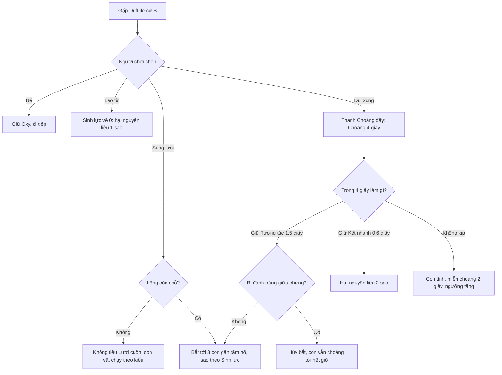
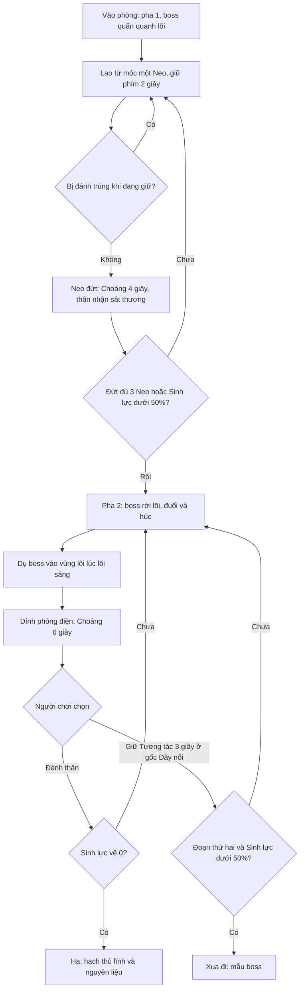

## II.4. Combat and Driftlife

Combat là cách người chơi lấy mẫu sinh vật và giữ Oxy khi ở ngoài trạm. Mỗi lần gặp một con Driftlife, người chơi chọn bắt sống, hạ hay né, và mọi đòn trúng người đều trừ thẳng vào Oxy, nên đánh hay né luôn là quyết định về thời gian còn lại của chuyến. Mục này nối với mục Người chơi ở Oxy và lướt, với mục Vật phẩm ở dụng cụ và thứ rơi ra, với mục Trạm và cảng ở chỗ lồng sinh vật sống bán được ở ca cảng. Ai cần biết vì sao một chuyến kết thúc sớm, hay vì sao bắt sống đáng công hơn hạ, nên đọc mục này.

### II.4.1. Overview

Ngoài không gian có **Driftlife**, sinh vật bản địa trôi trong chân không. Chúng sinh lại mỗi chuyến và không bao giờ cạn, nên hạ nhiều không bị phạt. Mỗi loài gắn với một dải của map và có đúng một kiểu hành vi, ví dụ trôi hiền lành, chạy trốn, đi bầy hay giữ lãnh thổ. Người chơi đọc kiểu hành vi để chọn cách xử. Bản MVP có ba dụng cụ combat. **Lao từ** là mũi lao có dây, gây sát thương và móc kéo được con nhỏ. **Dùi xung** không gây sát thương mà làm con vật choáng. **Súng lưới** bắt sống con nhỏ ngay khi trúng. Con bị choáng đứng im một lúc để người chơi lại gần bắt bằng tay hoặc kết liễu. Con bắt sống vào **Lồng mẫu**, cái lồng người chơi kéo theo sau lưng, về trạm thành hàng bán, con nuôi hoặc mẫu nghiên cứu. Con bị hạ vỡ ra nguyên liệu trôi để nhặt vào túi. Driftlife đánh lại bằng đòn có báo trước rõ, người chơi né bằng bay hoặc lướt. Combat không có thắng thua riêng: kết quả tốt là mang mẫu về trạm mà Oxy còn dư, kết quả xấu là hết Oxy và bị kéo về. Chương đầu có một boss ở map nhánh, kết thúc bằng hạ hoặc xua đi, cả hai đều mở tiếp chương.

### II.4.2. Damage, Telegraphs and Attack Tickets

Người chơi không có thanh máu. Sát thương tính bằng điểm Oxy, một điểm là một giây thở. Oxy cạn thì người đó vào **Ngạt**, chờ đồng đội cứu hoặc bị kéo về trạm (xem mục II.2). Khi trúng đòn:
- Nhân vật bị đẩy lùi theo hướng đòn và mất điều khiển 0,25 giây.
- Từ lúc trúng, người chơi được miễn sát thương 0,8 giây. Đòn khác trúng trong khoảng này chỉ đẩy lùi, không trừ Oxy.
- Trúng đòn hủy mọi thao tác đang giữ phím: kích Recall Beacon, bắt bằng tay, cạy. Dụng cụ đang nạp không mất đạn.
- Lướt có 0,2 giây đầu miễn sát thương. Đây là cách né chủ động duy nhất.

Mọi đòn của kẻ địch có ba pha: Báo trước, Đánh, Hồi. Báo trước có cả hình (thân con vật sáng màu) và tiếng. Pha Hồi là lúc kẻ địch đứng yên sau đòn, mở sơ hở để người chơi đánh lại. Khoảng cách tính bằng u, 1 u bằng chiều cao nhân vật.

| Loại đòn | Báo trước tối thiểu |
|---|---|
| Đòn hẹp trừ dưới 15 Oxy | 0,7 giây |
| Đòn hẹp trừ từ 15 Oxy | 0,8 giây |
| Đòn vùng bán kính 2 tới 3 u | 1,0 giây |
| Đòn vùng bán kính trên 3 tới 4 u | 1,3 giây |
| Đòn vùng lớn hơn 4 u | Phải có cách chống khác ngoài bay ra, ví dụ bám mảnh vỡ |

Các mức này đặt theo prototype bay, để mọi đòn đều né được bằng bay thường và lướt chỉ là cách né dư dả:
- Bay ra khỏi đòn hẹp cần khoảng 0,67 giây, ra khỏi vùng bán kính 2,5 u cần khoảng 0,92 giây.
- Đòn từ ngoài màn hình có thêm mũi tên ở mép màn và âm định hướng, hiện ngay từ đầu pha Báo trước.

**Vé tấn công** giới hạn số kẻ địch cùng đánh một người:
- Ở dải Gần mỗi người chơi có 2 vé. Kẻ địch muốn ra đòn vào ai phải giữ một vé của người đó, hết vé thì lượn vòng quanh chờ cách người chơi 4 u. Đòn vùng và đòn tiếp xúc không cần vé.
- Kẻ địch nhắm người vừa gây sát thương hoặc làm choáng nó gần nhất trong 3 giây qua, không có thì nhắm người gần nhất trong vùng phát hiện.
- Người đang Ngạt hoặc đang được cứu không bị nhắm và không nhận sát thương, kể cả đòn vùng.

Ngắm tự do bằng chuột hoặc cần phải gamepad, không khóa mục tiêu. Gamepad được hỗ trợ ngắm, đạn lệch tối đa 6 độ về mục tiêu gần tâm ngắm nhất. Không có sát thương lên đồng đội. Trong trạm không dùng được dụng cụ combat. Phản hồi khi đánh và bị đánh:
- Báo trước: thân con vật sáng vàng với đòn thường, đỏ với đòn lớn, kèm tiếng tích cao dần.
- Người chơi trúng đòn: nhân vật nháy trắng, thanh Oxy tụt có vệt đỏ. Rung màn nhẹ chỉ khi mất từ 15 Oxy, có tùy chọn tắt.
- Hitstop đòn nhẹ 2 tới 3 khung hình, đòn nặng và lúc đứt Neo boss 4 tới 6 khung hình. Choáng là nhịp ngắt rõ, con vật đơ hẳn.

Chi tiết dữ liệu: tab Enemy khối Luật combat và bắt sống, tab Assets và tab AUDIO ASSETS LIST cho hình và âm.

### II.4.3. Stun and Incapacitation

Mỗi Driftlife có **Sinh lực** và **Ngưỡng choáng**. Sinh lực về 0 thì con vật bị hạ. Dùi xung cộng điểm vào thanh Choáng, thanh đầy thì con vật **Choáng**:
- Choáng kéo dài 4 giây. Đánh con đang Choáng không làm nó tỉnh.
- Không bị trúng thêm trong 1 giây thì thanh Choáng tụt 20% ngưỡng mỗi giây, nên muốn làm choáng phải bắn liền tay.
- Con đang Choáng gọi là **Bất lực**: không di chuyển chủ động, không ra đòn, chỉ trôi chậm theo quán tính.

Con vật không bị khóa choáng mãi nhờ luật giảm dần. Mỗi con giữ một hệ số choáng riêng, khởi đầu bằng 1:
```text
NguongHieuLuc = NguongChoangGoc * HeSoGiamDan
HeSoGiamDan (sau mỗi lần tỉnh) = HeSoGiamDan * 1,5, tối đa 3
```
- NguongChoangGoc: ngưỡng choáng của loài ở bảng mục II.4.6, đơn vị điểm Choáng.
- HeSoGiamDan: hệ số riêng của từng con, không đơn vị. Về lại 1 khi đã qua 20 giây kể từ lần tỉnh gần nhất.
- NguongHieuLuc: số điểm Choáng thật cần cho lần choáng tiếp theo, đơn vị điểm Choáng.
- Vừa tỉnh thì con vật miễn choáng thêm 2 giây, trong khoảng này Dùi xung không cộng điểm.

Ví dụ một con có ngưỡng gốc 25:
- Lần choáng thứ hai cần 37,5 điểm, lần thứ ba cần 56,25 điểm, từ lần thứ tư dừng ở 75 điểm vì hệ số chạm trần 3.

Loài miễn choáng thì Dùi xung không cộng điểm, con vật chỉ sáng lên và hiện biểu tượng miễn. Ở bản MVP đó là Arc Eel, loài dạy người chơi rằng dụng cụ sai thì vô dụng. **Kết nhanh** là thao tác hạ con đang Bất lực bằng tay, giữ phím riêng 0,6 giây, không cần dụng cụ. Phím Kết nhanh khác phím Tương tác, nên trên cùng một con đang choáng người chơi luôn chọn rõ bắt hay hạ.

Chi tiết dữ liệu: tab Enemy khối Choáng và Mê.

### II.4.4. Live Capture and Sample Quality

Bản MVP chỉ bắt sống loài **cỡ S**, tức loài nhỏ, theo hai cách:

| Cách bắt | Cần Bất lực trước | Thời gian | Tốn gì |
|---|---|---|---|
| Súng lưới trúng | Không | Một phát, nạp lại 3 giây | 1 Lưới cuộn mỗi phát |
| Tương tác giữ phím | Có | 1,5 giây | Không tốn gì, nhưng phải làm choáng trước |

Súng lưới nổ thành vùng và Lồng mẫu giữ mẫu sống:
- Vùng nổ bán kính 1,5 u, bắt tối đa 3 con cỡ S, ưu tiên con gần tâm nổ.
- Trúng con từ cỡ M trở lên thì lưới quấn nó 2 giây, giảm 70% tốc độ, không bắt được.
- Mẫu sống không vào túi đồ. Lồng mẫu mở ra khi bắt con đầu tiên, chứa tối đa 3 con cỡ S, mỗi người kéo tối đa 1 lồng.
- Lồng là vật kéo nhẹ: không làm chậm, không chiếm ô túi hay ô đai dụng cụ. Mẫu trong lồng không chết trong chuyến.

Cái giá của bắt sống cỡ S vì vậy chỉ là Lưới cuộn hoặc thời gian bắt tay, cộng giới hạn một lồng mỗi người mỗi chuyến. Chất lượng mẫu tính bằng sao theo Sinh lực còn lại lúc bắt, nên bắn Lao từ cho yếu rồi mới bắt sẽ hạ sao mẫu:

| Cách lấy | Điều kiện | Sao |
|---|---|---|
| Bắt sống | Sinh lực còn từ 70% trở lên | 3 sao |
| Bắt sống | Sinh lực còn từ 30% tới dưới 70% | 2 sao |
| Bắt sống | Sinh lực còn dưới 30% | 1 sao |
| Kết nhanh | Con đang Bất lực | Nguyên liệu 2 sao |
| Hạ thường | Sinh lực về 0 bằng dụng cụ | Nguyên liệu 1 sao |

Luật lõi của bắt sống: với loài bắt được, mẫu sống luôn đáng hơn hạ. Thước đo là giá trị một mẫu sống, sau khi trừ vật tiêu hao kỳ vọng mỗi lần bắt, chia giá trị một lần hạ cùng loài:
- Mẫu sống 1 sao không được rẻ hơn nguyên liệu 2 sao cùng loài.
- Mục tiêu: 1,2 tới 2 lần. Sim kinh tế đo được từ 1,44 tới 1,81 lần qua lưới cho cỡ S.

Người chơi Ngạt rồi bị kéo về có thể chọn Lồng mẫu làm món giữ lại, nhưng chỉ giữ 1 con trong lồng: con nhiều sao nhất, bằng sao thì con bắt trước. Đang Ngạt thì lồng khóa tại chỗ, đồng đội không kéo đi được, người đó được cứu thì nối lại.


*Hình II.4.1 - Một lần gặp Driftlife cỡ S, từ lúc chọn cách xử tới kết quả*

Đọc sơ đồ: gặp một con nhỏ, người chơi có bốn lựa chọn. Né thì giữ Oxy cho việc khác. Lao từ là đường nhanh nhất nhưng chỉ ra nguyên liệu thường. Súng lưới bắt ngay mà không cần làm choáng, chỉ hụt khi lồng đã đầy, lúc đó súng không ăn vật tiêu hao. Đường Dùi xung chậm nhưng không tốn gì: con vật choáng, người chơi có một khoảng ngắn để lại gần. Giữ phím bắt mà bị con khác đánh trúng thì hủy, phải giữ lại từ đầu. Giữ Kết nhanh thì hạ con vật nhưng nguyên liệu tốt hơn hạ thường. Để lỡ thời gian choáng thì con vật tỉnh và lần sau khó choáng hơn.

Chi tiết dữ liệu: tab Enemy khối Bắt sống và khối Chất lượng mẫu. Giá lồng sinh vật sống xem mục II.6.

### II.4.5. Combat Tools

Người chơi mang dụng cụ vào chuyến theo các ô của đai dụng cụ. Chương đầu có thể buộc người chơi chọn giữa dụng cụ khai thác và dụng cụ combat, đây là lựa chọn trước chuyến có chủ đích. Dụng cụ không có độ bền. Dụng cụ mở và nâng cấp ở Xưởng nhờ Kỹ sư Ingrid Halvorsen, người giữ Xưởng của trạm. Bậc và giá dụng cụ do mục II.5 giữ.

| Dụng cụ | Mở | Tác dụng | Nhịp | Tầm | Đạn |
|---|---|---|---|---|---|
| Lao từ | Có từ đầu | 10 sát thương. Trúng con cỡ S hoặc vật thì móc dây, giữ phím để kéo về phía mình | 0,8 giây | 8 u | Không giới hạn |
| Lao từ bậc 2 | Chương 1, Kỹ sư nâng cấp | 14 sát thương, móc dây theo luật bậc 1 | 0,75 giây | 9 u | Không giới hạn |
| Dùi xung | Chương 1, quest Kỹ sư | 0 sát thương, 20 điểm Choáng, hình nón 60 độ trước mặt. Bắn liền 12 lần thì nóng, nghỉ 4 giây, tính riêng từng người | 0,5 giây | 2,5 u | Không giới hạn |
| Súng lưới | Chương 1, quest Kỹ sư, cùng lúc với Dùi xung | Bắt tới 3 con cỡ S trong vùng nổ | Nạp lại 3 giây | 7 u | 1 Lưới cuộn mỗi phát |

Lao từ trúng đồng đội không trừ Oxy mà móc dây kéo đồng đội về phía người bắn, cách nhanh để kéo một người đang Ngạt lại gần mà chia Oxy. Số phát Lao từ cần để hạ một con:
```text
SoPhatHa = LamTronLen(SinhLuc * HeSoNguoiChoi / SatThuongMoiPhat)
```
- SinhLuc: Sinh lực gốc của loài, đơn vị điểm, bảng mục II.4.6.
- HeSoNguoiChoi: hệ số nhân Sinh lực theo số người, mục II.4.9, không đơn vị.
- SatThuongMoiPhat: sát thương một phát Lao từ, đơn vị điểm, bảng trên.
- SoPhatHa: số phát trúng cần để hạ, đơn vị phát, chưa tính phát trượt và thời gian bay tới.

Chi tiết dữ liệu: tab Enemy khối Dụng cụ combat, tab ITEM LIST cho Lưới cuộn.

### II.4.6. Driftlife of the Near Belt

Bản MVP có bốn loài của dải Gần, mỗi loài dạy người chơi một bài:

| Loài | Cỡ, kiểu | Sinh lực | Ngưỡng choáng | Vùng phát hiện | Hành vi riêng | Khắc chế |
|---|---|---|---|---|---|---|
| Driftmoth | S, Hiền | 10 | 25 | 4 u | Trôi thành đám quanh mảnh vỡ nhỏ, bỏ qua người. Bị tấn công thì bơi ra xa 6 u rồi trôi tiếp, không đuổi. Con đầu tiên người chơi bắn trong game | Dụng cụ nào cũng được, một phát lao là xong |
| Skitter Ray | S, Chạy trốn | 20 | 25 | 6 u | Thấy người thì lướt ra xa trong 3 giây rồi nghỉ 2 giây, nhanh hơn người chơi chưa nâng bộ đẩy. Không bao giờ đánh, cố ý khó hạ | Súng lưới, dồn vào góc mảnh vỡ, co-op một người lùa một người chặn |
| Sting Krill | S, Đi bầy | 10 mỗi con | 25 | 5 u | Bỏ qua người tới khi một con bị đánh, rồi cả bầy trong 8 u lần lượt lao vào theo vé. Bỏ đuổi khi người chơi rời xa 12 u | Một phát Súng lưới, Dùi xung hình nón, lùi ra quá khoảng bỏ đuổi |
| Arc Eel | M, Giữ lãnh thổ. Ở MVP chỉ hạ, không bắt sống | 80 | Miễn choáng | 7 u | Tuần quanh xác có điện. Người ở trong vùng quá 2 giây thì bị tấn công, bị bắn từ xa vẫn đuổi người gây đòn. Bỏ đuổi khi người chơi rời điểm neo 10 u | Né vòng điện rồi đánh trong lúc nó Hồi sau phóng điện |

| Loài | Đòn | Hình dạng | Oxy mất | Báo trước | Hồi | Hồi chiêu | Cần vé |
|---|---|---|---|---|---|---|---|
| Sting Krill | Lao chích | Lao thẳng 4 u | 4 | 0,7 giây | 0,6 giây | 4 giây | Có |
| Arc Eel | Lao cắn | Lao thẳng 5 u | 8 | 0,7 giây | 0,8 giây | 3 giây | Có |
| Arc Eel | Phóng điện vòng | Vòng tròn bán kính 2,5 u quanh thân | 15 | 1,0 giây | 1,2 giây | 8 giây | Không, đòn vùng |

Hạ một con cho nguyên liệu mô sinh học chung và có tỉ lệ ra đặc sản của loài, danh sách rơi xem mục II.5.

[CHỜ ẢNH: bốn loài Driftlife dải Gần ở cỡ hiển thị thật, có hoạt ảnh Báo trước của Sting Krill và Arc Eel, lấy từ tab Assets khi artist giao]
*Hình II.4.2 - Driftmoth, Skitter Ray, Sting Krill và Arc Eel, silhouette khác nhau ở cỡ nhỏ*

Chi tiết dữ liệu: tab Enemy khối Driftmoth, Skitter Ray, Sting Krill, Arc Eel. Nơi sinh và mật độ: tab Zone.

### II.4.7. Frame Resolution Order

Khi nhiều việc xảy ra trong cùng một khung hình, game xử lý theo thứ tự cố định:
1. Đòn của người chơi trúng: tính miễn, cộng thanh Choáng, trừ Sinh lực.
2. Kiểm Sinh lực về 0: con vật bị hạ.
3. Kiểm thanh đầy: con vật vào Choáng.
4. Đòn của kẻ địch trúng người chơi: kiểm miễn sát thương, trừ Oxy, đẩy lùi, hủy thao tác giữ phím.
5. Kiểm Oxy người chơi về 0: vào Ngạt.
6. Hoàn tất bắt.

Vì vậy con vừa đầy thanh Choáng vừa hết Sinh lực cùng khung thì bị hạ, còn người đang giữ phím bắt mà trúng đòn đúng khung hoàn tất thì việc bắt bị hủy. Hai đòn trúng cùng khung thì đòn đầu trừ Oxy và kích miễn sát thương, đòn sau chỉ đẩy lùi.

Chi tiết dữ liệu: tab Enemy khối Thứ tự xử lý.

### II.4.8. Boss: Scrapmaw

**Scrapmaw** là boss chương đầu, một Driftlife làm tổ quanh lõi năng lượng trong khoang máy của xác trạm Station Cinder, sau cửa khóa nguồn. Luật chung của boss:
- Mỗi chương có đúng một boss, chỉ ở map nhánh. Boss không sinh lại, đã kết thì không đánh lại. Trận chưa kết không được lưu.
- Cửa phòng không khóa. Người chơi rút ra bằng lối vào rồi kích Recall Beacon đặt ngay ngoài phòng. Boss và con do boss sinh ra không rời phòng.
- Không còn ai trong phòng quá 10 giây, hoặc cả nhóm đã về trạm, thì boss hồi đầy và về pha 1.
- Boss miễn Dùi xung, không có thanh Choáng, chỉ Bất lực theo cơ chế từng pha. Lúc chuyển pha boss miễn sát thương 2 giây và có báo trước rõ.
- Scrapmaw có 600 Sinh lực khi chơi một mình, 2 pha, thời lượng mục tiêu một mình 1 tới 2 phút. Phòng rộng 16 x 12 u, lõi năng lượng ở giữa, 3 điểm neo xúc tu trên tường.

Pha đầu kéo dài tới khi đứt hết ba **Neo**, những xúc tu giữ thân boss vào tường, hoặc Sinh lực xuống dưới nửa. Xúc tu quấn che thân nên thân chỉ nhận sát thương khi boss đang Choáng:
- Bắn Lao từ vào một Neo rồi giữ phím 2 giây để giật đứt, bị đánh trúng thì hủy. Mỗi Neo đứt thì boss Choáng 4 giây.
- Quét xúc tu hình nón 120 độ, tầm 4 u, mất 8 Oxy, báo trước 0,8 giây, hồi chiêu 4 giây.
- Phun 2 Sting Krill, hồi chiêu 20 giây, tối đa 3 con sống cùng lúc.

Pha 2 boss rời lõi, thân nhận sát thương mọi lúc, nhưng vẫn nối với lõi bằng một **Dây nối**, xúc tu dài có gốc cố định sát lõi:
- Đuổi người chơi và lao húc thẳng 5 u, mất 10 Oxy, báo trước 1,0 giây, hồi chiêu 5 giây.
- Lõi phóng điện vòng bán kính 4 u mỗi 10 giây, mất 8 Oxy, báo trước 1,3 giây bằng lõi sáng dần và vòng đỏ trên sàn.
- Boss dính phóng điện thì Choáng 6 giây. Đây là cách duy nhất làm nó Bất lực ở pha 2.

Trận có hai cách kết, cả hai đều mở tiếp chương:
- **Hạ**: đưa Sinh lực về 0 bằng Lao từ. Rơi một hạch thủ lĩnh và nguyên liệu mô sinh học.
- **Xua đi**: Dây nối có 2 đoạn. Mỗi lần boss Choáng 6 giây do phóng điện, người chơi giữ Tương tác 3 giây ở gốc Dây nối, trong tầm 1,5 u, để cắt một đoạn. Cắt đoạn thứ hai khi Sinh lực boss dưới 50% thì boss bỏ đi, rơi một mẫu boss và ít nguyên liệu hơn.
- Đoạn đầu cắt được ở mọi mức Sinh lực. Sinh lực còn từ 50% trở lên thì gốc Dây nối hiện dấu khóa, giữ Tương tác không chạy, người chơi đánh thân cho Sinh lực xuống dưới 50% rồi mới cắt đoạn thứ hai. Đoạn đã cắt giữ tới hết trận, chỉ về lại 2 đoạn khi boss hồi đầy. Cắt đoạn đầu không đổi hành vi boss.

Xua đi tốn công ngang hạ, không phải đường tắt. Lúc cắt Dây nối chỉ Sting Krill sót lại từ pha trước mới hủy được thao tác. Hạch hoặc mẫu boss đều dùng được cho giai đoạn đầu của động cơ chính (xem mục II.6).


*Hình II.4.3 - Trận Scrapmaw, hai pha và hai cách kết*

Đọc sơ đồ: ở pha đầu thân boss được xúc tu che, người chơi phải giật đứt từng Neo để mở khoảng choáng ngắn mà đánh thân. Bị đánh khi đang giật thì làm lại Neo đó. Đứt đủ Neo hoặc boss mất nửa Sinh lực thì sang pha sau. Lúc này boss đuổi người, người chơi phải đọc lõi: lõi sáng là lúc dụ boss vào vòng điện. Boss choáng thì người chơi chọn đánh thân để hạ, hoặc chạy về gốc Dây nối để cắt. Đánh mà chưa hạ, hay cắt mà chưa đủ điều kiện, thì quay lại vòng dụ boss vào lõi. Cả hai nhánh đều cần nhiều lần choáng, nên người chơi chọn theo thứ muốn mang về, không theo độ dễ.

Chi tiết dữ liệu: tab Enemy khối Boss chung và khối Scrapmaw.

### II.4.9. Two-player Co-op and Acceptance Criteria

Mọi luật trên đúng cho cả một người và co-op. Ở co-op, Driftlife đông hơn và trâu hơn để mỗi người gánh việc ngang lúc chơi một mình:
```text
k = 1 + 0,3 * (SoNguoi - 1)
HeSoNguoiChoi = SoNguoi / k
SinhLucBoss = SinhLucGoc * (1 + 0,6 * (SoNguoi - 1))
```
- SoNguoi: số người ở ngoài không gian cùng map lúc con vật sinh ra hoặc lúc vào phòng boss, đơn vị người.
- k: hệ số số Driftlife một chuyến của dải Gần, không đơn vị, nguồn mục II.3.
- HeSoNguoiChoi: hệ số nhân Sinh lực và ngưỡng choáng của Driftlife, không đơn vị.
- SinhLucBoss: Sinh lực boss theo số người, đơn vị điểm. Boss không có ngưỡng choáng nên chỉ nhân Sinh lực.

| Chỉ số | 1 người | 2 người |
|---|---|---|
| Số Driftlife một chuyến, dải Gần | 1 | 1,3 |
| Sinh lực và ngưỡng choáng Driftlife, dải Gần | 1 | 1,54 |
| Sinh lực boss | 1 | 1,6 |
| Sát thương lên người chơi, vé tấn công mỗi người | Không đổi | Không đổi |

Vé tấn công tính riêng từng người nên mỗi người chịu áp lực như chơi một mình. Thêm người là thêm tay chia vai: một người choáng, một người bắt, một người lùa. Người hoàn tất thao tác bắt nhận mẫu vào lồng mình kéo. Nguyên liệu rơi khi hạ là vật trôi, ai tới gần trước nhặt được. Không cơ chế nào cần đúng hai người, một mình thắng được Scrapmaw. Kết quả sim combat các loài MVP, một người trung bình:

| Loài | Giây hạ | Oxy mất khi hạ | Giây bắt bằng Súng lưới | Bắt chia hạ mỗi phút, trừ vật tiêu hao |
|---|---|---|---|---|
| Driftmoth | 3,3 | 0 | 3,3 | 1,33 |
| Skitter Ray | 8,2 | 0 | 3,3 | 3,41 |
| Sting Krill | 3,3 | 0,2 | 3,3 | 1,08 |
| Arc Eel | 11,2 | 14,3 | Không bắt ở MVP | Không áp |

Mục tiêu cột cuối là từ 1,0 cho mọi loài để bắt không thiệt. Cỡ S được vượt xa vì đã bị chặn bởi một lồng mỗi người mỗi chuyến, Skitter Ray vượt nhiều nhất vì cố ý khó hạ.

| Cách kết Scrapmaw | Người chơi | Số người | Phút trung vị / P90 | Oxy P90 mỗi người | So với bình Oxy chương 1 | Xong trong 10 phút |
|---|---|---|---|---|---|---|
| Hạ | Tệ | 1 | 1,8 / 2,0 | 387 | 117% | 100% |
| Hạ | Trung bình | 1 | 1,2 / 1,3 | 200 | 61% | 100% |
| Hạ | Trung bình | 2 | 1,0 / 1,0 | 124 | 37% | 100% |
| Xua đi | Tệ | 1 | 1,3 / 1,8 | 356 | 108% | 80% |
| Xua đi | Trung bình | 1 | 0,8 / 1,2 | 174 | 53% | 90% |
| Xua đi | Trung bình | 2 | 0,7 / 0,9 | 109 | 33% | 87% |

Combat MVP đạt khi đủ các điều sau:
- Người trung bình đánh boss một mình: Oxy P90 không quá 75% bình Oxy của chương.
- Người tệ đánh boss một mình: Oxy trung vị không quá 100% bình, tức có thể thua lần đầu nhưng không chắc thua.
- Trên prototype bay, người chơi mới né được đòn hẹp báo trước 0,7 giây và thoát đòn vùng bán kính 2,5 u báo trước 1,0 giây bằng bay thường, mỗi loại ít nhất 70% số lần sau 3 lần thử.
- Trên prototype bay, người chơi mới thoát vùng phóng điện bán kính 4 u của lõi Scrapmaw bằng bay thường ít nhất 70% số lần sau 3 lần thử.

Combat ăn bao nhiêu Oxy một chuyến, cảm giác né và độ khó thật của boss thì sim chưa đo được, chờ playtest trên build.

Chi tiết dữ liệu: tab Enemy khối Co-op.

### II.4.10. Edge Cases

| Tình huống | Phán quyết |
|---|---|
| Oxy còn 3, trúng đòn mất 8 | Oxy về 0, vào Ngạt. Không có Oxy âm |
| Lồng còn 1 chỗ, Súng lưới trúng 3 con | Bắt 1 con gần tâm nổ nhất, tiêu 1 Lưới cuộn, 2 con còn lại chạy theo kiểu |
| Lồng đã đủ 3 con khi bắt | Không bắt được, con vật vẫn Bất lực, hiện thông báo lồng đầy |
| Con đang Bất lực, người chơi giữ cả phím Tương tác và phím Kết nhanh | Thao tác bấm trước được thực hiện, thao tác sau bị bỏ qua tới khi thả phím |
| Scrapmaw về 0 Sinh lực đúng lúc đủ điều kiện xua đi | Hạ thắng vì kiểm Sinh lực đi trước. Xua đi chỉ hoàn tất bằng Tương tác 3 giây |
| Một người Ngạt trong phòng boss, đồng đội còn đánh | Người Ngạt không bị nhắm, không nhận sát thương. Boss không hồi vì phòng vẫn còn người |
| Người đang giữ phím bắt bị rớt mạng | Việc bắt hủy, con vật vẫn Bất lực tới hết giờ. Mất kết nối quá 15 giây thì tính như bị kéo về, lồng xử như khi Ngạt |

### II.4.z. Post-MVP

- Súng gây mê, thanh Mê và trạng thái Ngủ, bắt sống cỡ M bằng Phao kéo, mẫu sinh thiết cỡ L bằng Kim sinh thiết, bắt Arc Eel khi ngủ.
- Lao từ bậc 3 và Súng lưới bậc 2.
- Latchjaw của dải Gần và mười loài của dải Giữa, dải Xa, gồm các kiểu Săn mồi và Phục kích. Loài có đòn tiếp xúc như Lumen Jelly chạm thì bỏng: không báo trước vì người chơi tự lao vào, mất tối đa 5 Oxy mỗi lần.
- Quân The Wardens ở dải Xa từ chương 3, dấu săn bắt trên Driftlife, toán bắt cóc Sevra và hộ tống kén của Sevra.
- Boss chương 2 tới 5: Tempest Gulper, Warden Reaper, Cradle Custodian, Daskel.
- Driftlife sổng trong trạm khi có khoang nuôi, hệ số co-op 3 và 4 người.
