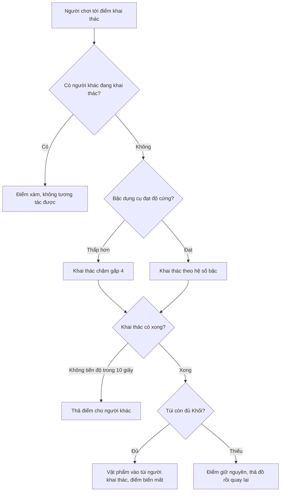
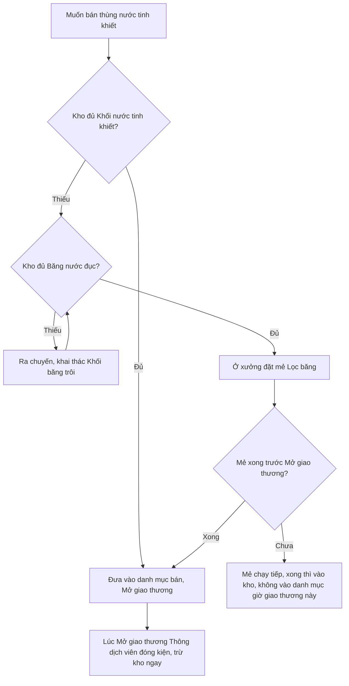

## II.5. Items and Crafting

Mục này nói về mọi thứ người chơi nhặt, chế, mang và bán: tài nguyên ngoài không gian, mẫu Driftlife, dụng cụ, vật tiêu hao, công thức ở xưởng và hàng hóa đóng thùng cho cảng. Nó là cầu nối giữa nửa đi ra ngoài (xem mục Map and Expeditions và mục Combat and Driftlife) và nửa ở trạm (xem mục Station and Port và mục Economy and Progression), nên mọi thứ nhặt về đều có chỗ dùng nhìn thấy được. Ai cần biết một món đồ đi từ đâu tới đâu, hay vì sao túi luôn chật, nên đọc mục này.

### II.5.1. Overview

Trong chuyến, người chơi khai thác **điểm khai thác** (mảnh vỡ, mạch quặng, khối băng, hòm kỹ thuật) và hạ hoặc bắt sống Driftlife, rồi nhét thứ nhặt được vào túi. Túi nhỏ và Oxy hữu hạn, nên mỗi lần nhặt là một lựa chọn "món này có đáng chỗ không". Về trạm, đồ trong túi tự chuyển sang kho chung.

Ở trạm, vật phẩm có ba đường tiêu. Đường một là sửa khoang và lắp động cơ. Đường hai là chế ở xưởng thành vật liệu chế, vật tiêu hao, dụng cụ và nâng cấp bộ đồ. Đường ba là đóng thành thùng bán cho tàu ở giờ giao thương. Không có vật phẩm nào chỉ để bán lấy số: thứ nào cũng có ít nhất một nơi tiêu, và không công thức nào tạo ra tài nguyên thô từ hư không. Chương 1 chỉ dùng dải Gần.

### II.5.2. Resources and Salvage Nodes

Dải Gần có sáu tài nguyên thô. **Khối** là đơn vị chiếm chỗ trong túi, **GTĐ** (giá trị tương đối) là thước đo giá trị nội bộ của vật phẩm, không phải Tally. Giá Tally của hàng nằm ở mục Economy and Progression.

| Tài nguyên | Nhóm | Độ hiếm | Khối | GTĐ |
|---|---|---|---|---|
| Mảnh vỏ Cradle | Phế liệu | Thường | 1 | 1,0 |
| Dây cáp đứt | Phế liệu | Thường | 1 | 1,2 |
| Quặng sắt thiên thạch | Khoáng | Thường | 2 | 2,2 |
| Bo mạch cháy | Linh kiện | Ít gặp | 1 | 3,0 |
| Băng nước đục | Băng | Thường | 2 | 2,0 |
| Đồ Trái Đất vụn | Phế liệu | Ít gặp | 1 | 2,5 |

Đồ hiếm đáng chỗ trong túi hơn đồ thường. Mỗi điểm khai thác nhả vật phẩm theo bảng rơi có trọng số: mỗi lần quay chọn một dòng theo trọng số rồi cho số lượng ghi ở dòng đó. Số lần quay cố định theo loại điểm. Điểm sinh lại mỗi chuyến, không cạn giữa các chuyến, và chỉ biến mất trong chuyến sau khi khai thác xong.

| Điểm khai thác | Dụng cụ | Độ cứng hoặc cấp khóa | Giây (bậc 1) | Lần quay | Bảng rơi (trọng số, số lượng mỗi lần) |
|---|---|---|---|---|---|
| Mảnh vỡ trôi | Tay | 0 | 1,6 | 1 | Mảnh vỏ Cradle 60 x1, Dây cáp đứt 40 x1 |
| Mạch quặng sắt | Dụng cụ khai thác | 1 | 8,0 | 1 | Quặng sắt 100 x2 |
| Khối băng trôi | Dụng cụ khai thác | 1 | 7,0 | 1 | Băng nước đục 100 x2 |
| Hòm kỹ thuật vỡ | Dụng cụ khai thác | 1 | 6,0 | 2 | Bo mạch cháy 30 x1, Dây cáp đứt 30 x2, Mảnh vỏ Cradle 25 x2, Đồ Trái Đất vụn 15 x1 |
| Tấm vỏ lớn | Dụng cụ khai thác | 1 | 14,0 | 3 | Mảnh vỏ Cradle 100 x2 |
| Hòm kỹ thuật Seed (map nhánh) | Dụng cụ khai thác | 1 | 8,0 | 3 | Bo mạch cháy 35 x1, Dây cáp đứt 25 x2, Mảnh vỏ Cradle 25 x2, Đồ Trái Đất vụn 15 x1 |
| Kho hàng Seed (map nhánh) | Dụng cụ khai thác | 2 | 12,0 | 3 | Bo mạch cháy 35 x1, Quặng sắt 35 x1, Đồ Trái Đất vụn 30 x1 |

Một dụng cụ khai thác dùng chung cho cả khoan khoáng, băng và nạy hòm. Bậc dụng cụ thấp hơn độ cứng thì vẫn làm được nhưng chậm gấp 4, bằng hoặc cao hơn thì nhanh theo hệ số bậc:
```text
ThoiGianKhai = GiayBac1 * 4            (khi BacDungCu < DoCung)
ThoiGianKhai = GiayBac1 / HeSoBac      (khi BacDungCu >= DoCung)
```
- giaybac1: thời gian khai thác ở bậc 1, đơn vị giây, lấy từ bảng trên.
- hesobac: hệ số tốc độ theo bậc dụng cụ, bậc 1 là 1,0 và bậc 2 là 1,4, không đơn vị.
- docung: độ cứng của vật liệu hoặc cấp khóa của hòm, từ 0 tới 3.

Ví dụ kho hàng Seed có độ cứng 2. Phép tính từ số của nguồn, không phải số cân bằng mới:
- Ở bậc 1: 12 x 4 = 48 giây.
- Sau nâng cấp Dụng cụ khai thác lên bậc 2: khoảng 8,6 giây.


*Hình II.5.1 - Một lần khai thác điểm: giữ điểm, cổng mềm theo bậc dụng cụ, túi đầy*

Đọc sơ đồ: người đến trước giữ điểm, người sau chỉ thấy điểm xám. Dụng cụ yếu không khóa người chơi lại, chỉ làm chậm, đây là cổng mềm. Hết 10 giây không có tiến độ thì điểm được thả. Khai thác xong thì vật phẩm vào túi của chính người khai thác nếu còn chỗ. Hết chỗ thì điểm giữ nguyên, người chơi thả bớt đồ rồi làm tiếp, và tiến độ bị hủy nếu bỏ đi.

Chi tiết dữ liệu: tab Salvage trên Sheet GDD, mỗi điểm khai thác có khối Type, Characteristic, Attribute, Resource Output, Spawn Point.

### II.5.3. Carrying and Storage

Vật phẩm nằm ở chỗ khác nhau tùy nhóm:

| Nhóm | Ví dụ | Chứa ở đâu | Chiếm Khối |
|---|---|---|---|
| Tài nguyên thô, mẫu đã hạ, vật tiêu hao | Mảnh vỏ Cradle, Lưới cuộn | Túi trong chuyến, kho ở trạm | Có |
| Vật nhiệm vụ | Mảnh lõi dẫn đường | Túi như vật thường | 1 Khối |
| Mẫu sống cỡ S | Driftmoth bắt được | Lồng mẫu kéo theo | Không |
| Kiện | Kiện phế liệu | Kho ở trạm, không có ngoài trạm | Không |
| Dụng cụ, nâng cấp bộ đồ | Lao từ, Bình Oxy bậc 1 | Mở khóa cho cả nhóm, không vào kho | Không |

Túi tính bằng Khối. Túi đầy thì không nhặt thêm được. Người chơi thả vật phẩm xuống để nhặt lại trong một khoảng ngắn, thả tối đa một lần mỗi giây. Kho dùng chung cả nhóm, giới hạn mỗi loại là 999 đơn vị, không giới hạn số loại. Sức chứa túi theo bậc:

| Bậc túi | Sức chứa (Khối) | Mở ở MVP |
|---|---|---|
| 0 | 80 | Khởi điểm |
| 1 | 100 | Chương 1 |

Khi Oxy về 0 rồi hết khoảng ngạt, người chơi bị kéo về trạm. Lúc đó người chơi giữ lại đúng một món do mình ghim, mặc định là vật hiếm nhất vừa nhặt, và mất phần còn lại của túi. Lồng mẫu chỉ giữ con có sao cao nhất. Vật nhiệm vụ mất theo túi nhưng không mất vĩnh viễn: nó về vị trí gốc ở map nhánh và có lại ở chuyến sau. Vật manh mối của truyện tự ghi vào Sổ tay khi nhặt, không chiếm túi và không thể mất.

Chi tiết dữ liệu: tab ITEM LIST trên Sheet GDD, cột Nguồn nhận và Nguồn tiêu.

### II.5.4. Driftlife Samples

Mỗi Driftlife có ba lựa chọn: hạ, bắt sống hoặc né. Hạ cho nguyên liệu sinh học của dải (mô sinh học Gần, số lượng theo loài) và có xác suất rơi **đặc sản** của loài đó. Bắt sống cho mẫu sống, chỉ với loài cỡ S và M. Ở MVP, loài cỡ S bắt bằng Súng lưới vào Lồng mẫu, xem mục II.4.

| Loài | Cỡ | Xác suất đặc sản khi hạ | Giá mẫu sống so với hạ | MVP |
|---|---|---|---|---|
| Driftmoth | S | 0,30 | 1,50 lần | Hạ và bắt sống |
| Skitter Ray | S | 0,40 | 1,50 lần | Hạ và bắt sống |
| Sting Krill | S | 0,20 | 1,60 lần | Hạ và bắt sống |
| Arc Eel | M | 0,60 | 1,50 lần | Chỉ hạ |

Cột giá ở trên và thước nghiệm thu K9 đo hai thứ khác nhau. Sàn giá đặt cao hơn để K9 ròng vẫn đạt:

| Thước | Tính thế nào | Giá trị |
|---|---|---|
| Sàn giá mẫu sống so với hạ | Giá mẫu sống chia giá hạ, chưa trừ vật tiêu hao | 1,5 trở lên |
| K9 | Giá trị ròng sau khi trừ vật tiêu hao tốn cho lần bắt | Mục tiêu 1,2 tới 2, sim đo 1,44 tới 1,81 |

Bắt sống luôn đáng hơn hạ, kể cả sau khi trừ vật tiêu hao tốn cho lần bắt. Đổi lại bắt sống chậm hơn và rủi ro hơn. Mẫu sống một sao cũng không rẻ hơn nguyên liệu hạ hai sao của cùng loài. Chất lượng mẫu chia ba bậc sao, hệ số giá trị tương ứng:

| Sao | Điều kiện (mẫu sống) | Hệ số giá trị |
|---|---|---|
| 3 sao | Sinh lực còn từ 70% lúc bắt | 1,5 |
| 2 sao | Sinh lực từ 30% tới dưới 70% | 1,25 |
| 1 sao | Sinh lực dưới 30% | 1,0 |

Hạ thường cho một sao, kết nhanh con đang bất lực cho hai sao. Mẫu sống ở MVP có hai nơi tiêu: đưa vào lồng giao để bán ở giờ giao thương, hoặc để dành cho nuôi và nghiên cứu ở các chương sau. Mẫu đã hạ có nguồn tiêu thô: kiện mô sinh học, kiện đặc sản, vật liệu cho Lưới cuộn. Boss Scrapmaw rơi hạch nếu bị hạ hoặc mẫu boss nếu bị xua đi, một trong hai dùng để sửa động cơ giai đoạn đầu.

Chi tiết dữ liệu: tab ITEM LIST, các dòng đặc sản, mẫu sống và loài ở dải Gần.

### II.5.5. Tools and Suit Upgrades

Dụng cụ là trang bị mở khóa cho cả nhóm. Chế một lần ở xưởng, mọi người đều dùng được, mỗi người tự chọn dụng cụ mang theo. Dụng cụ không có độ bền. Chi phí dùng dụng cụ là vật tiêu hao hoặc thời gian hồi.

| Dụng cụ | Vai trò | Cách có ở MVP |
|---|---|---|
| Dụng cụ khai thác | Khoan khoáng và băng, nạy hòm | Có từ đầu |
| Lao từ | Hạ, đòn tầm xa dùng thời gian hồi | Có từ đầu |
| Dùi xung | Choáng cận chiến | Chế sau quest của Kỹ sư |
| Súng lưới | Bắt sống cỡ S, tốn Lưới cuộn | Chế sau quest của Kỹ sư |
| Lồng mẫu | Chứa tối đa 3 mẫu sống cỡ S, mỗi người một lồng | Chế sau quest của Kỹ sư |
| Bộ kích nguồn | Chìa mở cửa khóa nguồn ở Station Cinder | Công thức đầu tiên của xưởng sau khi vớt Kỹ sư |

Lồng mẫu và chìa không chiếm ô đai. Bộ kích nguồn là cổng cứng: chưa chế thì lối đó không mở, nhưng không phải mang theo, ai trong nhóm tương tác với cửa cũng mở được. Số ô dụng cụ theo Đai dụng cụ:

| Bậc Đai dụng cụ | Số ô |
|---|---|
| 0 | 3 |
| 1 | 4 |

Bộ khởi điểm chiếm hai ô, ô còn lại chờ Dùi xung hoặc Súng lưới. Chỉ số combat từng dụng cụ nằm ở mục Combat and Driftlife.

Người chơi cũng mang **vật tiêu hao** vào túi. Ở MVP có hai loại:
- Bình Oxy nhỏ hồi 40 điểm Oxy trong 1,5 giây cho chính người dùng, tối đa 2 bình trong túi mỗi chuyến, tức tối đa 80 Oxy mỗi chuyến.
- Lưới cuộn là đạn của Súng lưới, mỗi lần chế ra 10 viên.

Nâng cấp bộ đồ và dụng cụ ở MVP có sáu món. Mỗi món chủ yếu dùng vật liệu chế, thêm Tally ở tab Upgrade (xem mục Economy and Progression):

| Nâng cấp | Hiệu ứng (chi tiết ở mục II.2 và II.4) | Vật liệu |
|---|---|---|
| Bình Oxy bậc 1 | Bình Oxy lớn hơn | 4 Tấm thép nén, 2 Khối nước tinh khiết |
| Túi đồ bậc 1 | Túi 100 Khối | 3 Dây dẫn bện, 2 Tấm thép nén, 2 Dây cáp đứt |
| Bộ đẩy bậc 1 | Bộ đẩy mạnh hơn | 2 Thỏi sắt, 1 Mạch phục hồi, 1 Tấm thép nén |
| Dụng cụ khai thác bậc 2 | Khai thác nhanh hơn, hệ số 1,4 | 2 Thỏi sắt, 2 Tấm thép nén, 1 Dây dẫn bện |
| Lao từ bậc 2 | Đòn mạnh hơn | 2 Thỏi sắt, 1 Mạch phục hồi, 1 Dây dẫn bện |
| Đai dụng cụ bậc 1 | Thêm một ô dụng cụ, đi kèm Dùi xung | 2 Tấm thép nén, 2 Dây dẫn bện, 1 Thỏi sắt |

Oxy hồi từ vật tiêu hao không quá 25% dung lượng bình trong một chuyến và không dùng được khi đang ngạt, để Oxy vẫn là áp lực chính của chuyến. Nâng cấp bậc cao hơn dải đã mở thì không cho, công thức bậc đó mở cùng dải.

Chi tiết dữ liệu: tab Recipe cho công thức chế dụng cụ, tab Upgrade cho nâng cấp và giá, tab ITEM LIST cho vật tiêu hao.

### II.5.6. Crafting at the Workshop

Xưởng mở sau khi Kỹ sư tỉnh và khoang xưởng được sửa (xem mục Station and Port). Công thức vật liệu chế mở theo vai và theo chương, không cần bản thiết kế. Chương đầu có năm vật liệu chế, mỗi cái luyện từ tài nguyên thô:

| Vật liệu chế | Đầu vào | Thời gian (giây) | Hệ số GTĐ |
|---|---|---|---|
| Tấm thép nén | 3 Mảnh vỏ Cradle | 10 | 1,30 |
| Dây dẫn bện | 3 Dây cáp đứt | 8 | 1,30 |
| Thỏi sắt | 2 Quặng sắt thiên thạch | 15 | 1,35 |
| Mạch phục hồi | 2 Bo mạch cháy, 1 Dây cáp đứt | 20 | 1,45 |
| Khối nước tinh khiết | 2 Băng nước đục | 12 | 1,30 |

Luyện luôn có lời so với bán thô, nhưng chỉ vừa phải để người chơi không bỏ qua mọi thứ khác:
```text
GTDra = GTDvao * HeSoChuoi
```
- gtdra: giá trị của đầu ra, đơn vị GTĐ.
- gtdvao: tổng giá trị của đầu vào, đơn vị GTĐ.
- hesochuoi: hệ số chuỗi, vật liệu chế từ 1,25 tới 1,5, không đơn vị. Ví dụ ba Mảnh vỏ Cradle (3,0 GTĐ) ép thành một Tấm thép nén (3,9 GTĐ), hệ số 1,30.

Chế có hai kiểu thời gian:
- Chế nhanh, không quá 20 giây, làm ở xưởng ngoài giờ giao thương. Vật liệu chế và vật tiêu hao thuộc kiểu này. Thời gian một mẻ theo từng công thức ở tab Recipe, ví dụ Lọc băng mất mười hai giây. Mẻ chạy nền theo thời gian thực, người chơi không phải đứng ở xưởng, kể cả khi đã ra chuyến.
- Chế qua đêm, đặt vào hàng đợi rồi nhận sau khi ngủ. Dụng cụ và nâng cấp bộ đồ luôn thuộc kiểu này.

Xưởng cấp đầu giữ hàng đợi hai chỗ, xếp theo thứ tự người chơi đặt. Mẻ thiếu vật liệu thì không bắt đầu và không trừ nguyên liệu. Trong giờ giao thương không chế. Ngủ khi hàng đợi chưa xong thì hàng đợi hoàn thành khi sang ngày, không có hàng đợi chạy khi người chơi thoát game.

Hàng cần chế duy nhất của chương 1 là kiện nước tinh khiết, nên đây là luồng người chơi dễ đi sai nhất:


*Hình II.5.2 - Đường đi của một thùng nước tinh khiết, từ khối băng ngoài chuyến tới lúc Mở giao thương*

Đọc sơ đồ: người chơi muốn bán nước tinh khiết thì phải có sẵn Khối nước tinh khiết trong kho. Thiếu thì lùi một bước: có đủ băng nước đục thì chế tại xưởng, thiếu băng thì ra chuyến khai thác Khối băng trôi. Mẻ chế xong sau lúc Mở giao thương không kịp danh mục của giờ giao thương đó, người chơi phải lên kế hoạch từ buổi sáng. Hàng đã nằm trong kho là hàng bán được, hàng còn trong túi người ở ngoài chưa tính.

Chi tiết dữ liệu: tab Recipe trên Sheet GDD, mỗi công thức có khối Type, Ingredients, Output, Unlock.

### II.5.7. Cargo and Crates

Kiện là đơn vị hàng trong kho, thùng là đơn vị bán trong giờ giao thương, và một kiện đổi ra 2,5 thùng. Kiện không đóng bằng tay trong giờ giao thương. Lúc Mở giao thương, Thông dịch viên đóng kiện tự động cho cả danh mục, không tốn thời gian giờ giao thương. Riêng lồng sinh vật sống do người chơi làm ở cảng trước Mở giao thương, thời gian làm ở bảng dưới, lồng nhớ loài và sao của mẫu bên trong. Lồng không chia thùng, một lồng là một đơn vị bán.

Chương đầu có chín loại kiện, chia theo cách đóng:

| Kiện | Đầu vào mỗi kiện | Loại |
|---|---|---|
| Kiện phế liệu | 14 Mảnh vỏ Cradle | Thô |
| Kiện cáp | 11 Dây cáp đứt | Thô |
| Kiện quặng | 6 Quặng sắt thiên thạch | Thô |
| Kiện băng | 7 Băng nước đục | Thô |
| Kiện mô sinh học | 9 Mô sinh học Gần | Thô |
| Kiện đồ Trái Đất | 5 Đồ Trái Đất vụn | Thô |
| Kiện nước tinh khiết | 2 Khối nước tinh khiết | Tinh, có bước chế trước |
| Kiện đặc sản Gần | 3 đặc sản, mỗi cái của một trong các loài Gần | Sinh học |
| Lồng sinh vật sống Gần | 1 mẫu sống cỡ S | Sống, làm tay trước Mở giao thương, 8 giây |

Kiện thô đóng thẳng từ tài nguyên thô, hệ số giá trị đúng 1,0 vì chỉ đóng gói. Kiện tinh làm từ vật liệu chế nên có thêm giá trị. Lồng mang đúng giá trị mẫu bên trong nhân hệ số sao:
```text
SoKienCan = LamTronLen(SoThungDanhMuc / 2,5)
SoDonViTho = SoKienCan * DauVaoMoiKien
GTDLong = GTDMauSong * HeSoSao
```
- sothungdanhmuc: số thùng của một loại hàng trong danh mục bán, đơn vị thùng.
- sokiencan: số kiện phải đóng, đơn vị kiện, làm tròn lên.
- dauvaomoikien: số đơn vị đầu vào của một kiện ở bảng trên, đơn vị cái.
- hesosao: 1,0 và 1,25 và 1,5 theo 1, 2, 3 sao.
- Ví dụ danh mục 5 thùng phế liệu cần 2 kiện, tức 28 Mảnh vỏ Cradle trừ khỏi kho lúc Mở giao thương.

Hết nguyên liệu lúc Mở giao thương thì loại hàng đó đóng được bao nhiêu thùng thì bày bấy nhiêu, không trừ nguyên liệu của thùng không đóng. Thùng thừa và thùng chưa bán ở lại kho cho giờ giao thương sau, không hỏng. Vật kể chuyện không bán cho tàu. Giá Tally của từng loại thùng và bậc giá hàng nằm ở mục Station and Port và mục Economy and Progression.

Chi tiết dữ liệu: tab ITEM LIST và tab Recipe cho kiện, tab Shop cho giá.

### II.5.8. Two-player Co-op and Acceptance Criteria

Mọi luật vật phẩm chạy đúng với một người, co-op chỉ thay các điểm sau:
- Kho, bản thiết kế, cấp dụng cụ, cấp nâng cấp bộ đồ và hàng đợi xưởng là dùng chung. Túi, dụng cụ đang mang và vật tiêu hao đang mang là riêng từng người.
- Mỗi người một Lồng mẫu. Mỗi điểm khai thác chỉ một người khai thác cùng lúc, người đến trước giữ điểm.
- Số điểm khai thác trên map tăng theo số người (xem mục II.3), không tăng lượng nhả của từng điểm. Ví dụ ở dải Gần, k(2) = 1 + 0,30 x (2 trừ 1) = 1,30.
- Người vào sau nhận mọi dụng cụ và nâng cấp đã mở, túi rỗng. Khách mất kết nối được giữ chỗ 15 giây, quá hạn thì tính như bị kéo về và chỉ giữ 1 món.
- Kho, hàng đợi, nâng cấp đồng bộ qua host. Khai thác điểm cần host xác nhận để chống nhân đôi vật phẩm.

Mục tiêu đo của hệ thống và kết quả sim đã có:

| Chỉ số | Mục tiêu | Kết quả sim |
|---|---|---|
| Thời gian làm đầy túi, chương 1 | 60 tới 70% thời gian chuyến | Chờ playtest |
| Tỉ lệ chuyến dùng đủ khoan, nạy hòm và hạ Driftlife, chương 1 | Trên 90% | Chờ playtest |
| Tỉ lệ kiện tinh trên kiện thô khi đủ nguyên liệu, sau chương 1 | Trên 50% | Chờ playtest |
| Giá mẫu sống so với hạ, cỡ S, đã trừ vật tiêu hao | 1,2 tới 2 lần | 1,44 tới 1,81 lần qua lưới |
| Một chuyến, một người, chương 1 | 4 tới 6 phút | 4,4 phút |
| Vật liệu 6 việc sửa khoang và 6 nâng cấp nhãn MVP | Không có mục tiêu riêng | 272,2 GTĐ, bằng khoảng 3,1 chuyến đầy túi bậc 0 |

Cổng kiểm máy của dữ liệu vật phẩm hiện báo 0 lỗi, kiểm ID duy nhất, đầu vào công thức có trong danh sách vật phẩm và mọi vật phẩm có nguồn nhận lẫn nguồn tiêu. Việc người chơi có hiểu vì sao món này đáng nhặt và bỏ gì khi túi đầy thì sim chưa đo được, chờ playtest trên build.

Chi tiết dữ liệu: tab Salvage, ITEM LIST, Recipe trên Sheet GDD.

### II.5.9. Edge Cases

| Tình huống | Phán quyết |
|---|---|
| Túi đầy, nhặt thêm | Không nhặt được, hiện cảnh báo "túi đầy" và số Khối còn thiếu |
| Kho đạt 999 một loại | Phần thừa khi về trạm bị bỏ tự động và hiện thông báo |
| Hai người cùng khai thác một điểm | Người đến trước giữ, người sau thấy điểm xám |
| Người giữ điểm đứng im không khai thác | Sau 10 giây không có tiến độ thì thả điểm |
| Thả vật nhiệm vụ xuống | Vật nằm 30 giây, không ai nhặt thì về vị trí gốc |
| Bị kéo về khi túi rỗng | Không có món để giữ, vẫn tính chuyến kết thúc |
| Hết nguyên liệu lúc Mở giao thương | Đóng được bao nhiêu thùng thì bày bấy nhiêu, không trừ phần không đóng |
| Công thức đòi một trong nhiều loài và kho có nhiều loài | Người chơi chọn loài dùng, giá trị tính theo loài rẻ nhất trong nhóm |
| Hai mẫu cùng loài, một sống một hạ | Hai vật phẩm khác nhau, không gộp |

### II.5.z. Post-MVP

- Dải Giữa và dải Xa: tài nguyên riêng, điểm khai thác mới, vật liệu chế và công thức luyện tương ứng.
- Nâng cấp bậc 2 trở lên cho Bình Oxy, Túi đồ, Bộ đẩy, Đai dụng cụ, Dụng cụ khai thác bậc 3, Lao từ bậc 3 và vỏ bộ đồ theo dải.
- Dụng cụ mới: Súng gây mê, Máy quét xung, Máy cắt thân tàu, cùng Phao kéo, Kim sinh thiết, Ống gây mê, Keo vá và Cầu chì dự phòng.
- Nghiên cứu mẫu sống ở phòng nghiên cứu để học bản thiết kế, và thức ăn nuôi cho khoang sinh quyển.
- Mẫu sinh thiết cho loài cỡ L, bắt sống cỡ M ngoài việc hạ Arc Eel.
- Kiện ngoài chương 1: kiện cơ khí, kiện điện tử, kiện sản phẩm nuôi, kiện vật tư, bản sao dữ liệu, kiện tin mật, kiện dải Giữa và dải Xa, kiện linh kiện Cradle và Warden.
- Lồng giao từ con nuôi, lồng sinh vật sống cỡ M, giá lồng theo loài dải Giữa và Xa.
- Linh kiện động cơ giai đoạn 2 tới 5 và vật liệu sửa các khoang chương 2 tới 5.
- Vật kể chuyện thứ hai trở đi và công thức ghép lõi dẫn hướng rời bãi vỡ.
