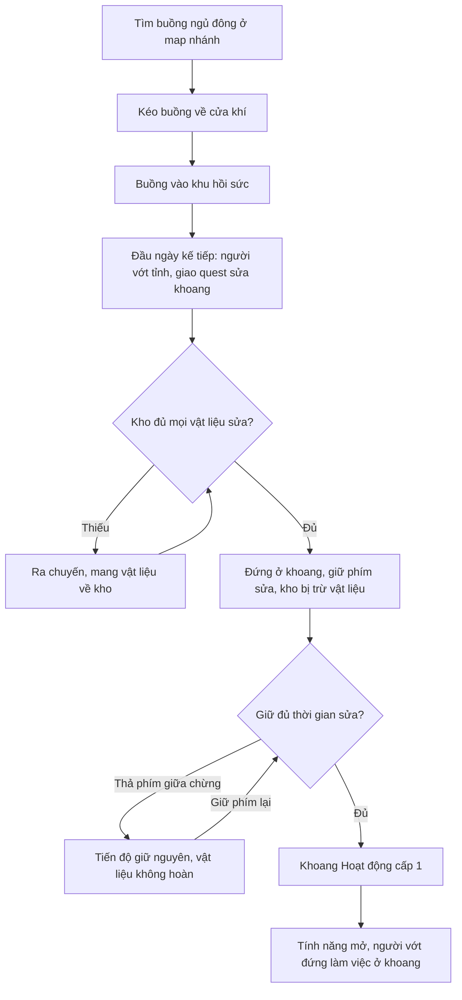
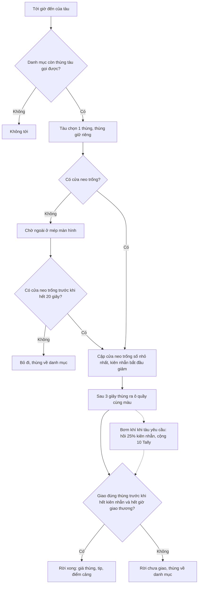

## II.6. Station and Port

Trạm và cảng là nửa ở nhà của The Novent. Ở đây người chơi biến thứ mang về từ chuyến ra ngoài thành tiến độ: sửa khoang để trạm sống lại, đánh thức người vớt để mở tính năng, và bán hàng cho tàu thương nhân ở giờ giao thương để lấy Tally. Mục này nối với mục Vật phẩm ở chỗ hàng nào bán được, với mục Kinh tế ở giá và nâng cấp, với mục Một ngày ở chỗ giờ giao thương là pha sau các chuyến. Ai cần hiểu vì sao người chơi muốn ra ngoài mỗi ngày nên đọc mục này.

### II.6.1. Overview

Người chơi sống trên **Station Ember**, trạm nhà bị hỏng neo giữa bãi vỡ. Trạm chia thành các **khoang**, mỗi khoang là một phòng chức năng. Khoang hỏng thì không dùng được. Người chơi mang vật liệu từ **chuyến**, tức một lần ra ngoài không gian rồi về, để sửa từng khoang. Sửa xong một khoang thì mặt cắt trạm đổi hình và trả lại một chức năng. Một số khoang chỉ sửa được khi có người phụ trách. Đó là **người vớt**, người sống sót còn nằm trong buồng ngủ đông ở các xác trạm ngoài kia. Người chơi tìm buồng, kéo về trạm, chờ người đó tỉnh, rồi sửa khoang của người đó để mở tính năng.

Khi khoang liên lạc và cảng đều chạy, mỗi ngày có một **giờ giao thương**, pha bán hàng cho tàu thương nhân. Trước giờ giao thương người chơi chọn hàng đem bán. Trong giờ giao thương tàu cập vào cảng, mỗi tàu gọi một món, người chơi chạy mang món đó tới đúng tàu trước khi tàu hết kiên nhẫn. Tiền bán và tiền thưởng theo tốc độ là **Tally**, đồng tiền duy nhất của game, dùng để nâng cấp bộ đồ và trạm cho các chuyến sau đi xa hơn. Giờ giao thương không có thua: tàu bỏ đi chỉ làm mất món của tàu đó, hàng quay về kho. Quyết định nặng nằm trước giờ giao thương (bán gì, bao nhiêu), trong giờ giao thương tay bận nhưng đầu nhẹ.

### II.6.2. Modules and Station Cross-section

Mỗi khoang ở một trong các trạng thái Hỏng, Hoạt động, Đang nâng cấp. Khoang Hỏng không có chức năng nhưng vẫn đi qua được. Khoang đang nâng cấp vẫn dùng được chức năng của cấp hiện tại. Khoang Hoạt động không tự hỏng lại, trạm không xấu đi khi người chơi nghỉ.

Bản MVP gồm các khoang của chương 1:

| Khoang | Chức năng | Người phụ trách |
|---|---|---|
| Buồng ngủ đông và khu hồi sức | Ngủ sang ngày, lưu. Khu hồi sức giữ buồng của người vớt chờ tỉnh và của người chơi vào sau | Có sẵn |
| Cửa khí | Ra và về chuyến, nạp đầy Oxy khi chuyến kết thúc, tối đa 2 chuyến mỗi ngày | Có sẵn |
| Kho | Chỗ chứa đồ chung, không giới hạn số lượng | Có sẵn |
| Khoang neo | Hãm trôi và neo trạm, việc sửa đầu tiên của game | Có sẵn |
| Xưởng | Chế và nâng cấp trang bị, chế trước hàng cảng cần chế | Kỹ sư |
| Khoang liên lạc | Bảng tàu, lập danh mục bán, mở giờ giao thương, shop | Thông dịch viên |
| Cảng | Bến 1 có 3 cửa neo và quầy cảng, nơi diễn ra giờ giao thương | Thông dịch viên |
| Động cơ chính | Tiến độ rời neo, MVP có giai đoạn 1 | Có sẵn, đang hỏng |

Kho có một nâng cấp ngay trong chương đầu là kho cấp 2, sửa bằng phế liệu và khoáng dải Gần. Mọi nâng cấp khoang khác thuộc bản đủ.

Trạm được nhìn theo mặt cắt ngang ba tầng, hai thang dọc nối các tầng:
- Tầng giữa là nơi người chơi qua lại nhiều nhất: buồng ngủ đông, xưởng, kho, quầy cảng, và bến 1 ở mép phải với 3 cửa neo nằm ngang nối tiếp.
- Tầng dưới có cửa khí, khoang neo, động cơ chính. Tầng trên có khoang liên lạc.
- Quầy cảng nằm ngay trái cửa neo 1, nên cửa neo càng xa thì đường chạy càng dài. Demo đo khoảng 1,1, 1,7 và 2,3 giây từ quầy tới cửa neo 1, 2, 3.

[CHỜ ẢNH: mặt cắt trạm chương 1, chụp từ build hoặc lấy khung từ Figma trang Wireframe MVP]
*Hình II.6.1 - Mặt cắt Station Ember, ba tầng, cảng ở mép phải tầng giữa*

Chi tiết dữ liệu: tab Customer trên Sheet GDD, khối Khoang trạm.

### II.6.3. Module Repair and Main Engine

Muốn sửa một khoang, mọi vật liệu trong danh sách sửa phải nằm sẵn trong kho. Người chơi đứng ở khoang và giữ phím sửa trong thời gian sửa (số khởi điểm 5 giây, chưa đo). Vật liệu bị trừ khỏi kho ngay lúc bắt đầu giữ phím. Thả phím giữa chừng thì tiến độ giữ nguyên, vật liệu không hoàn lại, giữ phím lại thì làm tiếp. Kho thiếu một vật liệu thì không bắt đầu được, khung khoang liệt kê thứ còn thiếu.

Sửa xong thì khoang sang Hoạt động cấp 1, mặt cắt đổi hình khoang đó và người phụ trách đứng làm việc tại chỗ. Đồ trong túi đồ tự vào kho khi người chơi qua cửa khí về trạm, nên vòng sửa khoang luôn là: ra chuyến, về kho, sửa. Khoang neo là khoang đầu tiên sửa được. Trước khi khoang neo Hoạt động, chỉ cửa khí, kho và buồng ngủ đông dùng được, và trạm trôi chậm trên nền. Sửa xong khoang neo thì trạm đứng yên tới hết game. Vật liệu sửa các khoang chương đầu là phế liệu, khoáng và linh kiện của dải Gần. Khoang neo và xưởng chỉ dùng tài nguyên thô, vì chưa có xưởng thì chưa chế được gì.

**Động cơ chính** là mục tiêu dài nhất của trạm. Động cơ có năm giai đoạn, mỗi chương mở đúng một giai đoạn, sửa một giai đoạn giống sửa khoang. Xong giai đoạn thì động cơ sáng thêm một phần. Giai đoạn đầu cần tài nguyên dải Gần, một hạch hoặc một mẫu của boss Scrapmaw, và linh kiện Van tiết lưu mua ở shop. Mốc đóng chương của truyện chỉ kích hoạt khi giai đoạn động cơ của chương đã lắp, trạm không có cổng chương riêng.

Chi tiết dữ liệu: tab Customer khối Khoang trạm, tab Upgrade và ITEM LIST cho danh sách và số lượng vật liệu.

### II.6.4. Waking the Survivors

Mỗi người vớt nằm trong một **buồng ngủ đông** còn chạy ở một **map nhánh**, khu dựng tay vào qua một lối trong map tổng. Người chơi tìm buồng và kéo buồng về cửa khí của trạm. Buồng qua cửa khí thì đặt vào khu hồi sức. Người vớt tỉnh vào đầu ngày kế tiếp và giao quest mở: sửa khoang của chính người đó. Sửa xong thì tính năng mở.

| Người vớt | Khoang phải sửa | Tính năng khi mở |
|---|---|---|
| Kỹ sư (Ingrid Halvorsen) | Xưởng | Chế dụng cụ cơ bản, chế trước Khối nước tinh khiết cho hàng cảng, nâng cấp bộ đồ bậc 1 |
| Thông dịch viên (Linh Tran) | Khoang liên lạc và cảng | Bảng tàu, lập danh mục bán, tự đóng thùng lúc Mở giao thương, giờ giao thương, shop |

Quest của Thông dịch viên là sửa cả hai khoang, vì giờ giao thương chỉ có khi khoang liên lạc và cảng đều Hoạt động. Người vớt không chết, không rời trạm, không cần ăn, và không phải nhân vật người chơi.


*Hình II.6.2 - Vòng đánh thức người vớt và sửa khoang*

Đọc sơ đồ: người chơi gặp buồng ngủ đông trong một chuyến ở map nhánh và kéo nó về cửa khí. Buồng nằm ở khu hồi sức qua đêm, sáng hôm sau người vớt tỉnh và giao quest. Nếu kho chưa đủ vật liệu, người chơi phải ra thêm chuyến, đây là cách quest đẩy người chơi ra ngoài. Đủ vật liệu thì giữ phím sửa. Thả phím không làm mất tiến độ, chỉ là vật liệu đã trừ thì không lấy lại. Giữ đủ thời gian thì khoang sáng lên, người vớt vào vị trí và tính năng mở.

Chi tiết dữ liệu: tab Customer khối Người vớt mở tính năng.

### II.6.5. Trade Hour Preparation: Ship Board and Sales Catalog

Mọi việc trước giờ giao thương làm ở **bảng tàu** của khoang liên lạc, mở được từ đầu ngày tới lúc Mở giao thương. Bảng tàu cho biết số tàu dự kiến, loại tàu ghé hôm nay và chúng hay gọi gì, đơn đặt trước, số thùng kho làm được và giá thùng từng loại hàng. Buổi sáng người chơi đọc bảng tàu để biết nên mang gì về, tối lập danh mục từ thứ đã mang về. Bảng tàu không chọn hộ.

**Danh mục bán** là các loại hàng và số thùng người chơi đưa ra bán trong giờ giao thương:
- Chương 1 cho tối đa 4 loại hàng. Mỗi loại đặt số thùng từ 1 tới số thùng kho làm được.
- Danh mục nháp được giữ tới khi Mở giao thương, kể cả khi thoát bảng tàu. Danh mục rỗng thì không Mở giao thương được.
- Bảng tàu cảnh báo khi tổng thùng ít hơn số tàu, vì giờ giao thương có thể kết thúc sớm.

**Thùng** là đơn vị bán trong giờ giao thương, bằng 0,4 **kiện**, đơn vị hàng trong kho và trong kinh tế:
```text
SoThung = SoKien * 2,5 (làm tròn xuống)
GiaThung = GiaKien / 2,5
```
- SoKien: số kiện của một loại hàng kho làm được theo công thức chế của mục Vật phẩm, đơn vị kiện.
- SoThung: số thùng tối đa của loại hàng đó được đưa vào danh mục, đơn vị thùng. Lồng sinh vật sống không chia, một lồng là một thùng.
- GiaKien: giá một kiện ở tab Shop, đơn vị Tally.
- GiaThung: giá một thùng khi giao cho tàu, đơn vị Tally. Lồng tính giá theo loài bên trong.

| Hàng bán được ở MVP | Bậc giá | Độ gọi | Giá thùng (Tally) | Trước giờ giao thương phải có | Mở |
|---|---|---|---|---|---|
| Thùng phế liệu | Hàng chợ | 3 | 42 | Hàng trong kho | Chương 1 |
| Thùng cáp | Hàng chợ | 3 | 40 | Hàng trong kho | Chương 1 |
| Thùng quặng | Hàng chợ | 3 | 40 | Hàng trong kho | Chương 1 |
| Thùng băng | Hàng chợ | 3 | 42 | Hàng trong kho | Chương 1 |
| Thùng nước tinh khiết | Hàng chế | 1,5 | 64 | Khối nước tinh khiết chế xong ở xưởng | Chương 1 |
| Thùng đồ Trái Đất | Hàng hiếm | 1 | 76 | Hàng trong kho | Chương 1 |
| Thùng mô sinh học | Hàng sinh học | 2 | 54 | Hàng trong kho | Hạng cảng 3 |
| Thùng đặc sản Gần | Hàng hiếm | 1 | 80 | Hàng trong kho | Hạng cảng 3 |
| Lồng Driftmoth, Skitter Ray, Sting Krill | Hàng sống | 1 | 65, 75, 55 | Bắt sống trong chuyến | Chương 1 |

Độ gọi là trọng số để tàu chọn món, hàng rẻ được gọi nhiều hơn (xem mục II.6.6). Thùng nước tinh khiết là hàng cần chế duy nhất của chương đầu:
- Xưởng chạy một mẻ một lúc và giữ thêm mẻ chờ trong hàng đợi. Hàng đợi xưởng cấp 1 có 2 chỗ, tính cả mẻ đang chạy: một mẻ chạy cộng một mẻ chờ. Thời gian mỗi mẻ theo công thức ở tab Recipe.
- Mẻ chạy cả khi người chơi ra chuyến. Mẻ còn lúc ngủ thì xong khi sang ngày.
- Mẻ xong sau khi Mở giao thương thì vào kho, không vào danh mục giờ giao thương đó.
- Danh mục chỉ dùng hàng đã nằm trong kho. Hàng trong túi của người còn ở ngoài chưa dùng được.

Mở giao thương và Nghỉ giao thương chọn ở bảng tàu. Mỗi ngày có đúng một giờ giao thương, chọn một trong hai thì cửa khí khóa tới ngày mới:
- Nghỉ giao thương không bị phạt: tàu hôm đó không tới, kho giữ nguyên.
- Mở giao thương bị chặn khi còn người ở ngoài chuyến hoặc danh mục rỗng, nút Mở bán xám kèm lý do.
- Từ 2 người online, Nghỉ giao thương và Mở giao thương lúc nhóm chưa đi đủ 2 chuyến cần mọi người xác nhận. Không trả lời trong 30 giây tính là đồng ý.
- Lúc Mở giao thương, Thông dịch viên đóng thùng cả danh mục và trừ kho ngay, không tốn thời gian giờ giao thương. Trong giờ giao thương không chế, không đóng gì thêm.
- Số người online lúc Mở giao thương chốt số tàu của giờ giao thương. Người vào giữa giờ giao thương không đổi lịch.
- Giờ giao thương đầu tiên của thế giới là giờ giao thương hướng dẫn: danh mục chọn sẵn thùng phế liệu, người chơi chỉ bấm Mở giao thương, lịch có 2 tàu Loose Bolt, không có đơn đặt trước.

Toàn giờ giao thương từ bảng tàu buổi sáng tới cuối ngày vẽ ở mục II.1, phần Day Rules.

[CHỜ ẢNH: màn bảng tàu khi lập danh mục, lấy từ Figma The Novent trang Wireframe MVP hoặc chụp build]
*Hình II.6.3 - Màn bảng tàu khi lập danh mục*

Chi tiết dữ liệu: tab Customer khối Nhóm hàng cảng và khối Luật giờ giao thương, tab Shop cho giá thùng.

### II.6.6. During Trade Hour: Docking, Crate Delivery, Air Pumping

Giờ giao thương dài tối đa 300 giây. Tàu đầu tới ở giây thứ hai. Mọi tàu tới trong cửa sổ đến ở đầu giờ giao thương, phần còn lại của giờ giao thương để tàu cập cuối còn đủ kiên nhẫn được phục vụ.
```text
GianCachTrungBinh = 225 / SoTau
```
- GianCachTrungBinh: thời gian trung bình giữa hai tàu tới, đơn vị giây. Mỗi khoảng lệch ngẫu nhiên tới 22%.
- 225: cửa sổ đến, đơn vị giây, tính từ đầu giờ giao thương.
- SoTau: số tàu của giờ giao thương, đơn vị tàu. Chương 1 là 25 tàu khi chơi một người, 55 tàu khi hai người. Ví dụ 25 tàu thì giãn cách trung bình 9 giây, mỗi khoảng từ 7 tới 11 giây.

Tàu tới cảng theo các luật sau:
- Cảng MVP là **bến 1** với 3 **cửa neo**, mỗi cửa neo chứa một tàu. Tàu tới thì cập cửa neo trống có số nhỏ nhất.
- Mọi cửa neo bận thì tàu chờ ngoài ở mép màn hình, tối đa 20 giây, quá thì bỏ đi. Có cửa neo trống thì tàu chờ lâu nhất cập trước.
- Lúc tới, mỗi tàu chọn đúng 1 thùng trong các loại hàng còn thùng của danh mục và giữ riêng thùng đó. Danh mục không còn thùng nào tàu gọi được thì tàu không tới.
- Tàu cập thì món gọi hiện bằng bong bóng trên tàu. **Quầy cảng** có 3 ô, mỗi ô cùng màu một cửa neo. Thùng hiện ở ô cùng màu 3 giây sau khi tàu cập.
```text
TrongSoGoi = DoGoiBacGia * HeSoHayGoi
```
- TrongSoGoi: trọng số để tàu rút ngẫu nhiên một loại hàng, không đơn vị.
- DoGoiBacGia: độ gọi của bậc giá, Hàng chợ 3, Hàng sinh học 2, Hàng chế 1,5, Hàng sống 1, Hàng hiếm 1. Nguồn tab Shop.
- HeSoHayGoi: hệ số sở thích của loại tàu với nhóm hàng, mặc định 1. Loose Bolt có hệ số 6 với đồ Trái Đất. Nguồn tab Customer.

| Tàu | Thương nhân | Kiên nhẫn | Hệ số tip | Hay gọi | Món mê | Tần suất ghé | Mở |
|---|---|---|---|---|---|---|---|
| Loose Bolt | Tikko, người Oru, khách quen đầu tiên | Dài, 60 giây | 1 | Mọi hàng, rất hay gọi đồ Trái Đất | Đồ Trái Đất | 3 | Chương 1 |
| Tàu vội | Dân Oru vãng lai | Ngắn, 30 giây | 2 | Chỉ băng và khoáng | Không | 1 | Hạng cảng 2 |

Tần suất ghé là số thẻ mỗi loại tàu góp vào túi trộn khi sinh lịch, số lớn thì tàu đó hay có trong lịch hơn. Danh mục không có băng hay khoáng thì Tàu vội không tới, người chơi mất luôn phần tip gấp đôi của nó. Vì vậy khi lập danh mục người chơi phải cân giữa bán hàng đắt và giữ chỗ cho hàng mà tàu tip cao gọi.

**Kiên nhẫn** là thanh thời gian của tàu ở cửa neo. Thanh đầy lúc tàu cập và giảm 1 mỗi giây, lúc chờ ngoài thì chưa giảm. Hết kiên nhẫn thì tàu rời chưa giao. Mang thùng: người chơi tay trống nhặt thùng ở ô quầy. Mỗi lần mang một thùng, tốc độ chạy không đổi khi mang. Thùng đã nhặt không đặt xuống được, chỉ giao. Tới cửa neo nhấn tương tác để giao. Giao vào cửa neo khác thì tàu từ chối, thùng ở lại tay, kiên nhẫn không bị trừ thêm. Thứ tự xử lý khi giao ghi ở tab Customer khối Thứ tự khi giao.

**Bơm khí** là việc phụ hồi kiên nhẫn:
- Lúc cập, một nửa số tàu bật yêu cầu bơm khí ngay. Tàu chưa giao thì bật lại sau 10 tới 18 giây kể từ lúc cập hoặc lần bơm trước.
- Người chơi tay trống đứng ở cửa neo giữ tương tác 1 giây. Kiên nhẫn hồi 25% kiên nhẫn tối đa (không vượt tối đa) và cộng 10 Tally.
- Rời cửa neo trước 1 giây thì không tính. Bỏ qua yêu cầu không bị trừ gì.
- Bơm khí tranh khoảng chờ thùng ra quầy, nên người chơi luôn phải chọn: chạy về quầy trước hay bơm trước.


*Hình II.6.4 - Một tàu trong giờ giao thương, từ lúc tới giờ đến tới lúc rời*

Đọc sơ đồ: tới giờ đến, tàu chỉ xuất hiện nếu danh mục còn món nó gọi được, nếu không thì bảng tổng kết giao thương đếm nó vào tàu không tới. Tàu xuất hiện thì giữ ngay một thùng. Cảng đầy thì tàu chờ ngoài, lúc này đồng hồ chờ ngoài chạy còn kiên nhẫn đứng yên. Hết thời gian chờ ngoài mà chưa có chỗ thì tàu bỏ đi. Cập được thì kiên nhẫn bắt đầu giảm và ít giây sau thùng ra quầy. Nhánh đứt nét là bơm khí: không bắt buộc, nhưng kéo dài thời gian để giao. Giao đúng trước khi kiên nhẫn hoặc giờ giao thương hết thì tàu trả tiền và rời. Không kịp thì tàu rời tay không, thùng của nó quay lại danh mục cho tàu sau gọi.

[CHỜ ẢNH: màn giờ giao thương, chụp từ demo giờ giao thương trong thư mục tools/prototype hoặc từ build]
*Hình II.6.5 - Màn giờ giao thương: quầy ba ô, cảng với ba cửa neo, bong bóng món gọi và thanh kiên nhẫn*

Chi tiết dữ liệu: tab Customer, khối Loose Bolt, Tàu vội và khối Luật giờ giao thương.

### II.6.7. Tally, Tips and Pre-orders

Giao đúng thì tàu trả Tally ngay:
```text
TallyThung = GiaBan + Tip
GiaBan = GiaThung * HeSoDon
Tip = LamTron(GiaBan * 0,25 * KienNhanConLai * HeSoTip * HeSoMe) + 10 * SoLanBomKhi
```
- GiaThung: giá thùng ở tab Shop, đơn vị Tally.
- HeSoDon: 1,5 nếu thùng thuộc đơn đặt trước, còn lại là 1. Không đơn vị.
- 0,25: mức tip cơ sở, tối đa bằng 25% giá bán trước khi nhân hệ số tip và món mê. Tip có thể tới 50% giá bán, chưa kể tiền bơm khí.
- KienNhanConLai: phần kiên nhẫn còn lại lúc giao, từ 0 tới 1.
- HeSoTip: hệ số tip của loại tàu, Loose Bolt 1, Tàu vội 2.
- HeSoMe: 2 nếu là món mê của tàu (đồ Trái Đất với Loose Bolt), còn lại là 1.
- SoLanBomKhi: số lần bơm khí đã làm cho tàu này, mỗi lần 10 Tally, tính vào tip. LamTron là làm tròn tới Tally nguyên.

Tip là chỗ duy nhất tốc độ đổi ra Tally. Giá không nhân theo Hạng cảng, không nhân theo số người. Tàu chỉ mua hàng trong giờ giao thương. Người chơi mua hàng ở shop của khoang liên lạc vào cuối ngày.

**Đơn đặt trước** là thùng một tàu cụ thể đặt từ đầu ngày, giá cao, hiện ở bảng tàu. Đây là mối nối giữa hai nửa ngày: đọc đơn buổi sáng, chọn dải để mang đúng thứ đó về.
- Chương 1 có 1 đơn mỗi ngày, ở tàu thứ 9 của lịch, là Loose Bolt đặt thùng đồ Trái Đất.
- Từ ngày có Súng lưới, ngày chẵn đặt 1 lồng sống thay cho đồ Trái Đất.
- Lúc Mở giao thương, nếu danh mục có loại hàng đặt thì 1 thùng được giữ riêng cho đơn đó.
- Danh mục không có loại hàng đặt thì tàu đặt gọi món khác như tàu thường. Đơn không đạt, không có phạt ngoài mất phần giá cao.

Thất bại trong giờ giao thương luôn nhẹ. Tàu hết kiên nhẫn, tàu chờ ngoài quá hạn, hay tàu còn lại khi hết giờ giao thương chỉ mất món của tàu đó: không có giá, tip, điểm cảng cho tàu đó, không trừ Tally, không giảm Hạng cảng. Thùng của tàu về lại danh mục. Giờ giao thương kết thúc ở điều tới trước trong ba điều:
- Hết 300 giây. Tàu còn ở cửa neo rời ngay, tàu chờ ngoài bỏ đi.
- Tàu cuối của lịch đã rời.
- Danh mục hết thùng và không còn tàu ở cửa neo hay chờ ngoài.

Bảng tổng kết giao thương ghi số tàu phục vụ xong trên số tàu trong lịch, số tàu rời chưa giao, số tàu không tới vì hết hàng, Tally từ giá thùng và tip tách riêng, tổng Tally, điểm cảng, kết quả đơn đặt trước, số thùng về kho và lời một thương nhân. Thùng chưa bán về kho, giữ qua ngày, không hỏng. Bảng tổng kết giao thương không có chữ thất bại.

Chi tiết dữ liệu: tab Customer khối Luật giờ giao thương (Tally và tip, Đơn đặt trước, Thất bại, Kết thúc giờ giao thương), tab Shop.

### II.6.8. Port Rank

**Hạng cảng** là thang tiến trình duy nhất của cảng, gồm tám hạng, chung cả nhóm. Hạng tăng theo **điểm cảng** cộng dồn qua các giờ giao thương và không bao giờ giảm.
```text
DiemTau = 1 + Thuong
```
- DiemTau: điểm cảng một tàu phục vụ xong cho, đơn vị điểm. Tàu rời chưa giao, bỏ đi hay không tới cho 0 điểm.
- Thuong: 1 nếu lúc giao còn từ 2/3 kiên nhẫn trở lên, còn lại là 0.

Điểm không nhân theo số người, vì số tàu đã tăng theo số người. Đủ điểm ngưỡng thì lên hạng ngay sau bảng tổng kết giao thương. Mỗi chương có trần hạng: chạm trần thì điểm vẫn cộng dồn và lên hạng khi chương sau mở. Trần của chương đầu là hạng 3.

| Hạng | Điểm cảng cần | Mở |
|---|---|---|
| 1 | Khởi đầu | Loose Bolt, bến 1 với 3 cửa neo, danh mục 4 loại, shop danh mục cơ bản |
| 2 | 70 | Tàu vội |
| 3 | 135 | Danh mục bán được thùng mô sinh học và thùng đặc sản Gần. Shop bán Van tiết lưu cho động cơ giai đoạn 1 |

Hạng cao nhất của chương đầu nối cảng với động cơ: linh kiện cho giai đoạn đầu của động cơ chỉ bán ở shop từ hạng đó, nên muốn đóng chương thì phải lên hạng.

Chi tiết dữ liệu: tab Customer khối Hạng cảng.

### II.6.9. Two-player Co-op and Acceptance Criteria

Mọi luật trên đúng cho cả một người và co-op. MVP có co-op hai người, khác biệt nằm ở các điểm sau:
- Danh mục bán là một danh mục chung, ai ở khoang liên lạc cũng sửa được, người bấm Mở giao thương chốt.
- Người đã về trạm khi đồng đội còn ở ngoài không ra lại trong chuyến đó, nhưng làm được mọi việc trạm: chế trước ở xưởng, sửa danh mục nháp, sửa khoang.
- Số tàu tăng theo số người, cửa sổ đến giữ nguyên nên tàu tới dày hơn. Số cửa neo, kiên nhẫn và chờ ngoài không đổi.
- Hai người nhặt cùng một thùng hoặc bơm cùng một cửa neo trong cùng khung hình thì yêu cầu tới máy chủ trước được nhận, người sau không có gì đổi.
- Chơi một mình thì tạm dừng giờ giao thương được. Từ 2 người thì giờ giao thương không dừng khi mở menu.

Kết quả sim giờ giao thương chương 1, danh mục đủ hàng, người chơi trễ phản xạ hai giây:

| Số người | Số tàu | Giãn cách trung bình | Tàu phục vụ xong | Thời gian rảnh | Giờ giao thương dài | Tip trong Tally | Tally một giờ giao thương |
|---|---|---|---|---|---|---|---|
| 1 | 25 | 9 giây | 99% | 14% | 230 giây | 26% | 1654 |
| 2 | 55 | 4,1 giây | 99% | 6% | 251 giây | 26% | 3602 |

Giờ giao thương chương 1 đạt khi đủ bốn điều, cả hai cấu hình trên đều đạt:
- Rảnh mỗi người không quá 30% thời gian giờ giao thương.
- Tàu phục vụ xong từ 85% tới 100%.
- Giờ giao thương dài từ 180 tới 300 giây.
- Tip kể cả bơm khí chiếm 20% tới 30% Tally của giờ giao thương.

Cảm giác thật của giờ giao thương và việc người chơi có hiểu giờ giao thương không thì sim chưa đo được, chờ playtest trên build.

Chi tiết dữ liệu: tab Customer khối Lịch tàu.

### II.6.10. Edge Cases

| Tình huống | Phán quyết |
|---|---|
| Nhặt thùng khi tay đang mang thùng khác | Không nhặt, hiện "Mỗi lần mang 1 thùng" |
| Muốn bơm khí khi tay đang mang thùng | Không bơm được, tương tác ở cửa neo là giao |
| Tàu rời khi người chơi đang mang thùng của nó | Thùng biến khỏi tay, về danh mục, hiện "Tàu đã rời, thùng về kho" |
| Kho giảm sau khi lập danh mục nháp | Số thùng loại đó tự hạ về số kho làm được, về 0 thì loại đó rời danh mục |
| Người chơi rời phiên giữa giờ giao thương | Nhân vật ở lại trạm, thùng trên tay về ô quầy của nó |

### II.6.z. Post-MVP

- Khoang chương 2 tới 4: khoang dẫn đường, bến Skiff, phòng nghiên cứu, khoang sinh quyển, bến 2, bến 3, tiện ích cảng và quầy phụ.
- Nâng cấp khoang cấp 2 và cấp 3, gồm Xưởng cấp 2 và Cảng cấp 2 (cửa neo thứ 4 của bến 1).
- Động cơ chính giai đoạn 2 tới 5, trạm rời neo và cảnh kết.
- Người vớt Hoa tiêu, Nhà sinh học, Trưởng cảng và phần tính năng lớn dần của Kỹ sư, Thông dịch viên từ chương 2.
- Chín loại tàu còn lại (Lamplighter, Vellune, Glasswing, Iron Keel, Stayfast, Tàu lạ, Tàu đơn gấp, Backchannel, Pilot Light), luật riêng của từng loại, mức kiên nhẫn Vừa, tàu theo mốc truyện.
- Hạng cảng 4 tới 8, danh mục 5 và 6 loại, 2 đơn đặt trước mỗi ngày.
- Hàng cảng ngoài chương 1: linh kiện, sản phẩm nuôi, vật tư, bản sao dữ liệu, kiện tinh dải Giữa và dải Xa, linh kiện đặc biệt, kiện tin mật, lồng loài cỡ M.
- Sự cố trong giờ giao thương từ chương 3 (rò khí, chập điện, Driftlife sổng) và nuôi Driftlife ở khoang sinh quyển.
- Co-op 3 và 4 người, cấu hình lịch giờ giao thương chương 2 tới 5.
