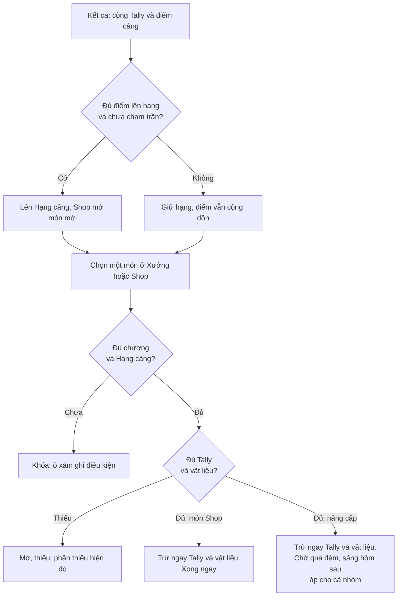

## II.7. Economy and Progression

Kinh tế là chỗ đổi đồ mang về thành sức mạnh cho chuyến sau. Mục này giải thích Tally đến từ đâu, đi về đâu, giá một thùng hàng và giá một nâng cấp được tính ra sao, và nhịp mở khóa trong chương đầu. Mục nối với mục Trạm và cảng ở chỗ ca cảng là nguồn tiền, với mục Vật phẩm ở chỗ giá đi theo giá trị của vật liệu, với mục Người chơi ở chỗ nâng cấp đổi Oxy, túi và bộ đẩy. Ai cần biết vì sao một chương dài như hiện tại và vì sao người chơi muốn chuẩn bị hàng trước ca thì đọc mục này.

### II.7.1. Overview

Game có đúng một đồng tiền là **Tally**, dùng chung cả nhóm. Tally chỉ đến từ ca cảng: tàu thương nhân trả giá thùng, tip theo tốc độ và tiền bơm khí. Không có Tally từ quest, từ hòm hay từ bán đồ ở Shop. Người chơi tiêu Tally vào hai chỗ: nâng cấp bộ đồ và dụng cụ ở Xưởng, và mua linh kiện động cơ ở Shop. Mỗi nâng cấp tốn cả Tally lẫn vật liệu trong kho (trừ Đai dụng cụ bậc 1, là thưởng quest của Kỹ sư và không tốn Tally), nên đồ mang về luôn bị kéo về hai phía: đem bán để có Tally, hay giữ lại để sửa trạm và nâng cấp.

Mọi giá đều tính từ một đơn vị gốc là **GTĐ**, giá trị tương đối của vật phẩm do mục Vật phẩm đặt. Giá bán một thùng hàng đi theo GTĐ của hàng và bậc giá của nó. Giá mua một nâng cấp đi theo thu nhập dự kiến của chương. Nhờ vậy khi lượng nhặt một chuyến đổi, giá tự đổi theo và sim chạy lại là xong. Tally không bao giờ giảm ngoài lúc mua, không có chi phí duy trì, không có phí cứu hộ, không có nợ. Tiến trình theo chương do truyện và động cơ quyết, kinh tế chỉ làm nhịp.

### II.7.2. Tally Sources and Sinks

Bảng dưới là toàn bộ đường vào và đường ra của Tally ở bản MVP:

| Chiều | Đường | Khi nào | Chi tiết ở |
|---|---|---|---|
| Vào | Giá thùng khi tàu nhận thùng | Mỗi tàu phục vụ xong trong ca cảng | Mục II.7.3, tab Shop |
| Vào | Tip theo kiên nhẫn còn lại | Cùng lúc với giá thùng | Mục II.6.7 |
| Vào | Bơm khí | Mỗi lần bơm khí xong cho một tàu | Mục II.6.6 |
| Vào | Phần giá cao của đơn đặt trước | Khi giao đúng thùng tàu đã đặt | Mục II.6.7 |
| Ra | Nâng cấp bộ đồ và dụng cụ | Mua ở Xưởng, xong qua đêm | Mục II.7.4, tab Upgrade |
| Ra | Linh kiện động cơ giai đoạn đầu | Mua ở Shop của khoang liên lạc, cần Hạng cảng 3 | Mục II.7.4, tab Shop |

Ba luật giữ cho dòng tiền này kín:
- Tally là ví chung của thế giới, là số nguyên và không âm. Ngạt, bị kéo về trạm hay thoát giữa chuyến không làm Tally giảm.
- Shop không bán tài nguyên, kiện hay vật tiêu hao, nên không có vòng mua rẻ bán đắt. Hàng bán chỉ đến từ chuyến ra ngoài, mà chuyến bị giới hạn bởi Oxy và túi, còn ca cảng bị giới hạn bởi số tàu.
- Giá in ở Shop không đổi theo thời gian và không đổi theo số người chơi.

Mọi giá Tally của game nằm ở hai tab: giá thùng và món Shop ở tab Shop, giá nâng cấp ở tab Upgrade. Tab khác chỉ ghi tên món và trỏ về hai tab này.

### II.7.3. Crate Prices and Price Tiers

Hàng trong kho tính bằng **kiện**, hàng bán trong ca tính bằng **thùng** (xem mục II.6.5). Giá một thùng tính từ GTĐ:
```text
GiaThung = GTDThung * 10 * HeSoBac
GTDThung = GTDKien / 2,5
```
- GTDKien: giá trị một kiện do mục Vật phẩm đặt, đơn vị GTĐ. Nguồn tab ITEM LIST.
- GTDThung: giá trị một thùng, đơn vị GTĐ.
- 10: số Tally của một GTĐ, cố định cho cả game.
- HeSoBac: hệ số của bậc giá mà hàng thuộc về, không đơn vị. Nguồn bảng bậc giá dưới đây.
- GiaThung: giá tàu trả cho một thùng, đơn vị Tally, làm tròn tới số chẵn để giá kiện (giá thùng nhân 2,5) là số nguyên.
- Ví dụ: kiện phế liệu có GTĐ 14,0, một thùng là 5,6 GTĐ. Nhân 10 và nhân hệ số hàng chợ 0,75 ra 42 Tally một thùng, tức 105 Tally một kiện.

Lồng sinh vật sống không chia thùng, giá theo loài bên trong:
```text
GiaLong = GTDMauSong * 10 * 1,3 (làm tròn tới 5)
GiaLongGiao = GiaLong * HeSoSao
```
- GTDMauSong: giá trị một mẫu sống của loài trong lồng, đơn vị GTĐ. Nguồn tab ITEM LIST.
- 1,3: hệ số của bậc Hàng sống.
- GiaLong: giá lồng loài đó ở tab Shop, đơn vị Tally. Bảng tàu hiện giá loài rẻ nhất kèm chữ "từ".
- HeSoSao: hệ số sao của con trong lồng, không đơn vị, nhận 1,0, 1,25 hoặc 1,5.

**Bậc giá** chia hàng theo vai của nó trong dải. Mỗi bậc đi kèm một **độ gọi**, trọng số để tàu chọn món trong danh mục bán. Hàng rẻ thì độ gọi cao, hàng đắt thì độ gọi thấp, nên bày hàng đắt không có nghĩa là bán được hết:

| Bậc giá | Hệ số giá | Độ gọi | Vai trong dải | Giá chương 1 (Tally một thùng hoặc một lồng) |
|---|---|---|---|---|
| Hàng chợ | 0,75 | 3 | Hàng khối lớn, cũng là vật liệu xây. Rẻ, tàu nào cũng gọi | Phế liệu 42, cáp 40, quặng 40, băng 42 |
| Hàng sinh học | 1,0 | 2 | Phụ phẩm khi hạ Driftlife | Mô sinh học 54 |
| Hàng chế | 1,35 | 1,5 | Phải chế ở Xưởng trước ca, giá trả công chế | Nước tinh khiết 64 |
| Hàng sống | 1,3 | 1 | Lồng Driftlife bắt sống | Driftmoth 65, Skitter Ray 75, Sting Krill 55 |
| Hàng hiếm | 1,5 | 1 | Đồ ít gặp, không dùng để xây. Đắt, ít tàu gọi | Đồ Trái Đất 76, đặc sản Gần 80 |

Giá không nhân theo Hạng cảng, không nhân theo số người. Tip, bơm khí và đơn đặt trước cộng thêm trên giá thùng theo công thức ở mục II.6.7.

Thế cân của bậc giá hiện ra khi đo các kiểu **danh mục bán**, tức các loại hàng và số thùng người chơi đưa ra trong ca. Bảng dưới đo trên mô hình ca cảng của chương đầu, người chơi trễ phản xạ 2 giây:

| Kiểu danh mục | Hàng bày | Tally một ca, 1 người | So với Chuẩn bị kỹ | Tally một ca, 2 người | Tàu không tới, 1 người | Tally mỗi GTĐ đã bán |
|---|---|---|---|---|---|---|
| Hàng chợ, không chuẩn bị | Phế liệu, cáp, quặng | 1203 | -28% | 2659 | 2,1 | 9,8 |
| Hàng chợ thêm đồ Trái Đất | Phế liệu, cáp, quặng, đồ Trái Đất | 1589 | -5% | 3454 | 1,4 | 12,6 |
| Chuẩn bị kỹ | Lồng, đồ Trái Đất, nước tinh khiết, phế liệu | 1666 | +0% | 3629 | 2,9 | 14,4 |
| Chuẩn bị kỹ, bày thừa hàng chợ | Như trên, phế liệu gấp đôi | 1658 | -1% | 3621 | 2,9 | 13,9 |
| Chuẩn bị kỹ, bỏ đồ Trái Đất | Lồng, nước tinh khiết, đặc sản Gần, phế liệu | 1551 | -7% | 3437 | 3,1 | 13,4 |
| Ít mà đắt | Lồng, đồ Trái Đất, nước tinh khiết, đặc sản Gần | 1414 | -15% | 3059 | 10,0 | 19,0 |

Đọc bảng:
- Chuẩn bị trước ca (bắt sống, chế nước, giữ đồ Trái Đất cho đơn đặt trước) cho thêm khoảng 30% Tally so với chỉ bày hàng chợ.
- Bày thừa hàng chợ cạnh hàng chuẩn bị không thêm gì, vì tàu gọi hàng chợ trước còn hàng đắt nằm lại kho.
- Ít mà đắt mất 10 tàu vì hết hàng, nhưng mỗi GTĐ bán ra được gấp đôi hàng chợ, nghĩa là giữ được hàng chợ để sửa trạm.
- Bỏ đồ Trái Đất làm trượt đơn đặt trước và mất tip gấp đôi của Loose Bolt.
- Bảng đo trên mô hình ca có sẵn mọi loại hàng. Trong game, thùng mô sinh học và thùng đặc sản Gần chỉ bày được từ Hạng cảng 3 (mục II.6), nên hai kiểu dùng đặc sản Gần là kiểu của cuối chương 1 trở đi.

Bắt sống phải đáng hơn hạ, nhưng không quá hai lần, để hạ vẫn là lựa chọn. Bảng dưới so Tally của lồng với Tally kỳ vọng khi hạ cùng loài, đã trừ Lưới cuộn tốn 1,10 GTĐ mỗi phát:

| Loài cỡ S | Hạ (Tally kỳ vọng) | Lồng (Tally) | Bắt tay sau choáng, sống trên hạ | Lưới trúng 1 con, ròng trên hạ | Lưới trúng 3 con, ròng trên hạ |
|---|---|---|---|---|---|
| Driftmoth | 35,0 | 65 | 1,86 | 1,54 | 1,75 |
| Skitter Ray | 41,7 | 75 | 1,80 | 1,54 | 1,71 |
| Sting Krill | 28,3 | 55 | 1,94 | 1,55 | 1,81 |

Chi tiết dữ liệu: tab Shop cho giá thùng, giá lồng, bậc giá và độ gọi. Tab ITEM LIST cho GTĐ.

### II.7.4. Upgrade and Shop Prices

Mỗi nâng cấp tốn hai phần: vật liệu trong kho theo công thức của mục Vật phẩm, và Tally. Phần Tally của mọi thứ mở trong một chương chia từ một **ngân sách chương**, tổng Tally mà sim dự kiến người chơi trung bình kiếm được trong chương đó nhân một hệ số:
```text
NganSach = Beta * NgayMucTieu * ThuNhapThamChieu
Gia = NganSach * TiLe / TongTiLe
```
- NganSach: ngân sách Tally của chương, đơn vị Tally.
- Beta: hệ số ngân sách, bằng 0,54, không đơn vị. Đây là núm duy nhất chỉnh độ dài mọi chương.
- NgayMucTieu: số ngày dùng để tính ngân sách, đơn vị ngày. Công thức ngay dưới.
- ThuNhapThamChieu: Tally một ngày của người chơi trung bình chơi một mình, đơn vị Tally. Công thức ngay dưới.
- TiLe: trọng số của loại món trong chương, không đơn vị. Nguồn bảng tỉ lệ dưới đây.
- TongTiLe: tổng trọng số các món có giá Tally mở ở chương đó, không đơn vị.
- Gia: giá Tally của món, dưới 100 làm tròn 5, dưới 1000 làm tròn 10, còn lại làm tròn 50.

```text
NgayMucTieu = GioMucTieu * 60 / PhutMotNgay
PhutMotNgay = 2 * PhutMotChuyen + PhutCaCang + 3
ThuNhapThamChieu = 2 * (GTDMotChuyen / 0,9) * 10 * ChiSoGia / (1 - PhanTip)
```
- GioMucTieu: giờ dùng để tính ngân sách, chương 1 là 0,8 giờ.
- PhutMotNgay: độ dài một ngày tham chiếu, đơn vị phút. 2 chuyến, một ca cảng và 3 phút chuẩn bị và cuối ngày.
- PhutMotChuyen: phút một chuyến đo bằng sim chuyến, chương 1 là 4,4 phút.
- PhutCaCang: phút một ca cảng đo bằng sim ca cảng, 3,83 phút.
- GTDMotChuyen: GTĐ một chuyến mang về kể cả Driftlife, đo bằng sim chuyến, chương 1 là 102,1 GTĐ. Chia 0,9 vì sim chuyến đo ở mức túi đầy 90%.
- ChiSoGia: Tally giá thùng của một danh mục đại diện chia cho GTĐ nhân 10, không đơn vị. Kịch bản trung bình là 0,97.
- PhanTip: phần tip trong Tally ca cảng, kịch bản trung bình là 26%. Chia cho phần còn lại vì tip là một phần của Tally ca chứ không cộng thêm trên giá.

Ví dụ chương 1:
- Phút một ngày = 2 x 4,4 + 3,8 + 3 = 15,6 phút.
- Ngày mục tiêu = 0,8 x 60 / 15,6 = 3,1 ngày.
- Thu nhập tham chiếu = 2 x (102,1 / 0,9) x 10 x 0,97 / (1 - 26%), sim in ra 3000 Tally.
- Ngân sách = 0,54 x 3,1 x 3000, sim in ra 4950 Tally. Số trong ví dụ đã làm tròn: sim dùng số lẻ 3,070 ngày và 2989 Tally, ra 4955, làm tròn 50 thành 4950. Nhân tay số tròn ra 5022.

Giờ mục tiêu thấp hơn giờ đo được vì chương có phần thời gian không phụ thuộc giá: chuyến map nhánh, đêm chờ người vớt tỉnh, thời gian sửa khoang, điểm lên Hạng cảng:
- Chương 1 đo được 1,77 giờ so với 0,8 giờ dùng tính ngân sách.
- Sim đo riêng phần không phụ thuộc giá của chương 1, khi giá Tally gần bằng 0, ra 1,8 giờ.

| Loại món | Tỉ lệ trong ngân sách chương |
|---|---|
| Linh kiện động cơ | 1,0 |
| Bình Oxy, Túi đồ | 0,5 mỗi trục |
| Đai dụng cụ | 0,4 |
| Bộ đẩy | 0,35 |
| Mỗi nâng cấp dụng cụ | 0,15 |

- Ví dụ Bình Oxy bậc 1: tổng tỉ lệ các món có giá Tally của chương 1 là 1,0 + 0,5 + 0,5 + 0,35 + 0,15 + 0,15 = 2,65. Giá = 4950 x 0,5 / 2,65 = 934, làm tròn 10 ra 930 Tally. 
- Đai dụng cụ bậc 1 là thưởng quest của Kỹ sư, không tốn Tally và không tính vào tổng.

Bảng dưới là mọi thứ mua được ở bản MVP. Cột Loại cho biết nâng cấp mở khả năng mới hay chỉ tăng số:

| Món | Loại | Hiệu ứng | Tally | Vật liệu (GTĐ) | Mở khi |
|---|---|---|---|---|---|
| Bình Oxy bậc 1 | Chỉ là số | Oxy 330 lên 450, chuyến dài hơn | 930 | 26,0 | Kỹ sư tỉnh, Xưởng chạy |
| Túi đồ bậc 1 | Chỉ là số | Túi 80 lên 100 Khối, mang về nhiều hơn | 930 | 24,2 | Kỹ sư tỉnh, Xưởng chạy |
| Bộ đẩy bậc 1 | Chỉ là số | Bay nhanh hơn một chút, chỉ số ở mục II.2 | 650 | 26,2 | Kỹ sư tỉnh, Xưởng chạy |
| Đai dụng cụ bậc 1 | Mở khả năng | 3 lên 4 ô dụng cụ, mang thêm một kiểu chơi | 0 | 23,1 | Thưởng quest Kỹ sư, đi kèm Dùi xung |
| Dụng cụ khai thác bậc 2 | Chỉ là số, có cổng mềm | Khai thác nhanh gấp 1,4. Điểm cứng hơn bậc dụng cụ thì chậm gấp 4 | 280 | 24,4 | Kỹ sư tỉnh, Xưởng chạy |
| Lao từ bậc 2 | Chỉ là số | Đánh mạnh hơn, xa hơn, chỉ số ở mục II.4 | 280 | 27,0 | Kỹ sư tỉnh, Xưởng chạy |
| Van tiết lưu | Mở tiến trình | Linh kiện cho giai đoạn đầu của động cơ chính | 1850 | Không | Shop, cần Hạng cảng 3 |

Bình Oxy và Túi đồ là hai nâng cấp làm tăng thu nhập chính. Cộng giá Tally của bảng trên ra 4920, sát ngân sách của chương.

Chi tiết dữ liệu: tab Upgrade cho giá, hiệu ứng và vật liệu từng bậc, tab Shop cho Van tiết lưu, tab Recipe cho công thức vật liệu.

### II.7.5. Purchase States and End of Day

Một món có thể mua đi qua năm trạng thái:

| Trạng thái | Vào khi | Người chơi thấy |
|---|---|---|
| Khóa | Chưa tới chương mở hoặc chưa đủ Hạng cảng | Ô xám, ghi điều kiện mở |
| Mở, thiếu | Đủ điều kiện nhưng thiếu Tally hoặc vật liệu | Phần thiếu hiện đỏ kèm số còn thiếu |
| Mua được | Đủ Tally và vật liệu | Nút sáng |
| Đang làm | Đã mua nâng cấp, chờ qua đêm | Thanh đang chế ở Xưởng |
| Xong | Sáng hôm sau với nâng cấp, ngay lập tức với món Shop | Hình bộ đồ hoặc khoang đổi, hiệu ứng áp cho cả nhóm |


*Hình II.7.1 - Từ bảng kết ca tới lúc một món mua xong*

Đọc sơ đồ: cuối ngày việc xử lý đi theo thứ tự cố định, kết thúc bằng giấc ngủ để hàng đợi qua đêm xong và game lưu. Tally và điểm cảng vào trước, Hạng cảng xét ngay sau đó, nên một món cần Hạng mới có thể mua ngay trong tối vừa lên hạng. Hạng đã chạm trần của chương thì điểm vẫn cộng dồn và chờ chương sau. Khi chọn một món, game xét điều kiện mở trước, rồi mới xét ví và kho. Thiếu bất kỳ phần nào thì món chưa mua được, nhưng người chơi thấy rõ thiếu gì. Đủ thì Tally và vật liệu bị trừ ngay lúc xác nhận. Món Shop có hiệu lực ngay, còn nâng cấp nằm ở Xưởng tới sáng hôm sau, nên kết quả của một lần mua luôn thấy ở chuyến đầu ngày kế tiếp.

[CHỜ ẢNH: màn Upgrade ở Xưởng với ô khóa, ô thiếu đỏ và ô mua được, lấy từ Figma The Novent trang Wireframe MVP hoặc chụp build]
*Hình II.7.2 - Màn nâng cấp ở Xưởng, mỗi giá hiện cả Tally và vật liệu*

### II.7.6. Chapter 1 Progression

Chương đầu đóng khi mốc đóng chương của truyện xong, và mốc đó chỉ kích hoạt khi giai đoạn đầu của động cơ chính đã lắp (xem mục II.6.3). Kinh tế không có cổng chương riêng, mọi nâng cấp không chặn chương. Con đường bắt buộc đi qua kinh tế chỉ có một:
- Van tiết lưu bán ở Shop từ Hạng cảng 3, cũng là hạng trần của chương 1.
- Muốn đóng chương thì phải bán đủ hàng để lên hạng và đủ Tally để mua Van tiết lưu.
- **Hạng cảng**, thang tiến trình của cảng, lên theo điểm cảng mỗi tàu phục vụ xong. Ngưỡng và cách tính điểm ở mục II.6.8.

Bảng dưới là một lượt sim chương đầu, kịch bản trung bình, chơi một mình. Mỗi dòng là một ngày, Tally cuối ngày bằng Tally cuối ngày hôm trước cộng Tally thu ở ca trừ Tally chi:

| Ngày | Nhặt cả ngày (GTĐ) | Tally thu ở ca | Mua | Tally chi | Tally cuối ngày | Hạng cảng |
|---|---|---|---|---|---|---|
| 1 | 153 | 0 | Không | 0 | 0 | 1 |
| 2 | 153 | 0 | Đai dụng cụ bậc 1 (thưởng quest) | 0 | 0 | 1 |
| 3 | 10 | 0 | Không | 0 | 0 | 1 |
| 4 | 107 | 0 | Không | 0 | 0 | 1 |
| 5 | 107 | 114 | Không | 0 | 114 | 1 |
| 6 | 204 | 1744 | Bình Oxy bậc 1, Bộ đẩy bậc 1 | 1580 | 278 | 1 |
| 7 | 204 | 1744 | Túi đồ bậc 1, Dụng cụ khai thác bậc 2, Lao từ bậc 2 | 1490 | 532 | 2 |
| 8 | 255 | 1744 | Van tiết lưu | 1850 | 426 | 3 |

Đọc bảng:
- Bốn ngày đầu chưa có ca cảng. Lịch tàu sinh đầu ngày, nên cảng sửa xong thì ngày sau mới có tàu, sớm nhất ngày 5, cùng ngày với ca thứ nhất của truyện.
- Ca ngày 5 là ca dạy: 2 tàu Loose Bolt chỉ gọi thùng phế liệu, thu 114 Tally gồm tip (mục II.6). Từ ngày 6 người chơi tự lập danh mục, mỗi ca 25 tàu cho khoảng một nâng cấp bộ đồ.
- Ngày 8 lên Hạng 3, cùng tối đủ Tally mua Van tiết lưu nên chương đóng ngày 8, sau sàn 7 ngày của truyện chương 1. Đây là một lượt mẫu. Trung bình 200 lượt cũng lên Hạng 3 và đóng chương ở ngày 8.
- Hạng 3 cần 135 điểm, tức ca dạy và ba ca đủ, nên chương 1 một người không đóng trước ngày 8. Giá chương 1 đặt để Tally đủ đúng lúc đó.

Người chơi học và mở theo chương, bảng chương 1:

| Nội dung | Chương 1 |
|---|---|
| Người chơi học | Bay, Oxy, nhặt, khoan, nạy, hạ, bắt sống loài nhỏ, sửa khoang, lập danh mục bán, mang thùng ở ca cảng, mua nâng cấp đầu tiên |
| Tài nguyên và map | Tài nguyên và map dải Gần, map nhánh Station Cinder |
| Trang bị | Dùi xung, Súng lưới, Lồng mẫu, Bộ kích nguồn, nâng cấp bộ đồ bậc 1 |
| Driftlife và boss | 4 loài dải Gần làm ở MVP, boss Scrapmaw |
| Sức mạnh tăng | Túi đồ, Bình Oxy, Bộ đẩy lên bậc 1, Đai dụng cụ thêm 1 ô. Một chuyến mang về khoảng 102 GTĐ, quy ra 1021 Tally |

Sim chạy ba kịch bản người chơi. Tham số hành vi là giả định nằm giữa người chơi cẩn thận và người chơi tham, chờ playtest để chỉnh:

| Tham số hoặc kết quả | Tệ | Trung bình | Tốt |
|---|---|---|---|
| Phần túi đầy mỗi chuyến | 75% | 90% | 100% |
| Hệ số mật độ nhặt đồ hiếm | 0,9 | 1,0 | 1,15 |
| Tỉ lệ chuyến ngạt, một người | 25% | 15% | 7% |
| Trễ phản xạ ở ca cảng | 3 giây | 2 giây | 1 giây |
| Chỉ số giá của danh mục | 0,84 | 0,97 | 1,07 |
| Hệ số phút một ngày | 1,15 | 1,0 | 0,9 |
| Tally một ca chương 1 khi kho đủ, một người | 1345 | 1744 | 2038 |
| Xong chương 1, một người | Ngày 9, 2,37 giờ | Ngày 8, 1,77 giờ | Ngày 8, 1,59 giờ |

Kịch bản tệ dài hơn chủ yếu vì người chơi không chuẩn bị chỉ bày hàng chợ, chỉ số giá thấp. Đây là ý đồ của giá theo bậc: chuẩn bị danh mục rút ngắn game.

Chi tiết dữ liệu: tab ECONOMIC cho thu chi từng ngày, tab PROCESSING cho mở khóa theo chương, tab Balance Sheet cho các lần đổi số cân bằng.

### II.7.7. Two-player Co-op and Acceptance Criteria

Mọi luật trên đúng cho cả một người và co-op. Khác biệt khi chơi hai người:
- Một ví Tally chung, một Hạng cảng chung. Nâng cấp mua một lần cho cả nhóm, người vào sau không mang Tally riêng và có bộ đồ cùng bậc với nhóm.
- Giá thùng, giá nâng cấp và giá Shop không đổi theo số người, kể cả khi số người đổi giữa phiên.
- Ca hai người có 55 tàu thay vì 25, nên Tally và điểm cảng một ca tăng theo số tàu, không cần hệ số riêng.

Kết quả sim kinh tế chương 1, kịch bản trung bình:

| Số người | Tally một ca khi kho đủ | Điểm cảng một ca | Phần hai chuyến đầy túi bán ở một ca | Xong chương 1 |
|---|---|---|---|---|
| 1 | 1744 | 46 | 58% | Ngày 8, 1,77 giờ |
| 2 | 3848 | 102 | 76% | Ngày 7, 1,60 giờ |

Nhóm hai người xong chương đầu sớm nhất có thể vì chạm sàn ngày của truyện, sàn này không đổi theo số người. Hai cột Tally và điểm một ca là ca đủ từ ca thứ hai, ca dạy đầu tiên chỉ có 2 tàu. Tally một ca ở đây là sim kinh tế theo chỉ số giá của kịch bản, nên khác chút với số ở mục Trạm và cảng đo bằng mô hình ca với một danh mục cố định.

Tiêu chí đã đo bằng sim, kịch bản trung bình, chơi một mình trừ khi ghi khác:

| Tiêu chí | Mục tiêu | Đo được | Đạt |
|---|---|---|---|
| Thời lượng chương 1 | 1,5 đến 2 giờ | 1,77 giờ | Đạt |
| Độ dài một ngày chương 1 | 15 đến 20 phút | 15,6 phút | Đạt |
| Tip kể cả bơm khí trong Tally ca cảng | 20 đến 30% | 26%, tệ 21%, tốt 30%, mọi kiểu danh mục 22% đến 29% | Đạt |
| Bắt sống so với hạ, đã trừ vật tiêu hao | 1,2 đến 2 lần | 1,44 đến 1,81 qua lưới, 1,50 đến 1,94 bắt tay | Đạt |
| Hạng cảng 3 tới trước khi chương 1 xong | Có | Hạng 3 và chương đóng ở ngày 8, cả lượt mẫu ở II.7.6 lẫn trung bình 200 lượt | Đạt |

Tiêu chí đo khi có build, qua event tracking:
- Mọi Tally nhận được có nguồn là thùng, tip, bơm khí hoặc đơn đặt trước, không có nguồn khác trong 100 phiên thử.
- Giá hiển thị bằng đúng tab Shop và tab Upgrade, không đổi khi số người đổi từ 1 lên 2 giữa phiên.
- Ngạt, bị kéo về hay thoát giữa chuyến không làm Tally giảm.
- Ca có từ 3 thùng hàng chế, sống hoặc hiếm cho Tally mỗi tàu cao hơn ca chỉ có hàng chợ từ 20% trở lên.
- Chương 1 của 5 người chơi mới trung bình trong 1,5 đến 2 giờ.

Người chơi có hiểu bậc giá và độ gọi khi lập danh mục không, có thấy nâng cấp đáng tiền không, thì sim chưa đo được, chờ playtest trên build.

### II.7.8. Edge Cases

| Tình huống | Phán quyết |
|---|---|
| Tally bằng 0 | Không mua được gì, không có phạt. Không thể kẹt: thùng hàng chợ đóng thẳng từ tài nguyên thô, không cần Tally |
| Người chơi bỏ mọi ca cảng | Không có Tally, không lên Hạng cảng, dừng ở Van tiết lưu. Game không ép, bảng tàu nhắc linh kiện động cơ cần Hạng 3 |
| Thiếu Hạng cảng cho Van tiết lưu dù ví đủ | Ô ghi "cần Hạng cảng 3" kèm thanh điểm tới hạng, không mua được |
| Đủ điểm nhưng hạng đã chạm trần chương | Điểm vẫn cộng dồn, lên hạng khi chương sau mở |
| Thùng chưa bán khi hết ca | Về kho, bán được ở ca sau với cùng giá |
| Hai người cùng bấm mua khi ví chỉ đủ một món | Người tới máy chủ trước mua được, người sau thấy giá đỏ |

### II.7.z. Post-MVP

- Giá thùng hàng dải Giữa, dải Xa, Cradle và hàng sau chương 1: kiện cơ khí, điện tử, sản phẩm nuôi, vật tư, bản sao dữ liệu và kiện tin mật bán nguyên cái. Giá lồng loài cỡ M và loài dải Giữa, dải Xa. Con nuôi giao trong lồng trả nửa giá.
- Ngân sách và giá Tally chương 2 tới 5. Chương 5 không có thứ mua mới.
- Nâng cấp bộ đồ bậc 2 tới 4 cần Xưởng cấp 2, Vỏ bộ đồ cấp 1 tới 3 để vào dải mới, Đai dụng cụ bậc 2, dụng cụ bậc 3, Súng lưới bậc 2.
- Hạng cảng 4 tới 8, linh kiện động cơ giai đoạn 2 tới 4 ở Shop theo Hạng cảng 5, 7 và 8. Món Shop và nâng cấp khoang: Cảng cấp 2, bản thiết kế, Xưởng cấp 2, Khoang sinh quyển cấp 3, cấp 3 các khoang còn lại.
- Thời lượng cả game, mốc từng chương và co-op 3 và 4 người.
