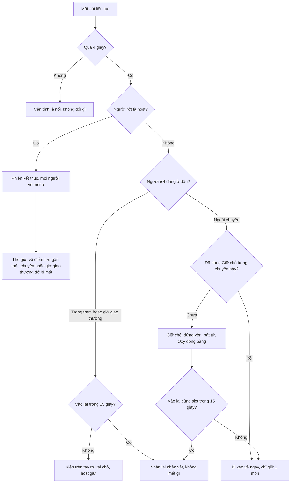

## II.8. Co-op and Saving

Mục này giải thích hai việc nền của The Novent mà người chơi chỉ thấy khi chúng hỏng: nhiều người chơi chung một thế giới mà không giật, không nhân đôi đồ, và thế giới được lưu đủ an toàn để thoát lúc nào cũng quay lại được. Nó nối với mọi mục khác vì mọi hệ thống đều có trạng thái phải đồng bộ hoặc lưu. Mục này chỉ nói ai nắm quyền trạng thái nào và điều gì xảy ra khi người chơi vào, rời, rớt mạng, không nói luật của từng hệ thống (xem các mục hệ thống khác). MVP có co-op hai người, luật viết sẵn cho nhóm lớn hơn.

### II.8.1. Overview

Một thế giới thuộc về một người, gọi là **host**, người tạo thế giới và giữ máy chạy thế giới đó. Không có máy chủ riêng. Máy của host là nguồn sự thật: mọi thứ dùng chung như kho, Tally, khoang, kẻ địch, tàu ở cảng đều do host giữ và quyết. Máy của mỗi người chơi tự lo phần của riêng mình là di chuyển nhân vật, để người đó điều khiển mượt dù mạng chậm.

Khi người chơi làm một việc đổi trạng thái chung, như nhặt thùng, sửa khoang, mua đồ hay chế, máy người đó gửi yêu cầu cho host. Máy người chơi hiện kết quả dự đoán ngay cho đỡ trễ. Host xét yêu cầu, trả lời cho mọi máy. Nếu host từ chối thì máy người chơi lùi về trạng thái đúng. Nhờ vậy hai người cùng nhặt một thùng thì chỉ một người nhận được, thùng không bao giờ nhân đôi hay biến mất.

Phần lưu đi cùng một nguyên tắc: file lưu nằm ở máy host, game tự lưu ở ba điểm cố định, không có nút lưu tay. Thoát giữa giờ giao thương thì lần sau vào lại ở điểm lưu gần nhất và mất phần đang dở. Thoát giữa chuyến cũng về điểm lưu sau chuyến trước và mất đồ trong chuyến, nhưng chuyến dở vẫn tính vào hạn hai chuyến của ngày.

### II.8.2. Host Authority and Synchronization

Mỗi loại trạng thái có đúng một bên nắm quyền. Bảng dưới gộp theo nhóm, chi tiết từng dòng ở tab Event Tracking trên Sheet GDD và ở `ky-thuat.md` (tài liệu kỹ thuật của đội dev).

| Nhóm trạng thái | Ai nắm quyền | Cách gửi |
|---|---|---|
| Vị trí, vận tốc, hướng, lướt của người chơi | Máy của chính người đó | Gửi liên tục, máy khác nội suy |
| Oxy, túi đồ, tải của người chơi | Máy người đó tính, host kiểm | Gửi khi đổi và gửi định kỳ 5 lần mỗi giây |
| Ngạt, được cứu, bị kéo về, Recall Beacon, Giữ chỗ | Host | Sự kiện tin cậy |
| Trao đồ giữa hai người, thả đồ | Host | Yêu cầu gửi host, host chuyển và trả kết quả |
| Vật kéo (buồng ngủ đông, lồng mẫu, kiện nổ) | Người đang giữ, từ 2 người cùng kéo thì host | Gửi liên tục |
| Seed chuyến, danh sách mảnh, khe đã kích hoạt | Host | Gửi lúc bắt đầu chuyến, sau đó chỉ gửi khe đã dùng |
| Pha chu kỳ của hazard | Mỗi máy tự tính từ seed và giờ host | Không gửi |
| Đồng hồ xác nhận ra chuyến và xác nhận ngủ, bộ đếm ngày | Host | Sự kiện tin cậy |
| Node khai thác đang bị giữ, lượng còn | Host | Sự kiện |
| Sinh lực, thanh Choáng, thanh Mê, vị trí kẻ địch | Host | Gửi liên tục và sự kiện |
| Khoang, giai đoạn động cơ, kho, hàng đợi xưởng, ô nuôi | Host | Sự kiện tin cậy |
| Mọi trạng thái giờ giao thương (đồng hồ, danh mục, lịch tàu, kiên nhẫn, thùng ở quầy, bơm khí) | Host | Sự kiện tin cậy, đồng hồ theo giờ host |
| Thùng trên tay | Người mang giữ vị trí, host giữ sự tồn tại | Yêu cầu gửi host |
| Tally, điểm cảng, Hạng cảng, thứ đã mua, cấp trang bị | Host | Sự kiện tin cậy |
| Mốc truyện, vật manh mối, người vớt đã tỉnh | Host | Sự kiện tin cậy |
| Ghim món, Ping | Máy người gửi | Sự kiện, không tin cậy |
| Menu, bảng, cài đặt | Từng máy | Không gửi |

Một số điểm đáng chú ý cho người đọc:
- Vị trí nhân vật thuộc máy người chơi, nên host không điều khiển được nhân vật. Host chỉ kiểm: nếu tốc độ vượt giới hạn quá dung sai thì kéo nhân vật về vị trí host.
- Oxy do máy người chơi tính nhưng host giữ bộ đếm Oxy hồi từ vật tiêu hao của từng người. Host từ chối khi lượng hồi vượt trần của chuyến, khi người đó đang ngạt, hoặc khi bình đã đầy.
- Hazard có pha chu kỳ cố định theo seed, nên không cần gửi từng khung hình. Máy khách sửa lệch giờ theo giờ host gửi kèm gói.
- Cảnh truyện là phần trình bày, không phải trạng thái thế giới. Mỗi máy có hàng chờ cảnh và danh sách cảnh đã xem riêng. Chỉ mốc truyện mới do host giữ.
- Menu không dừng thời gian khi có từ 2 người. Chơi một mình thì tạm dừng được.

Tham số mạng, số khởi điểm để dev chỉnh khi chọn stack:

| Tham số | Khởi điểm | Khoảng an toàn |
|---|---|---|
| Tần số gửi vị trí người chơi | 20 lần mỗi giây | 15 tới 30 |
| Trễ nội suy | 100 ms | 50 tới 150 |
| Tần số gửi trạng thái kẻ địch | 10 lần mỗi giây | 5 tới 20 |
| Tần số gửi định kỳ Oxy, túi đồ, tải | 5 lần mỗi giây | Chưa đặt |
| Dung sai host kiểm tốc độ | 15% trên vmax cộng lực ngoài | 10 tới 25% |
| Cửa sổ host trả lời yêu cầu | 250 ms | 150 tới 500 |

```text
NguongKeoVe = (VMax + LucNgoai) * (1 + DungSai)
```
- NguongKeoVe: tốc độ tối đa host chấp nhận, đơn vị u/s. Vượt thì host kéo nhân vật về vị trí host.
- VMax: vận tốc tối đa của bộ đẩy ở cấp hiện tại, đơn vị u/s, nguồn mục II.2.
- LucNgoai: tốc độ cộng thêm do lực ngoài như dòng chảy hazard, đơn vị u/s.
- DungSai: 0,15, không đơn vị, số khởi điểm chờ dev chỉnh.

Yêu cầu đổi trạng thái chung có một luồng chung cho mọi hệ thống. Nó hiện rõ nhất ở giờ giao thương, nên dùng giờ giao thương làm ví dụ: hai người cùng nhặt một thùng ở ô quầy, hoặc cùng giữ bơm khí một cửa neo. Yêu cầu tới host trước được nhận. Người sau bị từ chối, máy đó hiện lại tay trống và đi làm việc khác, không mất gì. Giao thùng đúng lúc tàu hết kiên nhẫn thì host quyết, máy người chơi lùi lại nếu host nói tàu đã rời.

Chi tiết dữ liệu: tab Event Tracking trên Sheet GDD, các sự kiện giờ giao thương và sự kiện đồng bộ.

### II.8.3. Joining Mid-session and Player Count

Mỗi người vào thế giới được host cấp một **mã slot**, số thứ tự từ nhỏ tới lớn, lưu trong thế giới. Một thế giới có tối đa bốn slot. Bản MVP khóa hai slot cuối ở màn Tạo thế giới, nên phòng MVP tối đa hai người. Người vào lại được nhận ra bằng mã slot gắn với ID người chơi của nền tảng mạng (Steam hoặc dịch vụ lobby dev chọn), không cần tài khoản riêng của game. Người mới lấy slot trống thấp nhất. Hết slot thì bị từ chối với lời báo "Phòng đầy". Host xóa được nhân vật của người đã rời.

Người mới vào giữa chừng không chen vào ngay. Buồng của người đó được đưa về trạm ở điểm nghỉ kế tiếp, không lấp buồng đã tắt của Ember. Trong lúc chờ, người đó ở trạng thái **Chờ vào**: xem được, chưa điều khiển. Nếu lúc đó đang có giờ giao thương thì người đó vào giờ giao thương ngay khi buồng về, số tàu của giờ giao thương đang chạy không đổi.

Số người N là đầu vào của nhiều hệ số cân bằng. N được lấy một lần lúc sinh và không đổi tới hết thứ đó:

| Ngữ cảnh | N là | Ví dụ ảnh hưởng |
|---|---|---|
| Chuyến | Số người đã xác nhận ra chuyến lúc chuyến bắt đầu, không tính người ở lại trạm | Lượng tài nguyên của dải (mục II.3) |
| Kẻ địch | Số người đang ở ngoài cùng map lúc kẻ địch sinh hoặc lúc vào phòng boss | Sinh lực và ngưỡng choáng (mục II.4) |
| Giờ giao thương | Số người online lúc Mở giao thương | Số tàu trong giờ giao thương (mục II.6) |

Vì N chốt lúc sinh, người vào hoặc rời giữa chừng không làm đổi số tàu hay độ trâu của kẻ địch đang có. Hệ số cụ thể do mục II.7 và các mục hệ thống giữ, mục này không lặp lại.

### II.8.4. Disconnects and Leaving

Có ba cách một người biến mất khỏi phiên, mỗi cách một luật. Sơ đồ bên dưới chỉ vẽ trường hợp mất gói và host rớt. Rời chủ động không qua phát hiện mất gói nên không có trong sơ đồ.

**Rời phiên chủ động.** Nhân vật ở lại trạm. Nếu người đó rời khi đang ngoài chuyến thì tính như bị kéo về, chỉ giữ đúng 1 món. Rời không phải đường về an toàn.

**Mất kết nối của khách.** Mạng giật thoáng qua không bị báo nhầm, nên chỉ khi mất gói liên tục quá thời gian phát hiện (khởi điểm 4 giây, dev chỉnh được) mới tính là rớt. Người rớt giữa chuyến vào **Giữ chỗ**: đứng yên, bất tử, Oxy đóng băng. Luật Giữ chỗ:
- Cửa sổ Giữ chỗ là 15 giây. Vào lại trong cửa sổ bằng cùng mã slot thì nhận lại nhân vật, không mất gì.
- Hết cửa sổ thì tính như bị kéo về và chỉ giữ 1 món.
- Mỗi người chỉ được Giữ chỗ một lần mỗi chuyến. Rớt lần hai trong cùng chuyến tính như bị kéo về ngay, để không ai rút mạng rồi vào lại nhằm dừng đồng hồ ngạt.
- Người rớt là người cuối còn ở ngoài thì chuyến chung chờ tối đa hết cửa sổ đó.

Trong trạm và giờ giao thương dùng cùng cửa sổ. Hết hạn thì kiện đang cầm rơi tại chỗ, host giữ, người khác nhặt được. Nếu tàu của kiện đó đã rời thì kiện về danh mục.

**Host mất kết nối hoặc thoát.** Phiên kết thúc với mọi người, mọi người về menu. Mặc định không chuyển host, vì thế giới thuộc về host. Dev được đề nghị chuyển host nếu stack mạng họ chọn hỗ trợ sẵn với chi phí thấp. Thế giới trở về điểm lưu gần nhất trong ba điểm lưu (mục II.8.5), chuyến hay giờ giao thương đang dở bị mất.


*Hình II.8.1 - Xử lý một người mất kết nối, từ lúc phát hiện tới lúc nhận lại nhân vật hoặc bị kéo về*

Đọc sơ đồ: mạng chỉ bị coi là rớt khi mất gói quá thời gian phát hiện. Nếu người rớt là host thì mọi thứ dừng và thế giới về điểm lưu. Nếu là khách thì nhìn vào chỗ họ đang đứng. Ở trong trạm hoặc giờ giao thương, họ có một cửa sổ để vào lại, hết hạn thì chỉ mất việc kiện đang cầm rơi xuống sàn. Ở ngoài chuyến, họ được Giữ chỗ nếu chưa dùng lần nào trong chuyến này. Vào lại kịp thì như chưa có gì xảy ra. Không kịp, hoặc đã dùng Giữ chỗ rồi, thì bị kéo về và mất túi, chỉ giữ món đã ghim.

Chi tiết dữ liệu: tab Event Tracking, nhóm sự kiện người chơi rớt và vào lại.

### II.8.5. Autosave and File Safety

Game tự lưu ở ba điểm và không có nút lưu tay:
- Sau mỗi chuyến, khi mọi người đã về trạm.
- Sau giờ giao thương.
- Lúc ngủ, tức lúc sang ngày.

Ba điểm dùng chung một file và cùng cách ghi an toàn. Thoát giữa chuyến hoặc giữa giờ giao thương, kể cả chơi một mình, thì lần sau vào lại ở điểm lưu gần nhất và mất phần đang dở. Riêng chuyến dở vẫn tính vào hạn hai chuyến: lúc cả nhóm qua cửa khí, game ghi nhanh số chuyến đã đi vào file lưu, không ghi điểm lưu đầy đủ. Ngày không có đồng hồ, chỉ sang ngày khi người chơi vào buồng ngủ đông.

**Bố cục map của từng chuyến** được lưu theo ngày và số thứ tự chuyến thay vì lưu cả map:
```text
SeedChuyen = Bam(SeedTheGioi, Ngay, SoThuTuChuyen)
```
- SeedChuyen: hạt giống sinh bố cục của một chuyến, không đơn vị.
- Bam: hàm băm tất định, cùng đầu vào cho cùng kết quả.
- SeedTheGioi: hạt giống cố định của thế giới, đặt lúc tạo.
- Ngay: số ngày trong game, đơn vị ngày.
- SoThuTuChuyen: số thứ tự chuyến trong ngày, chuyến thứ nhất hoặc thứ hai.

Ví dụ: nạp lại điểm lưu sau chuyến đầu rồi đi chuyến sau thì bố cục chuyến sau y nguyên, nạp lại không đổi được bố cục. Chuyến thoát giữa chừng đã tính vào hạn hai chuyến nên không có đường chơi lại đúng chuyến đó để dò bố cục. Muốn vậy bộ sinh map dùng bộ số ngẫu nhiên riêng có seed, không dùng bộ số ngẫu nhiên dùng chung của engine và không phụ thuộc thứ tự khung hình.

File lưu theo thế giới và chỉ nằm trên máy host. Khách giữ bản sao hồ sơ máy gồm cài đặt, phím, tiến độ tutorial, không đồng bộ qua mạng. File chứa các nhóm:

| Nhóm | Nội dung chính |
|---|---|
| Thế giới | Phiên bản save, mã thế giới, seed, ngày, tổng giây chơi, cờ đã kết game |
| Ngày | Số chuyến đã đi, giờ giao thương đã mở, giờ giao thương đã xong, điểm lưu hiện tại, seed của từng chuyến đã sinh |
| Người chơi theo slot | Mã slot, tên, màu, preset, vị trí trong trạm, cờ đã rời |
| Trang bị chung | Cấp từng nâng cấp đã mua, bản thiết kế, dụng cụ đã mở |
| Kho | Danh sách vật phẩm trong kho |
| Trạm | Trạng thái và cấp từng khoang, giai đoạn động cơ, hàng đợi xưởng gồm mẻ qua đêm, ô nuôi |
| Cảng | Tally, điểm cảng, Hạng cảng, thứ đã mua, danh mục đã lập, lịch tàu của ngày |
| Truyện | Mốc đã xong, vật manh mối, người vớt đã tỉnh, quest đã mở, hàng chờ cảnh và cảnh đã xem theo slot |
| Map nhánh | Cửa, vách, đường tắt đã mở, buồng đã vớt, boss đã kết và cách kết |

Ghi file theo cách an toàn để mất điện giữa lúc ghi không hỏng save:
1. Ghi ra file tạm rồi đổi tên đè lên file chính.
2. Giữ một bản `.bak` của lần lưu trước.
3. File chính hỏng khi mở thì mở `.bak` và báo người chơi lùi về điểm lưu trước đó.
4. Lưu lỗi 3 lần liền thì cho người chơi thoát và báo rõ là lùi về điểm lưu cuối ghi được.

File save mang số phiên bản dữ liệu. Bản build đổi dữ liệu thì chạy bước migrate có ghi log. Không migrate được thì game không mở file đó và báo lỗi, không đoán.

Sau cảnh kết, game về menu chính. Bản lưu nằm ở ngày cuối với mọi mốc truyện đã xong và Ember còn ở neo để chơi tự do. Cảnh kết không phát lại khi vào bản lưu, xem lại được từ Sổ tay (xem mục II.9).

Chi tiết dữ liệu: file save là cấu trúc của game, không nằm trong Sheet. Tên sự kiện ghi lúc lưu nằm ở tab Event Tracking.

### II.8.6. Two-player Co-op and Acceptance Criteria

MVP có co-op hai người, luật ở mục này được kiểm với hai người. Những điểm co-op riêng nằm rải ở các mục trên, gom lại để dev kiểm:
- Host nắm mọi trạng thái dùng chung, khách chỉ nắm vị trí và tính toán cá nhân.
- Hai người chạm cùng một vật cùng khung hình thì yêu cầu tới host trước thắng.
- Người đã về trạm không ra lại trong chuyến đó nhưng làm được mọi việc trạm (xem mục II.6).
- Số người N chốt lúc sinh và Mở giao thương, không đổi theo người ra vào giữa chừng.
- Không tạm dừng toàn cục khi có từ 2 người.

Sim hiện có chỉ phủ phần cân bằng theo số người (ví dụ giờ giao thương ở mục II.6.9), không phủ phần mạng. Các tiêu chí dưới đây đo được khi có build và chờ playtest:

| Tiêu chí | Cách kiểm | Kết quả |
|---|---|---|
| Hai người cùng nhặt một node | 1000 lần thử, mỗi lần đúng 1 người nhận | Chờ build |
| Thùng không nhân đôi hay mất | 100 lần nhặt và giao có rớt mạng giữa chừng, tổng thùng không đổi | Chờ build |
| Mất kết nối trong cửa sổ Giữ chỗ | Vào lại đúng nhân vật theo mã slot. Quá hạn thì tính như bị kéo về | Chờ build |
| Host thoát | Thử ở 4 thời điểm: giữa chuyến 1, sau chuyến 1, giữa giờ giao thương, sau giờ giao thương. Mở lại đúng điểm lưu gần nhất. Thoát giữa chuyến thì chuyến dở vẫn tính và chuyến kế có bố cục khác, thoát sau chuyến thì bố cục chuyến kế giống lần trước | Chờ build |
| Vào giữa chừng | Thử ở 3 pha: chuyến, giờ giao thương, cuối ngày. Người mới vào đúng luật Chờ vào | Chờ build |
| File save | Cắt điện giữa lúc ghi, mở lại được bản trước | Chờ build |
| Dữ liệu từ Sheet vào game | Xuất rồi nhập lại, 0 trường lệch | Chờ build |
| Số playtest khớp sim | Thời lượng chuyến, tỉ lệ tàu phục vụ xong, tip, rảnh mỗi người, tỉ lệ kéo về lệch không quá 20% so với kết quả sim cùng cấu hình | Chờ playtest |

Cảm giác mượt của co-op qua mạng thật, cùng độ trễ người chơi chịu được, sim không đo được và chờ playtest trên build với hai máy.

### II.8.7. Edge Cases

| Tình huống | Phán quyết |
|---|---|
| Hai người cùng nhặt một node hay một kiện cùng khung hình | Yêu cầu tới host trước được nhận, người sau bị từ chối và vật ở lại |
| Người vào giữa chừng khi cả nhóm đang ngạt hết | Ở trạng thái Chờ vào tới điểm nghỉ kế tiếp |
| Host rớt khi khách đang chia Oxy cho đồng đội | Phiên kết thúc, thế giới về điểm lưu gần nhất, người được chia Oxy không giữ gì của chuyến đó |
| Khách rớt giữa giờ giao thương khi đang cầm thùng | Thùng rơi xuống sàn tại chỗ, host giữ, người khác nhặt được |
| Người đang ngạt rút mạng rồi vào lại để dừng đồng hồ ngạt | Giữ chỗ lần đầu dừng đồng hồ, lần thứ hai trong cùng chuyến tính như bị kéo về ngay |
| Seed chuyến khác nhau giữa hai máy | Không xảy ra nếu cùng phiên bản dữ liệu. Lúc vào phiên có so hash dữ liệu, lệch thì không cho vào và báo cập nhật |
| File save chính hỏng khi mở | Mở bản `.bak` và báo người chơi lùi về điểm lưu trước |
| Hai người cùng kéo một buồng ngủ đông, một người rớt | Host giữ vị trí vật, người còn lại kéo tiếp ở hệ số một người |

### II.8.z. Post-MVP

- Co-op 3 và 4 người: cân bằng, hệ số theo N, cấu hình lịch giờ giao thương chương 2 tới 5.
- Chuyển host khi host thoát, nếu stack mạng hỗ trợ sẵn với chi phí thấp.
- Chọn stack netcode cuối cùng và chỉnh các tham số mạng theo đo thật trên build.
- Chuỗi và bước tutorial thành dữ liệu riêng cho Unity (hiện dev đọc thẳng từ bảng của UX).
