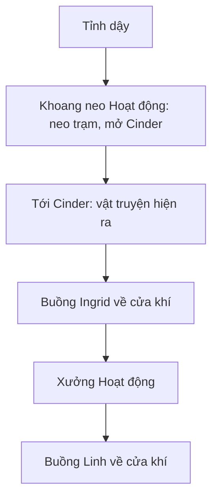
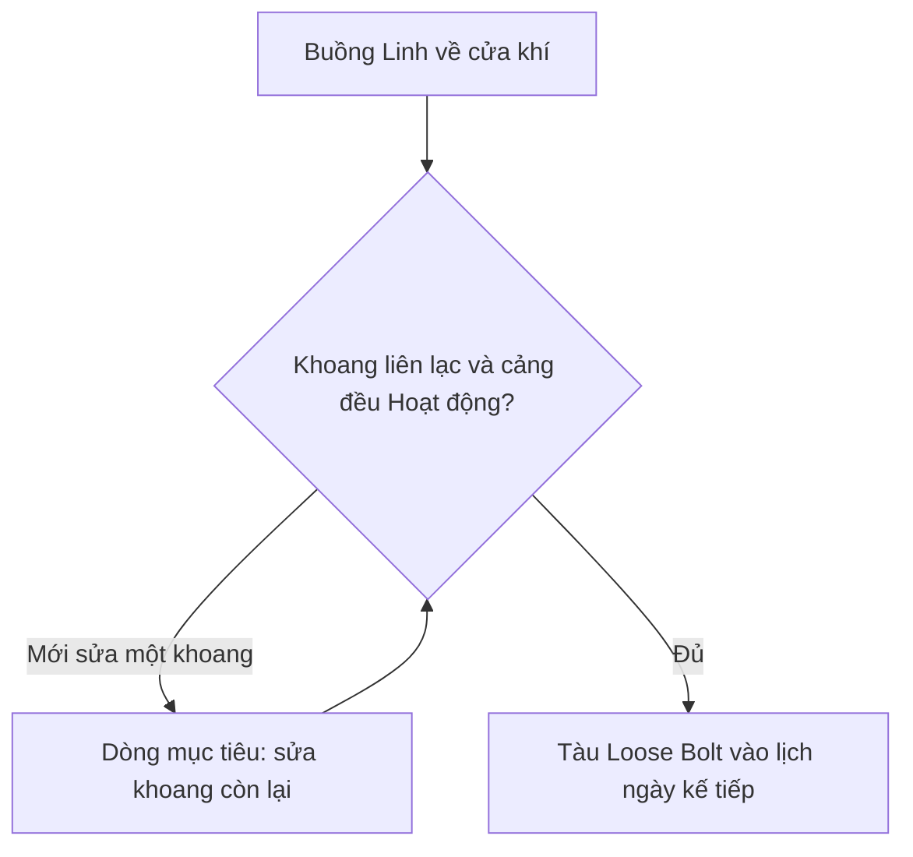
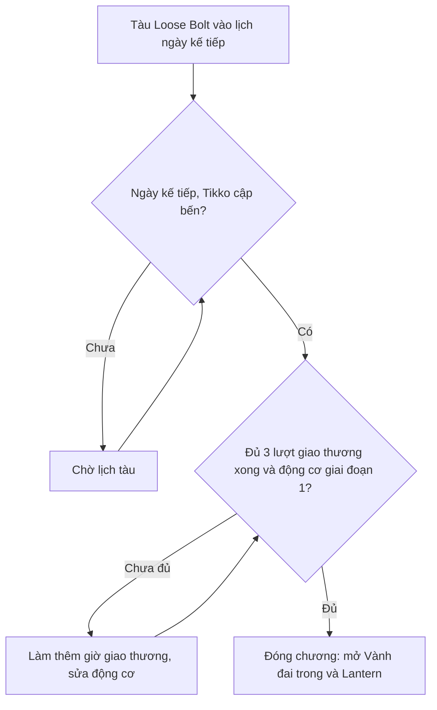

## II.9. Story and Ending

Cốt truyện cho người chơi một lý do để ra ngoài xa hơn mỗi ngày: ai đã đánh tàu mẹ Cradle, đường tới Solace có thật không, và làm sao rời được bãi vỡ. Truyện đi một đường qua năm chương, không rẽ nhánh, không thua. Nó chen vào vòng ngày ở các điểm nghỉ mà không khóa vòng chơi. Mục này nối với mục Trạm và cảng ở quest của người vớt, với mục Map và chuyến ở chỗ đặt manh mối, với mục Kinh tế và tiến trình ở nhịp mở chương.

### II.9.1. Overview

Truyện chia thành năm **chương**. Mỗi chương là một chuỗi **mốc** có thứ tự, mốc sau chỉ mở khi mốc trước xong. Mỗi mốc có một danh sách điều kiện lấy từ việc người chơi vốn đã làm: sửa khoang, kéo buồng ngủ đông về, phục vụ tàu ở giờ giao thương, tới một map nhánh. Mọi điều kiện cùng đúng thì mốc xong ngay, không chờ cảnh. Mốc cuối chương gọi là **mốc đóng chương**, chỉ nó mới mở dải và map nhánh của chương sau.

Truyện không đòi người chơi làm gì ngoài vòng ngày. Ra chuyến, sửa trạm, bán hàng ở giờ giao thương đều tiếp tục như mọi ngày, mốc chỉ khóa nội dung mới như dải, lối vào map nhánh, tính năng và loại tàu. **Cảnh** là phần trình bày của mốc, phát ở điểm nghỉ trong trạm, ngắn và bỏ qua được bằng một lần bấm. Ngoài không gian truyện chỉ nói bằng một dòng radio ở mép màn hình, không chặn điều khiển. **Sổ tay** trong trạm ghi mọi mốc đã xong và luôn có đúng một dòng mục tiêu, nên người chơi không bao giờ phải đoán việc kế tiếp.

### II.9.2. Setting and Conflict

Người chơi là một người trong kíp vận hành của **Station Ember**, tỉnh dậy sau giấc ngủ đông. Trạm trôi giữa **The Wake**, bãi vỡ của Cradle, con tàu mẹ của **United Accord** chở đoàn di cư rời Trái Đất đi tìm hành tinh **Solace**. Tàu đã nổ trước khi tới nơi. Bốn hồ sơ nhân vật mặc định là Nguyễn Việt, Jonas Weber, Mei Tanaka và Niamh Doyle, người chơi đổi được tên.

Thế giới có ba lực lượng:
- **The Veyl** là tên chung các chủng tộc ngoài hành tinh, gồm Oru, Sennari, Aelith, Brakk và Kesh. Họ buôn bán với nhau và với loài người, dùng chung Tally. Thương nhân The Veyl lui tới rìa bãi vỡ gom hàng, và họ là khách của giờ giao thương.
- **The Wardens** là chế độ và quân đội của **Daskel**, kẻ độc tài lật đổ Steward Ilvane của hành tinh Sennar. Lính của chế độ là người Sennari, không phải cả một chủng tộc. Chúng tuyên bố bãi vỡ là khu bảo hộ, trong khi tháo xác tàu, bắt người và săn Driftlife đem bán.
- **The Kindling** là mạng lưới cách mạng của **Sevra Ilvane**, con gái Ilvane và người thừa kế hợp pháp của Sennar. Cô giả làm thương nhân Ilsume để đi các tuyến buôn.

Xung đột gốc: Solace là thông tin mồi. **Lodestar Survey**, hồ sơ tả hành tinh đó và đường tới đó, do chế độ của Daskel dựng rồi phát qua **The Lattice**, mạng tin của thương nhân trung lập. Hồ sơ dẫn Cradle vào điểm phục kích. Daskel giữ ghế bằng cách hướng hận thù của Sennar sang loài người, vì cha hắn chết trong **The Meeting War**. Cái nhìn "loài người ăn hết thế giới của mình" đúng một nửa, vì Trái Đất cạn kiệt là thật. Nửa còn lại là hận thù của một người, được đem làm chính sách. Không người Sennari nào ngoài chế độ nói câu đó.

Vai người chơi và mục tiêu đổi theo chương. Ba chương đầu người chơi sống sót, vớt người và đi tìm đường tới Solace. Từ chương bốn người chơi biết Solace là mồi, và mục tiêu thành giúp Sevra lật đổ Daskel, vì đó là đường duy nhất để rời bãi vỡ.

### II.9.3. Five-chapter Arc

Chỉ chương đầu nằm trong MVP. Bốn chương sau là bản đủ, ghi ở đây để người đọc thấy chương đầu đứng ở đâu trong cả truyện.

| Chương | Tên | Map nhánh có truyện | Người vớt | Mốc đóng chương | Nhãn |
|---|---|---|---|---|---|
| 1 | Tỉnh dậy | Station Cinder | Ingrid, Linh | Bắt được sóng của Lantern, mở Vành đai trong | MVP |
| 2 | Không cô độc | Station Lantern, Station Wick | Amara, Rafa | Thấy vết phá từ ngoài vào, mở Vùng trung tâm | Post-MVP |
| 3 | Kẻ canh giữ | Veyl Waypost, The Raft, Station Flint | Yusuf | Cứu Sevra khỏi toán bắt cóc của The Wardens | Post-MVP |
| 4 | Tâm vụ nổ | Cradle Interior | Không | Hộp ghi hành trình lộ Solace là mồi, tin mật tới The Kindling | Post-MVP |
| 5 | Rời neo | Warden Rig | Không | Daskel thua, Ember rời neo | Post-MVP |

Mỗi chương có một kiểu chơi mới mà truyện đưa vào bằng lý do trong truyện chứ không bằng hướng dẫn. Chương 1 có khai thác, bắt sống loài nhỏ bằng lưới và giờ giao thương. Điều này chỉ là đề cương, luật từng kiểu chơi nằm ở mục tương ứng.

Chi tiết dữ liệu: tab GAME STORY trên Sheet GDD, khối Tóm tắt cốt truyện.

### II.9.4. Chapter 1 Beats and Chapter Gates

Chương 1 có chín mốc. Mục tiêu người chơi: hãm trôi và neo Ember, vớt hai người đầu tiên, sửa cảng, bán chuyến hàng đầu tiên, nghe được tiếng người khác.

Tên riêng trong bảng mốc: **Station Cinder** là trạm hoang đầu tiên người chơi tới được, nơi có hai buồng ngủ đông của Ingrid và Linh. **Station Lantern** là trạm có người sống sót ở chương 2, phát sóng ở mốc đóng chương. **Oru Tikko** là thương nhân The Veyl, chủ tàu **Loose Bolt**, khách đầu tiên của giờ giao thương.

| Mốc | Điều kiện | Mở gì |
|---|---|---|
| Tỉnh dậy | Bắt đầu thế giới | Cửa khí, Vành đai ngoài |
| Hãm trôi và neo | Khoang neo Hoạt động | Trạm ngừng xoay, lối vào Station Cinder |
| Một trạm khác | Tới lối vào Station Cinder | Vật truyện của Cinder hiện ra |
| Người đầu tiên | Buồng của Ingrid qua cửa khí | Ingrid tỉnh đầu ngày kế tiếp, giao quest sửa xưởng |
| Xưởng sáng đèn | Xưởng Hoạt động | Chế dụng cụ cơ bản và Súng lưới cho loài nhỏ |
| Người thứ hai | Buồng của Linh qua cửa khí | Linh tỉnh đầu ngày kế tiếp, giao quest sửa khoang liên lạc và cảng |
| Lời gọi đầu tiên | Khoang liên lạc và cảng cùng Hoạt động | Giờ giao thương, shop, tàu Loose Bolt vào lịch từ ngày kế tiếp |
| Tàu đầu tiên | Ngày kế tiếp sau mốc trên và tàu Loose Bolt của Tikko cập bến | Giờ giao thương thành kiểu chơi mới |
| Sóng của Lantern (đóng chương) | Đủ 3 lượt giao thương xong và động cơ chính xong giai đoạn 1 | Vành đai trong, lối vào Station Lantern, chương 2 |

Luật của chuỗi:
- Mọi điều kiện trong một mốc phải cùng đúng, không có điều kiện dạng "hoặc". Mỗi mốc xong đúng một lần trong một thế giới.
- Nhiều mốc có thể xong liền nhau trong một lần kiểm. Cảnh của chúng xếp hàng theo thứ tự mốc, mỗi điểm nghỉ phát một cảnh cho mỗi người.
- Mốc đóng chương chỉ xong khi giai đoạn động cơ chính của chương đã lắp. Trạm và kinh tế không có cổng chương riêng.
- Số giờ giao thương cần cho mốc đóng chương là khởi điểm 3, khoảng an toàn 2 tới 5, chưa đo. Đây là núm duy nhất của truyện chạm thời lượng chương 1.

Mốc Tàu đầu tiên rơi vào giờ giao thương thứ nhất, mốc đóng chương cần giờ giao thương thứ ba. Ngày chương đầu xong theo sim kinh tế ở mục II.7. Chơi một mình thường xong muộn hơn chơi hai người một ngày, vì phải đủ điểm lên Hạng cảng ba để mua linh kiện động cơ.


*Hình II.9.1 - Chuỗi mốc chương đầu, từ tỉnh dậy tới buồng thứ hai*


*Hình II.9.2 - Cổng thứ nhất: hai khoang liên lạc và cảng*


*Hình II.9.3 - Cổng thứ hai: tàu đầu tiên và đóng chương*

Đọc ba sơ đồ trên: từ lúc tỉnh dậy, người chơi neo trạm rồi tới Cinder và kéo hai buồng về, mỗi buồng mở một người vớt và một khoang. Khoang liên lạc và cảng cùng phải sáng thì tàu đầu tiên mới vào lịch. Nếu mới sửa một khoang thì Sổ tay ghi việc còn lại, mốc vẫn đứng ở trạng thái Mở. Tàu đầu cập bến thì chương vào giai đoạn cuối: hai điều kiện của mốc đóng chương không có thứ tự nào, người chơi làm thêm giờ giao thương và sửa động cơ theo nhịp của mình. Đủ cả hai thì chương đóng và cảnh cuối ngày phát ra.

Chi tiết dữ liệu: tab GAME STORY, khối Chương và mốc. Quest sửa khoang xem mục II.6.

### II.9.5. Clues, Quest Items and the Notebook

Vật truyện chỉ đặt ở map nhánh, không có ở map tổng, gồm hai loại:
- **Vật manh mối** nằm ở khe cố định, nhặt là ghi ngay vào Sổ tay của cả nhóm. Vật không chiếm túi đồ và không mất khi người nhặt bị kéo về.
- **Vật nhiệm vụ** là thứ phải đưa về trạm. Vật nhỏ chiếm túi, người bị kéo về chọn giữ lại được, không chọn thì ở chuyến sau nó nằm lại đúng khe của nó. Nộp không tiêu vật, vật vào kho và ở lại.

| Vật truyện chương 1 | Loại | Nói điều gì |
|---|---|---|
| Nhật ký trạm của Cinder | Manh mối | Người trực thấy một ánh chớp ngoài mạn tàu ngay trước tiếng nổ. Nghi vấn đầu tiên: thứ đó đến từ bên ngoài |
| Bản tin lưu trong máy liên lạc của Cinder | Manh mối | Tên Lodestar Survey xuất hiện lần đầu. Linh nhận ra tên này và im lặng |
| Thẻ tên hai buồng đã tắt, không bắt buộc | Manh mối | Mang về thì thẻ treo ở khoang buồng ngủ đông của Ember, Ingrid và Linh mỗi người có một lời riêng |
| Mảnh lõi dẫn đường của Cinder | Nhiệm vụ | Chưa có chỗ dùng ở chương 1, sang chương 2 là vật liệu sửa khoang dẫn đường |

Nhật ký trạm nằm ở khe người chơi nhặt được ngay lần vào Cinder đầu tiên, nên nó là manh mối đầu tiên của game.

**Sổ tay** ghi mọi mốc đã xong, mọi vật manh mối đã nhặt và đúng một dòng mục tiêu kèm tên nơi phải tới. Mỗi mốc có một dòng mục tiêu lúc Mở và một dòng tóm tắt lúc Xong. Chương đầu có 9 dòng tóm tắt, dù người chơi bỏ qua mọi cảnh.

Chi tiết dữ liệu: tab GAME STORY, khối Dòng Sổ tay chương 1.

### II.9.6. Scenes, Dialogue and Pacing Limits

Cảnh chỉ diễn ra ở điểm nghỉ: pha Chuẩn bị, lúc vừa về tới trạm, pha Cuối ngày, và trong khu có khí của map nhánh. Trong giờ giao thương và trong khu chân không, truyện chỉ nói bằng bong bóng trên đầu nhân vật hoặc radio. Mốc xong giữa giờ giao thương thì cảnh của nó phát sau giờ giao thương, ở màn kết thúc giờ giao thương hoặc pha Cuối ngày. Hộp thoại không tạm dừng khi co-op và không hiện khi giờ giao thương đang chạy (xem II.9.8).

| Giới hạn | Giá trị | Nguồn |
|---|---|---|
| Cảnh ngắn | Tối đa 3 câu | Tham số cảnh ngắn, tab GAME STORY |
| Cảnh dài | Tối đa 8 câu | Tham số cảnh dài, tab GAME STORY |
| Một câu hộp thoại | Tối đa 80 ký tự | Chốt với gd-ux, chuỗi hộp thoại truyện |
| Một dòng radio | Tối đa 60 ký tự | Chốt với gd-ux, chuỗi radio |
| Một lời bong bóng | Tối đa 60 ký tự | Chốt với gd-ux, chuỗi bong bóng |
| Số cảnh mỗi điểm nghỉ | 1 cho mỗi người | Tham số nhịp vòng ngày |
| Tốc độ đọc giả định | 17 ký tự mỗi giây | Tham số thời lượng cảnh |

Thời gian đọc tối đa của một cảnh:
```text
ThoiGianDoc = SoCau * SoKyTuMoiCau / TocDoDoc
```
- SoCau: số câu của cảnh, đơn vị câu, 3 cho cảnh ngắn và 8 cho cảnh dài.
- SoKyTuMoiCau: ký tự tối đa một câu hộp thoại, 80 ký tự.
- TocDoDoc: tốc độ đọc giả định, 17 ký tự mỗi giây.
- Ví dụ cảnh ngắn dài nhất đọc 3 x 80 / 17 xấp xỉ 14 giây, cảnh dài dài nhất đọc 8 x 80 / 17 xấp xỉ 38 giây.

Theo cùng công thức, cả game có:
- 40 mốc và 45 cảnh.
- Tối đa 180 câu thoại, khoảng 14,1 phút đọc, bằng 2,0% của một game 12 giờ.

Ngoài cảnh còn hai loại lời không phải cảnh và không vào hàng chờ cảnh:
- Lời theo trạng thái: nhân vật trong trạm nói một dòng khi người chơi tới gần, theo bối cảnh như chào đầu ngày, sau chuyến, sau giờ giao thương, gợi ý mục tiêu. Mỗi trạng thái có 4 biến thể và không nói lại biến thể vừa nói. Tikko có lời riêng ở cảng bằng bong bóng.
- Lời truyện không chứa chữ số, tên phím hay thuật ngữ luật chơi, và không dạy thao tác. Hướng dẫn thao tác thuộc mục Giao diện và hướng dẫn.

Mỗi nhân vật có giọng riêng, ghi ở bảng giọng nhân vật của tab GAME STORY. Hai ví dụ: Ingrid khô, gọn, nói bằng câu mệnh lệnh và tên dụng cụ. Linh khéo, giữ thể diện, nói lời chữa và lời cảnh báo lịch sự.

Chi tiết dữ liệu: tab GAME STORY, khối Voice sheet.

### II.9.7. Ending

Kết là phần của chương 5 và nằm ngoài MVP. Cách mạng thành công, Sevra lên nắm quyền ở Sennar, lập lại hòa bình và trao tọa độ một hành tinh có sự sống thật. Ember rời neo lên đường. Truyện kết mở: hành trình tới hành tinh đó dành cho phần sau.

Kết gồm hai cảnh liền nhau, phát cho mọi người đang có mặt, không chờ điểm nghỉ:
- Cảnh rời neo: động cơ chính chạy, mỗi người vớt đứng ở khoang của mình, bộ neo nhả. Lantern và một phần The Raft rời theo, tàu của thương nhân The Veyl quay lại đứng thành hàng nhìn Ember đi.
- Cảnh ngoài bãi vỡ: lần đầu trong game màn hình có bầu trời sao sạch, không mảnh vỡ. Rafa mở bản đồ thật và thấy một điểm Sevra đã đánh dấu, chưa ai đặt tên. Màn hình cuối hiện tên trên những buồng đã tắt của Ember, Cinder, Wick, Flint, rồi mới tới tên người làm game.

Người chơi tin tọa độ này dù đã bị một hồ sơ lừa vì nó nằm trên bản đồ sao thật do chính tổ Ember lấy từ tay Daskel, và Odile cùng Rafa tự kiểm được trên đó. Lodestar Survey thì không ai kiểm được gì. Người chơi mang theo vào cảnh kết những thứ đã làm: những người vớt, khoang sinh quyển (có đàn Driftlife nếu đã nuôi, trống thì vẫn đi, không phạt), thẻ tên các buồng đã tắt, bản đồ sao thật và một tọa độ. Sau cảnh kết game về menu chính, bản lưu ở ngày cuối cho chơi tiếp tự do nhưng không có nội dung mới.

### II.9.8. Two-player Co-op and Acceptance Criteria

Tiến trình truyện là của thế giới, không của từng người. Khác biệt khi co-op hai người:
- Mốc xong ngay khi điều kiện đúng, do ai làm cũng tính cho cả thế giới, và chỉ ghi một lần.
- Cảnh phát riêng trên màn từng người ở điểm nghỉ của người đó. Mỗi người có hàng chờ riêng, tự bỏ qua, không ai chờ ai, và mỗi người xem mỗi cảnh nhiều nhất một lần. Người đang ở ngoài thấy dấu báo và xem khi về.
- Vật manh mối ai nhặt cũng ghi cho cả nhóm. Vật nhiệm vụ ai mang cũng được và chuyền tay được.
- Cảnh tỉnh dậy theo số người tỉnh dậy ban đầu. Một người thì ba buồng tắt, hai người thì hai buồng tắt, cảnh dài như nhau và không nhân vật nào nói thay người chơi.
- Hộp thoại không tạm dừng khi co-op, và không hiện với bất kỳ ai trong nhóm khi giờ giao thương đang chạy.
- Không mốc, quest hay cảnh nào cần đúng một số người. Lời không chứa từ chỉ số người chơi như "một mình" hay "cả hai".

Mục tiêu nghiệm thu của hệ thống truyện:

| Tiêu chí | Mục tiêu | Trạng thái |
|---|---|---|
| Số mốc và vật truyện mỗi chương | Ít nhất 3 mốc, ít nhất 2 vật truyện. Chương 1 có 9 mốc và 4 vật | Đã đếm bằng script |
| Câu thoại mẫu trong giới hạn kênh | Không câu nào quá 80 hoặc 60 ký tự, không chứa chữ số | Đã đếm bằng script |
| Sàn ngày chương 1 | Ngày xong theo sim kinh tế ở mục II.7, chơi một mình muộn hơn chơi hai người một ngày | Đã đo bằng sim kinh tế, số ở mục II.7 |
| Bỏ qua mọi cảnh chương 1 | Sổ tay có 9 dòng tóm tắt và luôn có dòng mục tiêu | Chờ build |
| Bị kéo về khi đang kéo buồng Ingrid | Chuyến sau buồng ở vị trí gốc, Ingrid vẫn vớt được | Chờ build |
| Hai người, người thứ nhất nhặt manh mối | Sổ tay người thứ hai có manh mối đó ở lần mở kế tiếp | Chờ build |
| Sau mốc đóng chương 1, người chơi nói được việc kế tiếp không cần mở Sổ tay | 7 trên 10 người chơi, chỉ tiêu ước | Chờ playtest |

Số ngày sàn của chương đầu và của cả game lấy từ sim kinh tế ở mục II.7, mục này không chép lại. Sàn chưa tính thời gian gom vật liệu và tiền, nên thực tế dài hơn. Cảm giác của truyện và việc người chơi có nhớ nhân vật hay không thì máy chưa đo được, chờ playtest trên build.

### II.9.9. Edge Cases

| Tình huống | Phán quyết |
|---|---|
| Người chơi bỏ qua mọi cảnh | Mốc đã xong từ trước khi cảnh phát. Sổ tay vẫn đủ tóm tắt và dòng mục tiêu |
| Người chơi không bao giờ làm giờ giao thương | Mốc cần giờ giao thương đứng ở trạng thái Mở vô thời hạn. Sổ tay ghi rõ việc cần làm, không có đường vòng |
| Đang kéo buồng ngủ đông thì hết Oxy và bị kéo về | Buồng nằm lại vị trí gốc ở chuyến sau. Người trong buồng vẫn sống, truyện không có trạng thái thua |
| Tới cửa khóa của Cinder khi chưa có Bộ kích nguồn | Cửa không mở, một dòng radio của Ingrid gợi ý về xưởng. Không có cảnh |
| Sửa xong khoang liên lạc mà chưa sửa cảng | Mốc Lời gọi đầu tiên chưa xong, dòng mục tiêu ghi: sửa cảng |
| Tàu có điều kiện truyện cập bến đúng ngày người chơi bỏ giờ giao thương | Tàu đó vào lịch lại ngày sau, mốc không mất |
| Người chơi mới vào khi thế giới đã ở chương sau | Phát cảnh vào 3 câu. Cảnh của các mốc đã xong không vào hàng chờ của họ, Sổ tay có đủ |
| Host thoát khi một mốc vừa xong giữa ngày | Thế giới về điểm lưu gần nhất. Mốc xong sau lần lưu đó quay lại trạng thái Mở |
| Mốc xong khi mọi người chơi đều ở ngoài | Mốc xong ngay, cảnh chờ từng người ở điểm nghỉ kế tiếp của họ |

Giờ giao thương đầu tiên là giờ giao thương hướng dẫn và chỉ bán thùng phế liệu. Từ ngày có Súng lưới, đơn đặt trước ngày chẵn của Tikko là một lồng Driftlife sống, Tikko gom hộ một nhà sưu tầm chưa lộ mặt, mở đường cho truyện ở chương sau.

### II.9.z. Post-MVP

- Chương 2 tới 5, gồm bốn mốc đóng chương còn lại và 31 mốc của bốn chương này.
- Map nhánh Station Lantern, Station Wick, Veyl Waypost, The Raft, Station Flint, Cradle Interior, Warden Rig.
- Người vớt Rafa, Amara, Yusuf và nhân vật phụ Odile, Bram, Elias, Wren.
- Maro, toán bắt cóc và cảnh Sevra lộ danh tính, chuỗi đơn đặt trước tin mật của The Kindling.
- Cảnh kết rời neo và ngoài bãi vỡ, bản lưu ở ngày cuối sau kết.
- Chuyện riêng 3 đoạn của mỗi thương nhân có tên và lời theo trạng thái của bốn thương nhân còn lại.
- Gieo nghi ngờ về Solace qua chương 1 tới 3 và mục gọi lại ở Sổ tay.
- Người vào sau và người rời phiên khi co-op 3 và 4 người.
